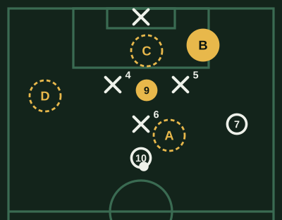
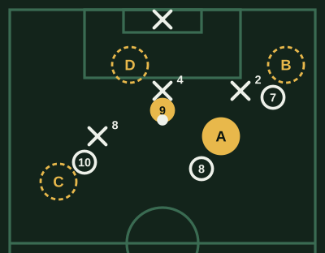
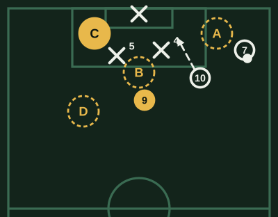
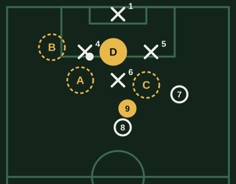

# Banco de Delantero centro (v1)

**Borrador sin revisar.** Marca lo que cambiarías al lado de cada pregunta: la respuesta correcta, una opción que también podría valer, una explicación floja o una pregunta que sobra.

64 preguntas. Cada examen toma 20, de todas las áreas y de las tres dificultades.

## Definición

### DC-DEF-01 · fácil

Quedas mano a mano con el arquero, que sale a achicar. ¿Qué haces?

- [ ] Pateo fuerte al primer palo, de una, para no darle tiempo
- [x] **Levanto la cabeza y elijo según cómo sale**
- [ ] Lo encaro hacia el lado de mi pierna buena
- [ ] Freno y espero que llegue un compañero para dársela

> Mano a mano, si no miras decide el arquero. Mirarlo te dice si salió rápido (picarla o eludirlo) o se quedó (cruzarla). Patear sin mirar o frenar le da la ventaja a él.

### DC-DEF-02 · fácil

Recibes en el área con el arco a la vista y un defensor que llega a cerrarte. ¿Qué buscas?

- [ ] Controlar bien antes, para patear más seguro
- [ ] Pasarla atrás a un volante que llega de frente
- [x] **Patear rápido, con pocos toques**
- [ ] Gambetear al defensor para patear después con más espacio

> En el área el tiempo es lo que falta: cada toque de más deja llegar al defensor. Con el arco a la vista, el remate rápido vale más que el control perfecto.

### DC-DEF-03 · fácil

Pateas desde un costado del área y el arquero cubre bien su primer palo. ¿Adónde apuntas?

- [ ] Fuerte y a media altura, al primer palo
- [ ] Arriba, al medio del arco, por encima de él
- [ ] Al medio, a media altura, para asegurar el arco
- [x] **Al segundo palo, cruzado y abajo**

> Si el primer palo está tapado, el espacio está al otro lado: el remate cruzado y abajo es el más difícil de alcanzar y, si lo desvía, puede quedar para el que llega.

### DC-DEF-04 · media

Te llega un balón que rebota en el área, a la altura de la rodilla. ¿Qué haces?

- [x] **Le pego de primera, con el cuerpo encima del balón**
- [ ] Lo controlo con el pecho o el muslo para acomodarme y patear
- [ ] Espero que baje del todo para patear con el empeine
- [ ] Lo cabeceo hacia atrás para un compañero que llega

> Con un balón que pica, cada segundo deja cerrar a los defensores. Con el cuerpo encima lo mantienes abajo; controlarlo o esperar regala el tiempo que te sobraba.

### DC-DEF-05 · media

Fallaste dos ocasiones claras en el primer tiempo y te llega otra. ¿Qué haces?

- [ ] Se la paso a un compañero para no fallar de nuevo
- [x] **La pateo igual, con la misma decisión**
- [ ] Le pego más fuerte para asegurarme de que entre
- [ ] Me tomo un toque más para pensarla mejor

> Un delantero que deja de patear por miedo a fallar pierde la ocasión. Cambiar la fuerza o sumar toques suele ser peor: la decisión correcta es la misma que si no hubieras fallado.

### DC-DEF-06 · media

Vas a patear un penal eligiendo el lado de antemano, sin esperar al arquero. ¿Qué es lo más importante?

- [ ] Patearlo lo más fuerte posible, aunque no lo ubique bien
- [ ] Cambiar de lado en el último paso si el arquero se mueve
- [x] **Elegir el lado antes y no cambiarlo en la carrera**
- [ ] Correr rápido hacia el balón, sin pensar en el lugar

> La duda en la carrera es la que hace errar el penal: se patea mal o al medio. Elegir antes y patear con convicción es lo que más depende de ti.

### DC-DEF-07 · media

Llegas a la línea de fondo, casi sin ángulo, y un compañero entra de frente al punto de penal. ¿Qué haces?

- [ ] Pateo fuerte al primer palo, por si el arquero no lo cubre
- [ ] Intento picarla por encima del arquero
- [ ] Espero que salga el arquero para eludirlo
- [x] **El pase atrás, raso, a mi compañero**

> Sin ángulo, el remate casi siempre termina en el arquero. El compañero que llega de frente tiene todo el arco: el pase atrás es la mejor ocasión.

### DC-DEF-08 · media

El arquero rival es muy alto y sale poco. Vas a patear desde fuera del área. ¿Adónde apuntas?

- [x] **Abajo y a un costado**
- [ ] Al medio, alto, donde no le llegan las piernas
- [ ] Al ángulo del primer palo, con efecto hacia afuera
- [ ] Por encima de él, por si está adelantado

> Un arquero alto tarda más en bajar: el remate abajo y a un costado es el que más le cuesta. Si sale poco, la vaselina no tiene sentido.

### DC-DEF-09 · media

Quedas solo frente al arco, pero el balón te llega a tu pierna mala. ¿Qué haces?

- [ ] Me la acomodo a la buena para patear mejor
- [x] **Pateo con la mala, sin perder tiempo**
- [ ] La paso a un compañero que llega por detrás
- [ ] Intento un taco con la buena para sorprender

> Acomodarla a la buena cuesta un toque, y ese toque es el que deja llegar al defensor o al arquero. Desde cerca, un remate seguro con la mala vale más.

### DC-DEF-10 · difícil

Te llega un centro raso y fuerte al primer palo. ¿Qué buscas?

- [ ] Controlarlo para acomodarme y patear después
- [x] **Desviarlo con un toque, usando su velocidad**
- [ ] Pegarle fuerte con el empeine, de primera
- [ ] Dejarlo pasar para el compañero que llega atrás

> Un centro fuerte ya trae la velocidad: solo hay que cambiarle la dirección. Controlarlo te frena y pegarle fuerte a un balón rápido suele mandarlo afuera.

## Desmarques y ataque del espacio

### DC-DES-01 · fácil

Tu volante tiene el balón de frente y los centrales rivales están adelantados. ¿Qué haces?

- [ ] Bajo a pedirla al pie para asegurar el pase
- [ ] Me quedo quieto en mi lugar esperando el pase
- [x] **Pico a la espalda de los centrales**
- [ ] Me abro a la banda para dar amplitud

> Con los centrales adelantados, el espacio está detrás de ellos y tu volante puede verte. Bajar o quedarte quieto desperdicia el momento.

### DC-DES-02 · fácil

¿Cuándo arrancas el desmarque a la espalda de la defensa?

- [ ] Apenas mi equipo recupera, aunque el que la tiene esté de espaldas
- [ ] Cuando el balón ya va en el aire hacia mí
- [ ] Cuando el central deja de mirarme, tenga o no el balón mi equipo
- [x] **Cuando mi compañero levanta la cabeza para pasar**

> El desmarque sirve si llega con el pase. Si arrancas antes, quedas en fuera de juego o sin balón; si esperas a que viaje, el central ya te ganó.

### DC-DES-03 · fácil

Antes de que salga el pase te das cuenta de que estás más adelantado que el último defensor. ¿Qué haces?

- [x] **Vuelvo a su línea antes de arrancar**
- [ ] Me quedo adelantado y pido el pase al pie, de espaldas
- [ ] Levanto la mano para que mi compañero no me la pase
- [ ] Sigo corriendo hacia el arco para llegar antes

> Si estás adelantado cuando sale el pase, es fuera de juego. Volver a la línea y arrancar desde ahí te deja habilitado y con la carrera intacta.

### DC-DES-04 · media

El central te marca muy pegado. ¿Cómo te lo sacas de encima?

- [ ] Me quedo pegado a él esperando un balón aéreo
- [x] **Amago hacia un lado y arranco hacia el otro**
- [ ] Lo empujo con el brazo para ganar un metro
- [ ] Bajo hasta la mitad de la cancha para recibir solo

> El cambio de dirección es lo que separa a un delantero de su marca: lo llevas hacia un lado y arrancas al contrario. Bajar tan lejos te saca de donde haces daño.

### DC-DES-05 · media

Tu extremo va a centrar y estás en el área junto a un central. ¿Qué movimiento haces?

- [ ] Me quedo pegado al central para pelearla de cuerpo
- [ ] Corro hacia el balón apenas el extremo levanta la cabeza
- [x] **Me alejo un paso y ataco el espacio en el último momento**
- [ ] Me quedo quieto en el punto de penal

> Llegar en movimiento te da ventaja sobre el defensor, que está parado mirando el balón. Si llegas antes, te marca; si estás quieto, te anticipa.

### DC-DES-06 · media

Tu 10 recibe entre líneas y se da vuelta de cara al arco. ¿Qué haces?

- [ ] Bajo hacia él para tirar una pared corta
- [ ] Me quedo de espaldas esperando el pase al pie
- [ ] Me abro a la banda para arrastrar al lateral
- [x] **Pico en diagonal a la espalda del central**

> Con el 10 de cara, es el momento del pase en profundidad. La diagonal te mantiene habilitado y te deja de frente al arco; bajar le quita esa opción.

### DC-DES-07 · media

Tu compañero conduce por la banda y tú estás en el centro, con los dos centrales cerca. ¿Qué haces?

- [x] **Arrastro a un central para abrir espacio al que llega**
- [ ] Voy hacia el balón para pedírsela
- [ ] Me quedo entre los dos centrales sin moverme
- [ ] Retrocedo para ayudar a defender

> A veces el mejor desmarque no es para recibir: si te lleva un central, deja libre la zona para el volante que llega. Quedarte quieto entre los dos no le sirve a nadie.

### DC-DES-08 · media

Los centrales rivales son rápidos y defienden muy atrás. ¿Qué te conviene?

- [ ] Picar a su espalda una y otra vez, hasta que alguno se equivoque
- [x] **Bajar a recibir y jugar de cara para el equipo**
- [ ] Quedarme en fuera de juego para obligarlos a subir
- [ ] Ir a la banda a buscar el uno contra uno con el lateral

> Si defienden atrás y son rápidos, a su espalda no hay espacio. El espacio está delante de ellos: bajar, recibir y descargar para que lleguen los volantes.

### DC-DES-09 · difícil

En el partido quedaste varias veces en fuera de juego por arrancar antes. ¿Qué cambias?

- [ ] Arranco igual, pero más rápido
- [ ] Me quedo bien atrás de la línea y no pico más
- [x] **Corro en curva, paralelo a la línea, y entro con el pase**
- [ ] Freno y pido el balón al pie, quieto

> La curva te deja en movimiento y habilitado: entras recién cuando el pase sale. Dejar de picar o arrancar más rápido no resuelve el momento del arranque.

### DC-DES-10 · difícil

Los dos centrales rivales son distintos: uno es rápido y el otro lento. ¿Dónde te desmarcas?

- [ ] En la zona del rápido, para desgastarlo
- [ ] Entre los dos, para que se confundan
- [x] **En la zona del lento**
- [ ] Lejos de los dos, en la banda

> Tus carreras rinden más contra el que no te puede seguir: buscar al lento es aprovechar la ventaja que el rival te da.

### DC-PIZ-01 · media

Tu 10 recibe de cara y los centrales rivales están en línea. ¿Adónde picas?

- [ ] A. Bajo hacia el 10 para una pared
- [x] **B. En diagonal, a la espalda del 5**
- [ ] C. Derecho al arco, entre los dos centrales
- [ ] D. Me abro a la banda izquierda

> La diagonal te mantiene habilitado, te deja de frente al arco y saca al central de su lugar. Derecho entre los dos, cualquiera te cierra; bajar o abrirte le quita al 10 el pase profundo.

## Juego de espaldas y apoyos

### DC-ESP-01 · fácil

Recibes de espaldas al arco con un defensor pegado. ¿Qué buscas primero?

- [ ] Girar de inmediato para encarar el arco
- [ ] Devolverla de taco hacia un compañero
- [x] **Proteger el balón con el cuerpo**
- [ ] Dejarme caer al primer contacto

> De espaldas y con el defensor encima, lo primero es no perderla: el cuerpo entre él y el balón te da tiempo para que lleguen tus compañeros.

### DC-ESP-02 · fácil

Recibes de espaldas y un volante tuyo llega de frente, libre. ¿Qué haces?

- [ ] Intento girar para encarar yo
- [ ] La aguanto hasta que me hagan falta
- [ ] Busco un pase largo a la banda
- [x] **Se la doy a él, con uno o dos toques**

> El que llega de frente ve el arco y la jugada; tú no. Descargarle rápido convierte tu recepción de espaldas en una jugada de cara para el equipo.

### DC-ESP-03 · fácil

Tu arquero saca largo hacia ti. ¿Qué haces?

- [x] **Peleo el balón y trato de bajarlo hacia un compañero cercano**
- [ ] Espero que caiga para controlarlo en el piso
- [ ] Lo cabeceo hacia adelante, lo más lejos posible
- [ ] Me corro para que lo pelee el central rival y yo voy al rebote

> En el saque largo, tu trabajo es ganar o molestar el primer balón y dejarlo cerca de un compañero. Si esperas, el central lo gana; si lo cabeceas lejos, se lo das a ellos.

### DC-ESP-04 · media

Recibes de espaldas y el defensor se queda a un par de metros, sin pegarse. ¿Qué haces?

- [ ] Protejo igual y la devuelvo atrás
- [x] **Me giro y lo encaro**
- [ ] Espero que se acerque para descargar
- [ ] Pido que suba un compañero antes de moverme

> Si el defensor no se pega, te deja girar: aprovecharlo es lo que hace peligroso a un 9. Devolverla igual desperdicia esa ventaja.

### DC-ESP-05 · media

Un balón largo te llega por el aire y el central está detrás de ti. ¿Qué buscas?

- [ ] Saltar lo más alto posible cuando llegue el balón
- [ ] Retroceder hacia el central para chocarlo
- [x] **Pongo el cuerpo delante del central antes de que caiga**
- [ ] Dejarla caer y pelear el rebote

> El duelo aéreo se gana antes del salto: si tu cuerpo está entre el central y la caída, él no llega aunque salte más.

### DC-ESP-06 · media

Recibes de espaldas cerca del área rival y ningún compañero está cerca todavía. ¿Qué haces?

- [ ] Me giro como pueda para patear
- [ ] La devuelvo lejos hacia mi campo
- [ ] Intento una gambeta de espaldas al defensor
- [x] **Aguanto con el cuerpo hasta que llegue alguien**

> Sin apoyo, tu trabajo es ganar tiempo: aguantarla deja que el equipo llegue. Girar a la fuerza o devolverla lejos es perderla cerca del área rival.

### DC-ESP-07 · media

Recibes de espaldas y sientes que el defensor carga contra tu lado derecho. ¿Hacia dónde giras?

- [x] **Hacia la izquierda, el lado contrario**
- [ ] Hacia la derecha, contra su carga, para ganarle de fuerza
- [ ] No giro: espero que deje de cargar
- [ ] Hacia atrás, hacia mi campo

> El defensor te avisa con el cuerpo de qué lado está: giras al contrario y queda descolocado. Girar contra él es pelear donde es más fuerte.

### DC-ESP-08 · media

Descargas el balón al volante que llega de frente. ¿Qué haces después?

- [ ] Me quedo de espaldas por si me la devuelve al pie
- [x] **Giro y ataco el espacio para la devolución**
- [ ] Bajo a la mitad de la cancha para ayudar
- [ ] Me abro hacia la banda para arrastrar al lateral

> La descarga es la mitad de la jugada: la otra es moverte para recibir la devolución de frente. Quedarte quieto te convierte en un pase de ida sin vuelta.

### DC-ESP-09 · difícil

Cuando bajas a recibir, el central te sigue hasta la mitad de la cancha. ¿Qué generó eso?

- [ ] Solo que me marcó más lejos, sin efecto en la jugada
- [ ] Que ahora puedo girarme y encarar cada vez
- [x] **Un espacio a su espalda para que pique otro**
- [ ] Que el otro central quedó más fuerte

> Si el central te sigue lejos, su zona queda vacía: es el espacio para el extremo o el volante que pica. Tu desmarque sirvió aunque no recibas.

### DC-ESP-10 · difícil

El central te hace falta cada vez que recibes de espaldas. ¿Qué haces?

- [ ] Busco el contacto para sacarle tarjeta
- [ ] Aguanto más el balón para que se canse de pegarme
- [x] **Juego a uno o dos toques, para no darle el contacto**
- [ ] Dejo de bajar a recibir

> Si el contacto es su arma, quítasela: tocar rápido no le da tiempo de llegar. Buscar la falta corta el ataque de tu equipo, y dejar de bajar le regala la pelota.

### DC-PIZ-04 · media

Recibes de espaldas con el 4 encima. ¿A quién se la das?

- [x] **A. Al 8, que llega de frente y libre**
- [ ] B. Al 7, en la banda, con el 2 cerca
- [ ] C. Al 10, con un rival encima
- [ ] D. Me giro yo para patear

> De espaldas y con el 4 encima, la mejor descarga es el que llega de frente y libre: ve el arco y la jugada. El 7 y el 10 tienen marca, y girar con el central pegado es perderla.

## Juego aéreo

### DC-AER-01 · fácil

Llega un centro al área y vas a cabecear al arco. ¿Con qué parte de la cabeza?

- [ ] Con la parte de arriba, para que salga más fuerte
- [ ] Con el costado, para cambiarle la dirección
- [x] **Con la frente, mirando el balón**
- [ ] Con la frente, pero cerrando los ojos para protegerme

> La frente es la parte más dura y, con los ojos abiertos, ves el balón hasta el contacto. Con los ojos cerrados o con la parte de arriba de la cabeza no controlas adónde va.

### DC-AER-02 · fácil

Llega un centro desde la derecha y tu compañero ya ataca el primer palo. ¿Adónde vas?

- [ ] También al primer palo, para pelearla entre dos
- [ ] Al borde del área, por el rebote
- [ ] Al punto de penal y me quedo quieto
- [x] **Al segundo palo, para dar otra opción**

> Si los dos van al mismo lugar, el centro tiene un solo destino. Ocupar el otro palo le da al centrador dos opciones y al rival dos marcas.

### DC-AER-03 · fácil

Cabeceas hacia el arco desde cerca. ¿Hacia dónde conviene?

- [x] **Hacia abajo, que pique antes de llegar**
- [ ] Fuerte y alto, al medio del arco
- [ ] Hacia arriba, al travesaño
- [ ] Suave, para que el arquero no la vea

> El cabezazo hacia abajo es el más difícil para el arquero: pica y cambia de altura. Alto y al medio es la atajada más fácil.

### DC-AER-04 · media

Atacas un centro con un defensor detrás de ti. ¿Cómo saltas?

- [ ] Parado en el lugar, para que no me hagan falta
- [x] **Con impulso, ganando el lugar antes, sin empujar**
- [ ] Empujándolo con los brazos para separarlo
- [ ] Tarde, cuando él ya saltó

> Con impulso llegas más alto, y si ya ganaste el lugar no necesitas empujar. Parado o tarde, el defensor se adelanta; empujar es falta.

### DC-AER-05 · media

Tu extremo va a centrar y un compañero ya está en el punto de penal. Tú estás del lado del segundo palo. ¿Qué movimiento haces?

- [ ] Voy también al punto de penal, para pelearla entre los dos
- [ ] Me quedo quieto en el segundo palo esperando
- [x] **Cruzo hacia el primer palo, por delante de mi marca**
- [ ] Salgo del área para esperar el rebote

> Cruzar por delante de tu marca te deja ganar el primer palo y arrastra defensores: tu compañero del punto de penal queda con menos marca. Quieto en el segundo palo o amontonado en el penal, la defensa los marca fácil.

### DC-AER-06 · media

El centro viene pasado, por encima de ti, hacia el segundo palo. ¿Qué haces?

- [ ] Me quedo en el primer palo esperando otro centro
- [ ] Me doy vuelta y bajo a defender
- [ ] Salto igual, aunque no llegue
- [x] **Sigo la jugada hacia el segundo palo por si la bajan**

> Un centro pasado muchas veces vuelve al área: un compañero lo baja o rebota. Seguir la jugada te deja listo para esa segunda pelota.

### DC-AER-07 · media

Córner a favor y tu zona es el primer palo. ¿Qué buscas?

- [x] **Llegar antes que el defensor y peinarla o rematarla**
- [ ] Quedarme quieto en el primer palo esperando el balón
- [ ] Ir al segundo palo si veo que el centro va largo
- [ ] Tapar al arquero para que no salga

> En el primer palo se gana llegando antes: un toque cambia la dirección y descoloca a todos. Quieto te anticipan, y cambiar de zona deja la tuya vacía.

### DC-AER-08 · media

El arquero rival duda en los centros y sale tarde. ¿Qué buscas?

- [ ] Esperarlo en el punto de penal, lejos de él
- [x] **Atacar el balón en el área chica**
- [ ] Pedir centros por abajo para no chocar con él
- [ ] Quedarme atrás por si el balón rebota afuera

> Si el arquero sale tarde, el área chica es tierra de nadie: el que llega primero remata. Alejarte desperdicia su duda.

### DC-AER-10 · difícil

El centro va al primer palo y te marca un central más alto que tú. ¿Qué haces?

- [ ] Salto con él, a ver quién llega más alto
- [ ] Me alejo al segundo palo por si lo despeja mal
- [x] **Me adelanto y ataco el balón antes que él**
- [ ] Me quedo detrás de él para el rebote

> Contra uno más alto, la altura la pierdes: la ganas en el tiempo. Adelantarte al balón lo deja saltando a la nada.

### DC-PIZ-02 · media

Tu extremo va a centrar desde la derecha. Tu compañero ya ataca el primer palo. ¿Adónde vas?

- [ ] A. También al primer palo
- [ ] B. Al punto de penal y me quedo
- [x] **C. Al segundo palo**
- [ ] D. Afuera del área, por el rebote

> Con un compañero en el primer palo, el segundo es tuyo: el centro tiene dos destinos y la defensa dos marcas. Ir al mismo lugar los amontona; quieto o afuera no amenazas.

## Presión y primera defensa

### DC-PRE-01 · fácil

El central rival tiene el balón y tu equipo presiona arriba. ¿Cómo vas a presionarlo?

- [ ] En línea recta y lo más rápido posible
- [x] **En curva, tapándole el pase hacia un lado**
- [ ] Despacio, para no cansarme
- [ ] Directo al balón, para robarla de una

> Viniendo en curva le cierras una salida y lo obligas a jugar hacia donde tu equipo quiere. En línea recta le dejas los dos lados y un toque te supera.

### DC-PRE-02 · fácil

Pierden el balón cerca del área rival. ¿Qué haces?

- [ ] Vuelvo a la mitad de la cancha a ordenar
- [ ] Me quedo arriba esperando el contragolpe
- [x] **Presiono enseguida al que la tiene**
- [ ] Le pido al volante que vaya él

> Recién perdida, el rival todavía está desordenado: el más cercano presiona y puede recuperarla cerca del arco. Volver o esperar le deja salir limpio.

### DC-PRE-03 · fácil

Tu equipo defiende atrás, sin presionar arriba. ¿Dónde te ubicas?

- [ ] Encima del central que tiene el balón
- [ ] Bien adelante, esperando el contragolpe
- [ ] En mi área, ayudando a defender
- [x] **Cerca del pivote rival**

> Si el equipo espera, tu trabajo es que no jueguen fácil por el medio: tapar al pivote los obliga a ir por fuera, donde es más fácil defender.

### DC-PRE-04 · media

El central rival juega bien con la derecha y mal con la izquierda. ¿Hacia dónde lo empujas?

- [x] **Hacia su pierna mala**
- [ ] Hacia su pierna buena, para que se confíe
- [ ] Hacia el medio, donde están mis volantes
- [ ] No importa la pierna, solo el balón

> Obligarlo a jugar con la mala hace que el pase salga peor y más lento: es una ventaja que el rival te da gratis.

### DC-PRE-05 · media

El arquero rival va a sacar corto. ¿Qué haces?

- [ ] Presiono al arquero para que la reviente
- [x] **Me ubico para tapar el pase al central más hábil**
- [ ] Me quedo en la mitad de la cancha
- [ ] Marco al central más lento

> Si tapas al que mejor juega, el arquero tiene que dársela al más incómodo o sacar largo. Correr al arquero sin cerrar ese pase se resuelve con un toque.

### DC-PRE-06 · media

Presionas al central y él la pasa al otro central. ¿Qué haces?

- [ ] Vuelvo a mi lugar y espero
- [ ] Corro directo al otro central
- [x] **Sigo en curva, tapando la vuelta**
- [ ] Me quedo marcando al primero

> Si cierras la vuelta, el segundo central queda con menos opciones y tu compañero puede saltar a él. Correr en línea recta los deja jugar entre ellos.

### DC-PRE-07 · media

Van ganando, están cansados y quedan quince minutos. ¿Cómo presionas?

- [ ] Igual que al principio, a todo lo que se mueva
- [ ] Dejo de presionar para guardar energía
- [ ] Solo presiono al arquero
- [x] **Elijo los momentos: un mal control o un pase atrás**

> Cansado, presionar todo te deja sin piernas y abre huecos. Elegir los momentos en que la presión puede robar la pelota rinde más con menos.

### DC-PRE-08 · media

Tu equipo presiona arriba y tú vas al central. ¿Qué pase no puedes dejarle?

- [x] **El pase por dentro al pivote**
- [ ] El pase hacia atrás al arquero
- [ ] El pase largo a la banda contraria
- [ ] El pase al otro central

> Si el pivote recibe de cara, la presión entera queda superada. Por fuera o hacia atrás, tu equipo todavía puede seguir presionando.

### DC-PRE-09 · difícil

El central te supera con un pase y tu presión queda atrás. ¿Qué haces?

- [ ] Me quedo arriba, ya no llego
- [x] **Vuelvo a tapar el pase por dentro**
- [ ] Sigo presionando al central que pasó
- [ ] Corro al balón por el camino más corto

> Superado, todavía sirves si vuelves por dentro: tapas el pase al medio y obligas a jugar por fuera. Quedarte arriba deja al equipo con uno menos.

### DC-PRE-10 · difícil

El rival sale jugando con tres defensores y tú estás solo arriba. ¿Qué haces?

- [ ] Voy a uno solo con toda la fuerza
- [x] **Me paro entre dos de ellos para tapar el pase**
- [ ] Corro de un lado al otro detrás del balón
- [ ] Me quedo en el círculo central

> Solo contra tres, ir a uno deja libres a los otros dos. Parado entre dos, cierras ese pase y el rival tiene que buscar el lado que tu equipo cubre.

### DC-PIZ-03 · media

El central rival tiene el balón y tu equipo presiona arriba. ¿Por dónde vas a presionarlo?

- [ ] A. Derecho al balón, lo más rápido posible
- [ ] B. Por fuera, dejándole libre el pase al medio
- [ ] C. Me quedo marcando al 6
- [x] **D. Por dentro, en curva, tapándole el pase al 5**

> Viniendo por dentro le cierras el pase al otro central y al medio: solo le queda la banda, donde tu equipo puede apretar. Derecho al balón lo supera con un toque, y por fuera le abres el centro.

## Lectura del área y segundas jugadas

### DC-ARE-01 · fácil

El arquero ataja un remate de tu compañero, pero no la retiene. ¿Qué haces?

- [ ] Freno para no chocar con el arquero
- [ ] Me quedo quieto viendo dónde cae
- [x] **Sigo la jugada hacia el arco por el rebote**
- [ ] Corro hacia el córner por si sale

> Muchos goles salen del rebote: el que sigue la jugada llega primero. Si te quedas mirando, la gana el defensor.

### DC-ARE-02 · fácil

Tu compañero patea desde fuera del área. ¿Qué haces?

- [ ] Me aparto para no tapar el remate
- [ ] Me quedo de espaldas al arco
- [ ] Vuelvo para defender por si la pierde
- [x] **Voy hacia el arco por si da rebote**

> Un remate de lejos rara vez lo atrapa limpio el arquero: el rebote es para el que va hacia el arco. Apartarte o mirar te deja afuera de esa jugada.

### DC-ARE-03 · fácil

Hay un balón dividido en el área entre tú y un defensor. ¿Qué haces?

- [x] **Voy fuerte al balón, con la pierna firme**
- [ ] Espero a ver qué hace el defensor
- [ ] Me tiro al piso para cortarlo
- [ ] Levanto la pierna para llegar antes

> En el balón dividido gana el que va decidido; con la pierna firme lo peleas sin lastimar. Tirarte o levantar la pierna puede terminar en falta.

### DC-ARE-04 · media

El ataque de tu equipo es por la izquierda. ¿Dónde te ubicas en el área?

- [ ] Al primer palo, pegado al balón
- [x] **Entre los dos centrales**
- [ ] Al segundo palo, lo más lejos del balón
- [ ] Fuera del área, esperando

> Entre los centrales los obligas a decidir y te quedan los dos palos según el centro. Comprometerte antes le dice al defensor adónde vas.

### DC-ARE-05 · media

Un defensor despeja de cabeza un centro y el balón cae en la puerta del área. ¿Qué haces?

- [ ] Me quedo en el área chica
- [ ] Me alejo para dar espacio al remate
- [x] **Me acerco a la zona de la caída**
- [ ] Bajo a defender por si contragolpean

> La segunda pelota la gana el que está cerca: si un compañero la recupera, tú estás listo para el pase o el rebote. En el área chica quedas lejos de la jugada.

### DC-ARE-06 · media

Un defensor despeja un centro y tu equipo va a volver a cargar el balón al área. Quedaste adelantado, cerca del arco. ¿Qué haces?

- [ ] Me quedo donde estoy, para estar cerca del arco
- [ ] Pido el pase al pie, de espaldas al arco
- [ ] Me quedo quieto para que no me vean adelantado
- [x] **Salgo hasta la línea del último defensor**

> Después del despeje, la defensa sube: si te quedas adelantado, el próximo pase te encuentra en fuera de juego. Salir a su línea te habilita para la segunda llegada.

### DC-ARE-07 · media

Un compañero queda mejor ubicado que tú dentro del área. Tú tienes el balón con un ángulo difícil. ¿Qué haces?

- [x] **Se la doy al que está mejor ubicado**
- [ ] Pateo igual al primer palo, por si el arquero se equivoca
- [ ] Intento gambetear para mejorar el ángulo
- [ ] La aguanto esperando que llegue otro

> El gol es del equipo: si un compañero tiene una ocasión más clara, el pase vale más que tu remate difícil. Gambetear ahí suele terminar en pérdida.

### DC-ARE-08 · media

Tu equipo hace un tiro libre cerca del área y no lo pateas tú. ¿Qué haces?

- [ ] Me pongo en la barrera rival para molestar
- [x] **Me ubico para el rebote o un posible desvío**
- [ ] Me quedo atrás por si contraatacan
- [ ] Me acerco al que patea para una jugada corta

> El arquero muchas veces da rebote en un tiro libre fuerte, y alguien tiene que estar ahí. Ubicarte para eso es tu trabajo en la jugada.

### DC-ARE-09 · difícil

Van perdiendo 1-0 en el último minuto y el arquero rival tiene el balón en las manos. ¿Qué haces?

- [ ] Me quedo encima del arquero para molestarlo
- [ ] Vuelvo a mi campo a esperar
- [x] **Me preparo para presionar su saque**
- [ ] Espero en el área por si se le cae el balón

> Molestar al arquero mientras tiene el balón en las manos es falta. Lo que sirve es estar listo para presionar el saque y recuperar rápido.

### DC-ARE-10 · difícil

El rival defiende con todos en el área y tu equipo centra mucho. ¿Qué haces?

- [ ] Me quedo fijo en el punto de penal
- [ ] Me voy de a poco hacia la banda
- [x] **Me muevo entre los palos y el punto de penal**
- [ ] Bajo a la mitad de la cancha a armar

> Con el área llena, el que está quieto queda marcado. Moverte entre zonas obliga a los defensores a pasarse la marca, y en ese momento quedas libre.

### DC-ARE-11 · difícil

Va a llegar un centro raso desde la línea de fondo y estás en el punto de penal con un central. ¿Qué haces?

- [ ] Corro al primer palo con el central
- [ ] Me meto al área chica a buscar el balón
- [ ] Salto como si fuera un centro alto
- [x] **Freno y me quedo atrás, donde suele caer el pase**

> En el centro raso desde el fondo, los defensores corren hacia su arco. Si frenas, el pase atrás te encuentra solo y de frente.
