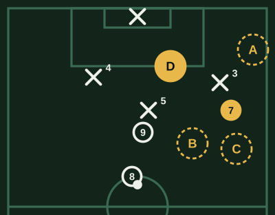
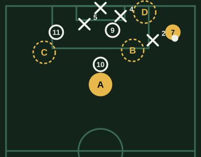
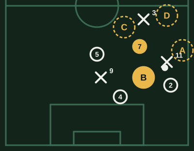
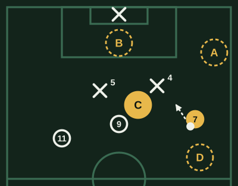

# Banco de Extremo (v1)

**Borrador sin revisar.** Marca lo que cambiarías al lado de cada pregunta: la respuesta correcta, una opción que también podría valer, una explicación floja o una pregunta que sobra.

64 preguntas. Cada examen toma 20, de todas las áreas y de las tres dificultades.

## Uno contra uno

### EXT-UNO-01 · fácil

Recibes en la banda con el lateral rival a tres metros, de frente. ¿Qué haces primero?

- [ ] Freno y espero que se acerque él para pasarlo
- [ ] Me la llevo lejos de un toque largo, a pura velocidad
- [x] **Lo encaro con el balón cerca del pie**
- [ ] La toco atrás apenas la recibo

> Con el lateral a tres metros, conducir pegado al pie te deja cambiar de dirección cuando él se compromete. Un toque largo se lo regala, y frenar le da tiempo a que llegue la ayuda.

### EXT-UNO-02 · fácil

El lateral rival es lento pero te espera bien parado. ¿Qué te conviene?

- [ ] Amagar varias veces en el lugar hasta desacomodarlo
- [ ] Esperar a que llegue un compañero para hacer la pared
- [ ] Ir directo contra él para ganarle de cuerpo
- [x] **Un cambio de ritmo fuerte para sacarle ventaja**

> Si es lento, tu arma es la velocidad: un cambio de ritmo lo deja atrás. Amagar en el lugar le da tiempo de reacomodarse, y esperar la pared deja que llegue su ayuda.

### EXT-UNO-03 · fácil

Encaras y el lateral se tira al piso a quitarte el balón. ¿Qué haces?

- [x] **Le paso el balón por un costado y sigo**
- [ ] Freno de golpe para que se pase de largo
- [ ] La protejo con el cuerpo y aguanto el contacto
- [ ] La toco atrás a mi lateral

> Si se tira, ya está en el suelo: un toque al costado lo deja afuera de la jugada. Si frenas o aguantas el contacto, le das tiempo de levantarse o de llevarse el balón con la pierna.

### EXT-UNO-04 · media

El lateral rival te cierra por fuera y te deja el camino hacia adentro. ¿Qué haces?

- [ ] Insisto por fuera con un cambio de ritmo
- [x] **Me meto hacia adentro, donde me deja el espacio**
- [ ] Freno y espero que cambie de perfil
- [ ] La toco atrás y probamos por el otro lado

> Un defensor que cierra un lado te está mostrando el otro. Insistir donde te espera es pelear su duelo; meterte hacia adentro te abre el pase o el remate.

### EXT-UNO-05 · media

Encaras y llega un segundo rival a cerrarte: quedas uno contra dos. ¿Qué haces?

- [ ] Intento pasar a los dos con una gambeta
- [ ] Aguanto el balón esperando una falta
- [x] **Suelto el balón al compañero que quedó libre**
- [ ] Me la llevo hacia la raya para escapar

> Si vienen dos a ti, alguien de tu equipo quedó libre: soltarla a tiempo es aprovechar esa ventaja. Contra dos, la gambeta suele terminar en pérdida.

### EXT-UNO-06 · media

Recibes de espaldas en la banda con el lateral pegado. ¿Qué buscas?

- [ ] Girar enseguida para encararlo antes de que llegue la ayuda
- [ ] Un taco de primera hacia el volante
- [ ] Devolverla larga al central
- [x] **Protegerla y descargar al que llega de frente**

> De espaldas y con marca encima, el giro suele perderse, y el taco sin mirar es una lotería. Proteger y descargar de cara mantiene el balón y te deja moverte para la devolución.

### EXT-UNO-07 · media

Le ganaste al lateral y entras al área por la banda. El central sale a cerrarte. ¿Qué haces?

- [x] **Levanto la cabeza y busco al que quedó libre**
- [ ] Intento gambetear también al central
- [ ] Freno y la toco atrás al volante
- [ ] Remato al primer palo antes de que me cierre

> Si el central sale a la banda, deja libre su zona: ahí suele haber un compañero. Si levantas la cabeza antes de decidir, tu gambeta se convierte en una ocasión. Rematar al primer palo es justo lo que el central viene a tapar.

### EXT-UNO-08 · media

¿Cuándo es mejor momento para encarar?

- [ ] Cada vez que recibo, para desgastarlo
- [x] **Cuando tengo espacio y su ayuda está lejos**
- [ ] Cuando el equipo va perdiendo y hace falta
- [ ] Apenas recibo, sin mirar dónde está su ayuda

> El uno contra uno rinde con espacio y sin ayudas cerca. Encarar cada vez que recibes, o sin mirar dónde está su ayuda, suele terminar en un dos contra uno y en pérdida.

### EXT-UNO-09 · difícil

El lateral rival te anticipa cada vez que te la pasan al pie. ¿Qué cambias?

- [ ] Bajo más a recibir, para alejarme de él
- [ ] Pido que me la pasen más fuerte
- [x] **Amago bajar y pico a su espalda**
- [ ] La pido al pie y la toco de primera

> Si te anticipa al pie, sale a buscarte apenas bajas: el amago lo hace salir y su espalda queda libre. Así usas su agresividad en su contra.

### EXT-UNO-10 · difícil

Van ganando 1-0, quedan pocos minutos y recibes en la banda rival con el lateral delante. ¿Qué haces?

- [ ] Lo encaro para buscar el segundo gol
- [ ] Centro al área por si alguien llega
- [x] **Me la llevo a la esquina y la protejo**
- [ ] Pateo de lejos para terminar la jugada

> Con el resultado a favor y poco tiempo, perderla en la banda rival es darle un contragolpe. Conservarla lejos de tu arco gasta minutos sin riesgo.

## Desmarques y amplitud

### EXT-DES-01 · fácil

Tu equipo tiene el balón en el medio. ¿Dónde te ubicas?

- [x] **Abierto, cerca de la raya**
- [ ] Cerca del 9, en el centro
- [ ] Pegado al volante que tiene el balón
- [ ] Atrás, a la altura de mi lateral

> Abierto estiras la defensa rival y abres espacios por dentro. Si te cierras, los defensores también se juntan y el medio se tapa.

### EXT-DES-02 · fácil

El lateral rival está adelantado y tu volante levanta la cabeza. ¿Qué haces?

- [ ] Bajo a pedirla al pie
- [x] **Pico a su espalda**
- [ ] Me meto al centro con el 9
- [ ] Me quedo quieto en mi lugar

> Con el lateral adelantado, su espalda es el espacio, y tu volante puede verte. Bajar o quedarte desperdicia ese momento.

### EXT-DES-03 · fácil

Tu lateral sube por fuera para desdoblar. ¿Qué haces?

- [ ] Sigo pegado a la raya, delante de él
- [ ] Bajo a mi campo para cubrirlo
- [x] **Me meto hacia adentro y le dejo la banda**
- [ ] Voy al área a esperar el centro

> Si los dos ocupan la raya, se estorban. Meterte un poco hacia adentro le deja la banda y te pone entre líneas para recibir.

### EXT-DES-04 · media

El 9 baja a recibir y arrastra a un central. ¿Qué haces?

- [ ] Bajo yo también a ofrecerme, para tener dos opciones de pase
- [ ] Me quedo abierto en la raya
- [ ] Me acerco al 9 para una pared
- [x] **Ataco en diagonal el espacio que dejó el central**

> Cuando un central sale detrás del 9, su zona queda vacía: la diagonal del extremo es la que la aprovecha.

### EXT-DES-05 · media

Juegas a pierna cambiada (eres zurdo por la derecha). Tu volante tiene el balón. ¿Qué movimiento te rinde más?

- [x] **Recibir hacia adentro, perfilado para patear o pasar**
- [ ] Recibir pegado a la raya para centrar con la derecha
- [ ] Picar a la espalda del lateral cada vez
- [ ] Bajar a buscarla al lado del volante

> A pierna cambiada, tu pierna buena queda mirando el arco cuando vas hacia adentro: ahí patea o filtra. Pegado a la raya, el centro te obliga a usar la mala.

### EXT-DES-06 · media

El balón está en la banda contraria. ¿Dónde te ubicas?

- [ ] Pegado a mi raya, bien abierto
- [x] **Cerrado, para llegar al segundo palo**
- [ ] Bajo al medio a ayudar
- [ ] Voy a la banda contraria a acompañar la jugada

> Con el balón del otro lado, te cierras para llegar al segundo palo: el centro que viene desde la otra banda suele terminar ahí, y llegando en carrera le ganas al lateral.

### EXT-DES-07 · media

Tu equipo sale jugando desde atrás y el rival presiona. ¿Qué haces?

- [ ] Me quedo arriba esperando un pelotazo por encima de la presión
- [ ] Me meto al medio, entre los centrales rivales
- [x] **Me ofrezco abierto y un poco más atrás, como salida**
- [ ] Bajo hasta la línea de mis centrales

> Con presión, el equipo necesita salidas por fuera: abierto y un poco más atrás, recibes con espacio. Muy arriba no eres opción, y en tu línea de defensa estorbas.

### EXT-DES-08 · media

El rival defiende muy cerrado, con todos en su área. ¿Qué te pide el equipo?

- [ ] Meterme al centro para sumar gente
- [ ] Patear de lejos para que salgan
- [ ] Bajar a armar el juego
- [x] **Bien abierto, para estirar la defensa**

> Contra un bloque cerrado, el espacio está en las bandas: si estás bien abierto, los defensores se separan y aparecen huecos por dentro.

### EXT-DES-09 · difícil

El lateral rival te sigue a todos lados, aunque bajes a tu campo. ¿Qué haces?

- [x] **Lo arrastro lejos de su zona**
- [ ] Me quedo en mi lugar para no desordenar al equipo
- [ ] Pido que me la tiren larga para ganarle en velocidad
- [ ] Me voy al otro lado de la cancha

> Si el lateral te sigue, cada metro que bajas es un metro libre a su espalda: tu lateral o el 9 pueden atacarlo.

### EXT-DES-10 · difícil

Tu extremo del otro lado tiene el balón y va a centrar. Tú vienes de lejos. ¿Cuándo entras al área?

- [x] **Cuando él levanta la cabeza para centrar**
- [ ] Apenas recibe, para estar adentro antes
- [ ] Cuando el balón ya está en el aire
- [ ] Después del centro, por el rebote

> Llegar en movimiento, justo con el centro, te da ventaja sobre el defensor. Si entras antes, te marca; si esperas al balón, llegas tarde.

### EXT-PIZ-01 · media

El 9 baja a recibir y el central rival lo sigue. ¿Adónde te desmarcas?

- [ ] A. Pegado a la raya, más arriba
- [ ] B. Bajo a ofrecerme al lado del 9
- [ ] C. Me quedo donde estoy
- [x] **D. En diagonal al espacio que dejó el 5**

> Cuando el central sigue al 9, su zona queda vacía: la diagonal del extremo la aprovecha y te deja de frente al arco. Por la raya el 3 te sigue, y bajar o quedarte desperdicia el hueco.

## Centro y último pase

### EXT-CEN-01 · fácil

Llegas a la línea de fondo con el balón. ¿Qué miras antes de centrar?

- [ ] Dónde está parado el arquero
- [ ] Que el lateral no me tape el centro
- [x] **Quién llega al área y dónde**
- [ ] El arco, por si puedo patear

> El centro es un pase: necesitas saber a quién va y a qué zona. Una mirada antes de patear cambia el centro a ciegas por uno con destino.

### EXT-CEN-02 · fácil

Llegas al fondo y tus compañeros entran de frente a la puerta del área. ¿Qué pase les das?

- [ ] Alto y bombeado al centro del área
- [ ] Fuerte al primer palo
- [ ] Alto al segundo palo, lejos del arquero
- [x] **Raso y hacia atrás**

> Los defensores corren hacia su arco y quien llega de frente remata cómodo. El centro alto, en cambio, lo defienden de frente el arquero y los centrales.

### EXT-CEN-03 · fácil

No hay ningún compañero en el área cuando llegas al fondo. ¿Qué haces?

- [x] **La toco atrás y esperamos a que lleguen**
- [ ] Centro igual al área, por si cae un rebote o un error
- [ ] Pateo al arco sin ángulo
- [ ] Encaro al lateral otra vez

> Un centro sin nadie adentro suele terminar en balón del rival. Tocar atrás conserva el balón hasta que el equipo llegue.

### EXT-CEN-04 · media

El 9 ataca el primer palo. ¿Qué centro le das?

- [ ] Bombeado, para que tenga tiempo
- [x] **Tenso y a media altura**
- [ ] Al segundo palo, lejos de la marca
- [ ] Raso y fuerte, detrás de él

> Al primer palo se gana llegando antes: un centro tenso coincide con la carrera del 9. Uno bombeado le da tiempo al defensor y al arquero.

### EXT-CEN-05 · media

El lateral rival te tapa el centro con tu pierna buena. ¿Qué haces?

- [ ] Centro igual, contra su pierna
- [ ] La toco atrás al lateral para empezar de nuevo
- [x] **Recorto hacia adentro y busco el otro perfil**
- [ ] Intento el centro con el exterior del pie

> Si te tapan un perfil, el recorte te abre el otro y descoloca al lateral. Centrar contra su pierna suele terminar en córner o en su balón.

### EXT-CEN-06 · media

Recibes a 25 metros del arco, por dentro, y el 9 pica a la espalda del central. ¿Qué haces?

- [ ] Pateo de lejos, que tengo el arco de frente
- [ ] Me la llevo hacia la banda para centrar
- [ ] La toco al volante para que arme
- [x] **Le filtro el pase a la espalda del central**

> El pase a la espalda deja al 9 solo frente al arco: es la ocasión más clara. Un remate de 25 metros o volver a la banda la desperdician.

### EXT-CEN-07 · media

Tu equipo tiene dos cabeceadores buenos y el rival es bajo. ¿Qué centro conviene?

- [x] **Alto, a la zona donde atacan ellos**
- [ ] Raso al punto de penal
- [ ] Pase atrás a la puerta del área
- [ ] Mejor jugar por abajo, sin centros

> Si tu ventaja está en el aire, el centro alto la aprovecha. El raso o el pase atrás sirven cuando llegan jugadores de frente.

### EXT-CEN-08 · media

Entras al área por la banda y el arquero sale a cortar. ¿Qué haces?

- [ ] Centro alto por encima de él
- [x] **Pase atrás, raso, lejos de su alcance**
- [ ] Remate al primer palo
- [ ] Lo encaro para eludirlo

> Con el arquero afuera, el arco queda libre y el pase atrás llega al que entra de frente. El centro alto es justo lo que el arquero salió a cortar.

### EXT-CEN-09 · difícil

Llegas al fondo: el 9 está marcado al primer palo, el otro extremo llega libre al segundo y la puerta del área está vacía. ¿Qué haces?

- [ ] Centro tenso al primer palo, al 9
- [ ] Pase atrás a la puerta del área
- [x] **Centro pasado al segundo palo**
- [ ] Remate al arco sin ángulo

> El que llega libre es la mejor opción: el centro pasado por encima de la defensa lo encuentra solo. Al primer palo, el 9 está marcado.

### EXT-CEN-10 · difícil

Van perdiendo y el rival se encierra. Tus centros salen todos despejados por el central alto. ¿Qué cambias?

- [ ] Sigo centrando alto, que alguno va a llegar
- [ ] Centro más fuerte, para que no llegue a cabecear
- [x] **Busco pases atrás y centros rasos**
- [ ] Pateo de lejos en vez de centrar

> Si el central alto gana todo arriba, el centro alto le hace el trabajo fácil. Por abajo, su altura no le sirve y los que llegan de frente rematan.

### EXT-PIZ-02 · media

Llegas al fondo por la derecha. ¿A quién se la das?

- [x] **A. Pase atrás al 10, que llega solo**
- [ ] B. Centro al 9, al primer palo
- [ ] C. Centro pasado al 11
- [ ] D. Remate al arco sin ángulo

> El 10 llega de frente y sin marca a la puerta del área: el pase atrás le deja todo el arco. El 9 tiene encima al 4, el 11 está cerca del 5, y sin ángulo el remate termina en el arquero.

## Finalización

### EXT-FIN-01 · fácil

Llegas al segundo palo y el centro te queda a la altura del pie. ¿Qué haces?

- [ ] La controlo para acomodarme
- [x] **Le pego de primera hacia abajo**
- [ ] Le pego fuerte y alto, al medio
- [ ] Se la doy al 9 de cabeza

> En el segundo palo hay poco tiempo y mucho arco: el remate de primera hacia abajo es el más difícil para el arquero. Controlarla deja llegar a la defensa.

### EXT-FIN-02 · fácil

Te metes desde la banda y quedas de frente al arco, a pierna cambiada. ¿Adónde apuntas?

- [ ] Al primer palo, fuerte
- [ ] Al medio, para asegurar
- [x] **Al segundo palo, con rosca**
- [ ] Arriba, al ángulo más cercano

> Viniendo de afuera hacia adentro, el remate natural con la pierna buena va al segundo palo, lejos del arquero. El primer palo suele estar cubierto.

### EXT-FIN-03 · fácil

Tu compañero patea y el arquero da rebote hacia tu lado. ¿Qué haces?

- [ ] Me quedo abierto en la banda
- [ ] Me quedo en la puerta del área por si sale rechazada
- [ ] Me freno a ver si entra
- [x] **Sigo la jugada hacia el arco**

> Muchos goles de extremo salen de llegar al rebote: el que sigue la jugada hacia el arco llega primero. Desde la puerta del área llegas tarde si el rebote queda cerca.

### EXT-FIN-04 · media

Quedas mano a mano entrando en diagonal desde la banda, y el arquero se queda parado en su línea. ¿Qué haces?

- [x] **Me acerco y la cruzo lejos de él**
- [ ] Pateo fuerte apenas entro, desde lejos
- [ ] La pico por encima de él
- [ ] Intento eludirlo por fuera, hacia la raya

> Si el arquero no sale, cada paso que das le achica el arco: de cerca la cruzas lejos de su alcance. Desde lejos tiene tiempo de reaccionar, picarla sin que haya salido se la deja en las manos, y eludirlo hacia la raya te deja sin ángulo.

### EXT-FIN-05 · media

Recibes en la puerta del área, de frente, con un defensor a dos metros. ¿Qué haces?

- [ ] Lo encaro para tener más ángulo
- [x] **Remate rápido, antes de que me cierre**
- [ ] Paso atrás al volante
- [ ] Me acomodo con un toque más

> De frente y con espacio, el remate rápido es la mejor ocasión. Un toque más deja que el defensor te tape.

### EXT-FIN-06 · media

Juegas a pierna natural (diestro por la derecha) y te meten un pase cruzado al área. ¿Qué haces?

- [ ] Controlo y me la acomodo a la izquierda
- [ ] Centro atrás para el 9
- [x] **Le pego de primera al segundo palo**
- [ ] Pateo fuerte de primera al primer palo

> Con el pase cruzado, el balón ya viene hacia tu pierna buena: de primera y al segundo palo usas su velocidad. Acomodarla cuesta el tiempo que no tienes.

### EXT-FIN-07 · media

Te llega un balón largo que pica delante del arquero. ¿Qué haces?

- [ ] Espero que pique otra vez para controlarla
- [ ] Le pego fuerte de volea
- [ ] Freno para no chocar con el arquero
- [x] **Llego antes y la toco suave**

> Con el arquero saliendo, ganar el balón antes es todo: un toque suave lo supera. Esperar le da tiempo, y pegarle fuerte con el arquero encima suele terminar en su cuerpo.

### EXT-FIN-08 · media

Entras al área con poco ángulo y ves al 9 solo en el punto de penal. ¿Qué haces?

- [x] **Se la doy al 9 en el punto de penal**
- [ ] Pateo igual, desde donde estoy
- [ ] Gambeteo para mejorar mi ángulo
- [ ] La aguanto esperando que llegue más gente

> El gol es del equipo: con poco ángulo tu remate es difícil, y el 9 solo en el punto de penal tiene la ocasión más clara. Gambetear para mejorar el ángulo le da tiempo a la defensa de cerrarlo.

### EXT-FIN-09 · difícil

El arquero rival se adelanta mucho cuando atacas por tu banda. Recibes a 25 metros. ¿Qué intentas?

- [ ] Un remate fuerte y raso al primer palo
- [x] **Un remate por encima de él**
- [ ] Un centro al área
- [ ] Encararlo para eludirlo

> Si el arquero sale mucho, el espacio está a su espalda: el remate por encima es la ocasión. Raso y al primer palo es justo lo que está cubriendo.

### EXT-FIN-10 · difícil

Llegas al segundo palo y el centro viene alto, por encima de tu cabeza. ¿Qué haces?

- [ ] Cabeceo al arco sin ángulo
- [x] **La bajo de cabeza hacia el centro del área**
- [ ] Dejo que siga para el rebote
- [ ] Salto igual aunque no llegue bien

> Desde el segundo palo sin ángulo, devolverla al centro del área encuentra al que llega de frente: es mejor ocasión que un cabezazo forzado al arco.

## Trabajo defensivo

### EXT-DEF-01 · fácil

Perdemos el balón y el lateral rival sube por tu banda. ¿Qué haces?

- [ ] Me quedo arriba para el contragolpe
- [ ] Voy a presionar al que tiene el balón
- [ ] Le dejo la marca a mi lateral
- [x] **Lo sigo y vuelvo a cubrir mi banda**

> Si el lateral rival sube y tú te quedas, tu lateral queda con dos encima. Volver con él cierra esa banda.

### EXT-DEF-02 · fácil

Tu equipo defiende atrás. ¿Dónde te ubicas?

- [x] **Delante de mi lateral, cerrando el pase por dentro**
- [ ] Pegado a la raya, bien abierto, para salir rápido de contragolpe
- [ ] Arriba, cerca del 9
- [ ] Dentro de mi área

> Delante de tu lateral y un poco hacia adentro, tapas el pase al medio y ayudas si el extremo rival encara.

### EXT-DEF-03 · fácil

El rival va a centrar desde la otra banda. ¿Dónde estás?

- [ ] En mi banda, lejos de la jugada, para el contragolpe
- [x] **Cerca de la puerta del área, por el rebote**
- [ ] En el área chica, con los centrales
- [ ] Arriba, esperando el contragolpe

> El rechazo de un centro suele caer en la puerta del área: si estás ahí, la ganas tú y no un rival que llega.

### EXT-DEF-04 · media

El extremo rival encara a tu lateral. ¿Qué haces?

- [ ] Voy también por fuera, a doblar la marca
- [ ] Me quedo lejos, esperando
- [x] **Me acerco por dentro a cerrarle el centro**
- [ ] Retrocedo a la línea de mis centrales

> Tu ayuda va por dentro: el lateral lo lleva hacia la raya y tú le cierras la entrada. Si van los dos por fuera, el centro queda libre.

### EXT-DEF-05 · media

Tu equipo presiona arriba y el central rival tiene el balón de tu lado. ¿Qué haces?

- [ ] Voy directo al central
- [ ] Me quedo con el lateral, lejos del balón
- [ ] Retrocedo a mi campo
- [x] **Presiono tapándole el pase al lateral**

> Viniendo de afuera hacia adentro tapas el pase al lateral y lo obligas a jugar por el medio, donde tu equipo está más junto.

### EXT-DEF-06 · media

El lateral rival se queda arriba siempre que atacan. Tu equipo pierde el balón. ¿Qué haces?

- [x] **Vuelvo a tomarlo antes de que reciba**
- [ ] Me quedo arriba, él no va a bajar
- [ ] Presiono al que tiene el balón
- [ ] Le aviso a mi lateral y sigo arriba

> Si el lateral rival se queda arriba, es una salida rápida para ellos: llegar antes de que reciba corta su contragolpe.

### EXT-DEF-07 · media

Hay un córner en contra. ¿Qué te toca normalmente?

- [ ] Marcar al más alto del rival
- [x] **Quedarme en la puerta del área por el rebote**
- [ ] Ponerme en el primer palo
- [ ] Quedarme en la mitad de la cancha

> En el córner en contra, el extremo suele cubrir la puerta del área: el rebote cae ahí y, si la ganas, sales tú de contragolpe.

### EXT-DEF-08 · media

Van ganando y el rival ataca mucho por tu banda. ¿Qué cambias?

- [ ] Me quedo más arriba para obligarlos a defender
- [ ] Me voy al centro a ayudar
- [x] **Me quedo más cerca de mi lateral**
- [ ] Presiono más alto al central

> Si atacan por tu lado, tu lateral necesita ayuda: más cerca de él forman un dos contra uno y cierran esa banda.

### EXT-DEF-09 · difícil

El rival hace un cambio de frente hacia tu banda. Estás lejos. ¿Qué haces?

- [ ] Espero a ver quién la recibe
- [ ] Le dejo la jugada a mi lateral
- [ ] Corro hacia mi área
- [x] **Corro mientras el balón viaja**

> El tiempo del balón en el aire es tuyo: si sales mientras viaja, llegas cuando controla. Si esperas, recibe solo.

### EXT-DEF-10 · difícil

Tu lateral salió a presionar al extremo rival y dejó su espalda libre. ¿Qué haces?

- [ ] Voy a presionar con él al extremo
- [ ] Me quedo arriba, no es mi zona
- [ ] Corro al centro del área
- [x] **Bajo a cubrir su espacio hasta que vuelva**

> Si el lateral sale, su espalda queda libre para el pase. El extremo que está más cerca la cubre hasta que él vuelva.

### EXT-PIZ-03 · media

El extremo rival encara a tu lateral por su banda. ¿Dónde te ubicas?

- [ ] A. Por fuera, a doblar con mi lateral
- [x] **B. Por dentro de él, cerrándole la entrada**
- [ ] C. Donde estoy, mirando
- [ ] D. Con el 3, que sube por detrás

> Tu ayuda va por dentro: tu lateral lo lleva hacia la raya y tú le cierras el camino al centro. Por fuera se amontonan; quieto o con el 3, el extremo encara solo.

## Transiciones

### EXT-TRA-01 · fácil

Recuperan el balón y el rival está desordenado. ¿Qué haces?

- [ ] Bajo a pedir el balón al pie
- [ ] Me quedo quieto para ver la jugada
- [ ] Me meto al medio a ayudar
- [x] **Arranco al espacio por mi banda**

> El contragolpe dura segundos: tu carrera al espacio da una opción rápida antes de que el rival se ordene.

### EXT-TRA-02 · fácil

Pierden el balón y el rival que la recoge está cerca de ti. ¿Qué haces?

- [x] **Lo presiono enseguida**
- [ ] Vuelvo a mi posición
- [ ] Retrocedo unos pasos y lo espero
- [ ] Me tiro al suelo a robarla

> Recién perdida, el rival todavía no está ordenado: el más cercano presiona al instante y puede recuperarla.

### EXT-TRA-03 · fácil

Arrancas un contragolpe con el balón y el rival viene volviendo. ¿Qué haces?

- [ ] Conduzco hasta el área para patear yo
- [x] **Avanzo rápido y suelto el balón a tiempo**
- [ ] Freno para que llegue más gente
- [ ] Pateo apenas paso la mitad de la cancha

> En el contragolpe, la velocidad y el momento del pase deciden: avanzas mientras hay espacio y lo sueltas cuando un compañero queda mejor.

### EXT-TRA-04 · media

Contragolpe tres contra dos: llevas el balón por la banda. ¿Qué haces?

- [ ] Encaro a los dos para llegar al área
- [ ] Centro alto apenas paso la mitad
- [x] **Atraigo a un defensor y paso al que queda libre**
- [ ] Freno y espero refuerzos para atacar con más gente

> En superioridad, tu trabajo es fijar a un defensor: cuando viene hacia ti, el pase al libre deja a tu compañero solo.

### EXT-TRA-05 · media

Tu compañero conduce un contragolpe por el centro. Tú vienes por la banda. ¿Qué haces?

- [ ] Me acerco a él para una pared
- [ ] Me quedo atrás por si la pierde
- [ ] Cruzo hacia su mismo carril
- [x] **Me abro y avanzo para estirar a la defensa**

> Abierto y en carrera, obligas a un defensor a decidir entre él y tú: así queda espacio para el pase o el remate.

### EXT-TRA-06 · media

Pierden el balón y estás arriba, lejos de tu lateral. ¿Qué haces?

- [x] **Vuelvo a mi banda por el camino más corto**
- [ ] Me quedo arriba por si la recuperan
- [ ] Presiono al rival más cercano, tenga o no el balón
- [ ] Vuelvo trotando, al ritmo del equipo

> Tu banda queda libre para su contragolpe: volver rápido cierra ese espacio y le da ayuda a tu lateral.

### EXT-TRA-07 · media

Recuperan el balón, pero el rival ya está ordenado atrás. ¿Qué haces?

- [ ] Encaro igual en velocidad
- [x] **Aseguro el pase y armamos el ataque**
- [ ] Pido un pelotazo a la espalda
- [ ] Pateo de lejos

> El contragolpe sirve contra un rival desordenado. Si ya está ordenado, forzarlo es perder el balón.

### EXT-TRA-08 · media

Arrancas el contragolpe y ves que el 9 pica a la espalda del central. ¿Qué haces?

- [ ] Sigo conduciendo para llegar yo
- [ ] Le doy el pase al pie
- [x] **Le doy el pase al espacio**
- [ ] Freno y espero que se ordene el equipo

> Si el 9 ya ganó la espalda, el pase al espacio lo deja solo. Al pie lo obliga a frenar y la defensa vuelve.

### EXT-TRA-09 · difícil

Contragolpe rival: estás en la mitad de la cancha y un rival corre libre por tu banda. ¿Qué haces?

- [ ] Corro detrás de él, por su mismo carril
- [ ] Me quedo en la mitad de la cancha
- [ ] Voy al balón por el camino más directo
- [x] **Corro hacia adentro, entre él y el arco**

> Volviendo por dentro llegas entre el rival y el arco: lo mandas a la banda y proteges el área.

### EXT-TRA-10 · difícil

Ganan 1-0, último minuto, y recuperas en tu campo con espacio. ¿Qué haces?

- [ ] Busco el segundo gol en velocidad
- [ ] Pateo lejos el balón hacia adelante
- [ ] Me quedo con el balón en mi campo
- [x] **Lo llevo a la esquina rival**

> Con el partido casi ganado, llevar el balón lejos de tu arco y protegerlo gasta el tiempo sin riesgo.

### EXT-PIZ-04 · media

Recuperan y arrancas el contragolpe por la banda, tres contra dos. ¿Qué haces?

- [ ] A. Sigo por la raya hasta el fondo
- [ ] B. Centro alto ya, al área
- [x] **C. Conduzco hacia el 4 y paso al 9**
- [ ] D. Freno y espero refuerzos

> En tres contra dos, fijas a un defensor conduciendo hacia él: cuando sale, el 9 queda libre. Por la raya te llevan al fondo sin ventaja, y el centro temprano o frenar la regalan.
