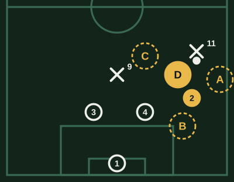
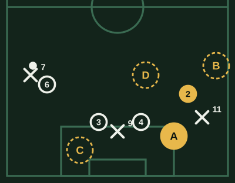
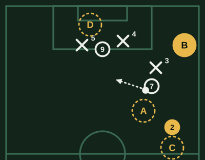
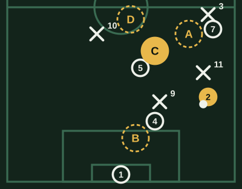

# Banco de Lateral (v1)

**Borrador sin revisar.** Marca lo que cambiarías al lado de cada pregunta: la respuesta correcta, una opción que también podría valer, una explicación floja o una pregunta que sobra.

64 preguntas. Cada examen toma 20, de todas las áreas y de las tres dificultades.

## Uno contra uno

### LAT-UNO-01 · fácil

El extremo te encara y tu equipo defiende mandando al rival hacia la banda. ¿Cómo te paras?

- [ ] De frente y con los pies paralelos, para tapar los dos lados del cuerpo
- [ ] Perfilado al revés, dejándole libre el camino hacia el centro
- [x] **Perfilado, cerrándole el camino hacia adentro**
- [ ] Bien pegado, metiendo la pierna apenas toque el balón

> Perfilado y tapando el interior lo mandas hacia la raya, donde tiene menos opciones. De frente, un amague te deja sentado; meter la pierna a la primera le regala el regate.

### LAT-UNO-02 · fácil

El extremo viene conduciendo hacia ti. ¿A qué distancia lo esperas?

- [ ] A cinco o seis metros, para tener tiempo de reaccionar a lo que haga
- [ ] Encima, tocándolo, para que no pueda levantar la cabeza
- [ ] A la altura de tu central, sin salir de la línea aunque él avance
- [x] **A uno o dos metros**

> Muy lejos le das tiempo para centrar o elegir; encima, un toque largo te deja atrás. A uno o dos metros lo molestas y todavía puedes acompañarlo.

### LAT-UNO-03 · fácil

El extremo te supera con un amague. ¿Qué haces?

- [x] **Giro y corro por dentro, entre él y el arco**
- [ ] Lo dejo seguir: ahora es trabajo del central
- [ ] Me barro por detrás para intentar puntear el balón
- [ ] Lo agarro de la camiseta para frenarlo

> Superado, lo primero es volver por dentro para tapar el camino al arco y molestar el centro. Dejarlo deja al equipo con uno menos; barrerte por detrás o agarrarlo es falta y tarjeta.

### LAT-UNO-04 · media

Notas que el extremo siempre busca meterse hacia adentro para patear con su pierna buena. ¿Qué ajustas?

- [ ] Lo dejo ir hacia adentro, que ahí lo esperan los centrales
- [x] **Me paro un poco más hacia adentro para quitarle ese camino**
- [ ] Me alejo un par de metros para que no me encare
- [ ] Salgo a presionarlo apenas recibe, sin fijarme en su perfil

> Si su recurso es entrar hacia su pierna buena, tápale ese lado y oblígalo a la banda o a su pierna mala. Dejarlo entrar es regalarle el remate.

### LAT-UNO-05 · media

Tu extremo no volvió y quedas solo contra el extremo y el lateral rival en tu banda. ¿Qué haces?

- [ ] Salgo a presionar al del balón aunque deje libre al otro
- [ ] Me quedo marcando al que no tiene el balón
- [x] **Retrocedo ganando tiempo hasta que llegue ayuda**
- [ ] Me tiro al piso para cortar el pase entre ellos

> En inferioridad no vas a uno: ganas tiempo, tapas lo más peligroso (el pase al que pica o la entrada al área) y esperas que llegue tu compañero.

### LAT-UNO-06 · media

El extremo te espera parado con el balón y no arranca. ¿Qué haces?

- [ ] Me lanzo a robarla ahora que está quieto
- [ ] Me quedo lejos hasta que él se decida a arrancar
- [ ] Le dejo espacio para que centre de lejos, que es menos peligroso
- [x] **Me acerco con cuidado, perfilado, sin lanzarme**

> Quieto, lo que busca es que te tires. Acortar con cuidado le quita tiempo sin darle la ventaja del primer movimiento; quedarte lejos le deja centrar cómodo.

### LAT-UNO-07 · media

El extremo te encara ya dentro de tu área. ¿Qué cuidas sobre todo?

- [x] **No hacer penal: voy al balón de frente o de costado, nunca por detrás**
- [ ] Quitarle el balón como sea, antes de que llegue a la línea de fondo
- [ ] Que no centre, aunque tenga que tirarme
- [ ] Que no remate, empujándolo para desequilibrarlo

> Dentro del área, un contacto torpe es penal. Defiendes de pie, acompañas y entras solo de frente o de costado; tirarte o empujar es el error que más caro sale.

### LAT-UNO-08 · media

Ganas el uno contra uno y te quedas con el balón cerca de tu área. ¿Qué haces primero?

- [ ] Arranco conduciendo por la banda para salir de contragolpe
- [x] **Levanto la cabeza: si no hay pase seguro, la saco lejos**
- [ ] La devuelvo de primera al arquero sin mirar
- [ ] Busco al central por dentro aunque tenga un rival cerca

> Cerca de tu área, perderla es un tiro al arco. Primero miras: si hay un compañero libre, juegas; si no, la alejas. El pase sin mirar o por dentro con rivales cerca es el error típico.

### LAT-UNO-09 · difícil

El extremo recibe de espaldas a tu arco, pegado a la raya. ¿Qué buscas?

- [ ] Le dejo espacio para que gire y ahí lo encaro de frente
- [ ] Me lanzo al balón por detrás antes de que controle
- [x] **Lo acoso de cerca sin tirarme, para que no gire**
- [ ] Lo empujo contra la raya para que el balón salga

> De espaldas no es peligroso. Pegado le impides girar y lo obligas a jugar atrás; dejarlo girar le da el uno contra uno de frente, y entrar por detrás o empujar es falta.

### LAT-UNO-10 · difícil

El extremo rival es mucho más rápido que tú y hay espacio a tu espalda. ¿Cómo lo marcas cuando no tiene el balón?

- [ ] Bien pegado, para que no pueda recibir
- [ ] Adelantado, para cortar el pase antes de que llegue
- [x] **Le doy un par de metros de ventaja**
- [ ] Atento solo al balón, en la línea de los centrales

> Contra alguien más rápido, el peligro es el pase a tu espalda. Con un par de metros de ventaja llegas al balón largo; pegado o adelantado, un pase al espacio te deja atrás.

### LAT-PIZ-01 · media

El extremo te encara por tu banda y tu equipo lo manda hacia la raya. ¿Dónde te paras?

- [ ] A. Por fuera de él, pegado a la raya
- [ ] B. Atrás, en la línea de los centrales
- [ ] C. Hacia adentro, cerca del 9
- [x] **D. Delante de él, un poco hacia adentro**

> Delante y un poco hacia adentro le tapas el camino al centro y lo mandas a la raya, como pide el equipo. Por fuera le regalas la entrada; atrás o junto al 9, encara sin oposición.

## Cierres y vigilancias

### LAT-CIE-01 · fácil

El balón está en la banda contraria. ¿Dónde te ubicas?

- [ ] Bien abierto, pegado a mi raya
- [x] **Cerrado hacia adentro, cerca de mis centrales**
- [ ] Adelantado, a la altura de la mitad de la cancha
- [ ] Encima del extremo de mi lado, esté donde esté

> Con el balón lejos, el peligro está en el centro y el segundo palo. Te cierras para achicar el espacio entre tú y el central, sin perder de vista a tu extremo.

### LAT-CIE-02 · fácil

Va a llegar un centro desde la otra banda. ¿Qué zona cuidas?

- [ ] El primer palo, junto a mi central
- [ ] La puerta del área, por si hay rebote
- [x] **El segundo palo, por detrás del último delantero**
- [ ] Mi banda, por si el balón sale hacia ahí

> El centro desde la otra banda suele terminar en el segundo palo, que es tu zona. Si no lo cierras, el que llega de atrás cabecea solo.

### LAT-CIE-03 · fácil

El rival cambia el juego hacia tu banda con un pase largo. ¿Qué haces?

- [ ] Me quedo adentro hasta que el extremo controle
- [ ] Espero que salga el volante de mi lado
- [ ] Retrocedo hacia mi arco para cubrir la espalda
- [x] **Salgo hacia afuera mientras el balón viaja**

> El tiempo que el balón está en el aire es tuyo: si sales mientras viaja, llegas cuando controla. Si esperas, recibe solo y te encara con ventaja.

### LAT-CIE-04 · media

El balón está en la otra banda y el extremo de tu lado se queda bien abierto. ¿Qué haces?

- [x] **Me cierro y lo vigilo de reojo**
- [ ] Lo sigo hasta la raya para que no reciba solo
- [ ] Me olvido de él y me ocupo del 9
- [ ] Me adelanto para dejarlo en fuera de juego

> Pegarte a él abre un hueco entre tú y el central justo donde ataca el rival. Cerrado y perfilado, ves balón y extremo, y llegas si cambian de frente.

### LAT-CIE-05 · media

Tu central sale a cortar al medio y deja su lugar libre. ¿Qué haces?

- [ ] Me quedo pegado a mi raya, que es mi zona
- [x] **Me cierro un poco hacia su espacio**
- [ ] Salgo yo también al medio para ayudarlo
- [ ] Retrocedo hasta el área chica

> Cuando un central salta, la línea se reacomoda hacia el hueco: el lateral más cercano se cierra un poco. Quedarte en la raya o salir también deja el centro vacío.

### LAT-CIE-06 · media

Defienden con línea de cuatro y el balón está en el medio, sin presión sobre el que la tiene. ¿Cómo te paras?

- [ ] Más adelantado que la línea, para presionar si recibe el extremo
- [ ] Pegado a la raya y de frente al balón
- [x] **Un paso atrás con la línea, perfilado para ver balón y extremo**
- [ ] Igual que antes, porque el balón no viene a mi banda

> Con el balón sin presión, el rival puede filtrar el pase cuando quiera: la línea retrocede junta. Perfilado ves a la vez el balón y a tu extremo.

### LAT-CIE-07 · media

El 9 rival se tira hacia tu banda para recibir. ¿Qué haces?

- [ ] Lo sigo hasta la mitad de la cancha
- [ ] Lo dejo: el 9 es del central
- [ ] Me quedo en mi lugar, callado
- [x] **Lo tomo yo y aviso**

> Si el 9 cae en tu zona, es tuyo mientras esté ahí, y avisas para que nadie quede con dos. Seguirlo lejos te saca de la línea; dejarlo o no hablar abre la jugada.

### LAT-CIE-08 · media

El rival ataca por la otra banda y su extremo de tu lado espera atrás, a tu espalda. ¿Dónde te paras?

- [x] **Donde lo vea a él y al balón a la vez, del lado de adentro**
- [ ] Delante de él, mirando solo el balón para cortar el centro antes
- [ ] Detrás de él, pegado a la línea de fondo
- [ ] En el primer palo, para ayudar a mi central

> Si solo miras el balón, el extremo te gana la espalda. Del lado de adentro y viendo las dos cosas, llegas al centro y no se te escapa.

### LAT-CIE-09 · difícil

Van ganando 1-0 en los últimos minutos. El balón está en la otra banda y el extremo de tu lado se fue al área. ¿Qué haces?

- [ ] Me quedo en mi banda, que es mi zona
- [x] **Lo acompaño hasta el área**
- [ ] Subo a presionar al que tiene el balón
- [ ] Le dejo la marca al central sin decirle

> Una zona vacía no hace goles; un rival libre en el área sí. Si se metió al área, lo acompañas y avisas: los centrales ya tienen al 9.

### LAT-CIE-10 · difícil

Hay un centro desde la otra banda y llegan dos rivales: uno al primer palo y uno al segundo. ¿A quién tomas?

- [ ] Al del primer palo, que llega antes
- [x] **Al del segundo palo, que es el de mi lado**
- [ ] Me quedo en la línea de los centrales, sin tomar marca
- [ ] Al que esté más cerca del arco en ese momento

> El del primer palo es del central; el del segundo es del lateral de esa banda. Si los dos van al mismo, el otro cabecea solo.

### LAT-PIZ-02 · media

Van a centrar desde la otra banda. ¿Dónde te ubicas?

- [x] **A. En el segundo palo, adentro del 11**
- [ ] B. Donde estaba, pegado a mi raya
- [ ] C. En el primer palo, con los centrales
- [ ] D. En la puerta del área, por el rebote

> Con el centro desde la otra banda, tu zona es el segundo palo: del lado de adentro del 11 llegas al balón antes que él. En la raya o en el primer palo, el 11 cabecea solo.

## Proyección y desdoble

### LAT-PRO-01 · fácil

Tu extremo tiene el balón y lo encaran. ¿Cuándo pasas por fuera?

- [ ] Apenas mi equipo recupera, aunque el extremo esté de espaldas
- [x] **Cuando él fija al rival y tiene el balón controlado**
- [ ] Cuando el balón está en la otra banda
- [ ] En cuanto el lateral rival retrocede a su área

> El desdoble sirve si tu extremo puede darte el pase: con el balón controlado y el rival fijado, tu carrera le abre la opción. Subir antes solo deja tu espalda vacía.

### LAT-PRO-02 · fácil

¿Qué tiene que pasar atrás antes de que subas al ataque?

- [ ] Que el extremo rival esté de espaldas
- [ ] Que mi equipo vaya ganando
- [x] **Que alguien cubra mi espacio: el pivote o un central**
- [ ] Que mi arquero esté atento

> Subir está bien si el equipo queda equilibrado. Si nadie cubre tu espacio, una pérdida te deja un contraataque por tu banda.

### LAT-PRO-03 · fácil

Tu extremo se mete hacia adentro con el balón. ¿Qué haces?

- [ ] Me quedo atrás mirando la jugada
- [ ] Me meto hacia adentro, pegado a él
- [ ] Bajo a pedirle el balón al central
- [x] **Subo por fuera para darle amplitud**

> Cuando el extremo entra, la banda queda libre. Si la ocupas, le das un pase y estiras a la defensa; si te metes con él, se estorban.

### LAT-PRO-04 · media

Subes por fuera, recibes cerca del área y el central rival sale a cerrarte. ¿Qué haces?

- [x] **Levanto la cabeza: centro o pase atrás al que llega libre**
- [ ] Pateo al arco desde donde esté, antes de que me cierre del todo
- [ ] Freno y espero que suba el equipo
- [ ] Encaro al central por dentro

> Si el central sale a la banda, dejó su zona: el área tiene un espacio para el que llega. Levantar la cabeza y servirlo vale más que un tiro sin ángulo.

### LAT-PRO-05 · media

Tu extremo se queda abierto en la raya con el balón. ¿Por dónde subes?

- [ ] Por fuera, pegado a la raya, detrás de él
- [x] **Por dentro, entre el lateral y el central rivales**
- [ ] No subo: con el extremo abierto no hace falta
- [ ] Por el centro, a la posición del 9

> Si el extremo ocupa la raya, el espacio está entre el lateral y el central rivales. Pasar por ahí obliga a uno de los dos a decidir y abre el pase.

### LAT-PRO-06 · media

Tu equipo ataca por la otra banda. ¿Qué haces?

- [ ] Me meto al área a buscar el centro
- [ ] Me quedo pegado a mis centrales
- [x] **Subo hasta la altura del medio, abierto, por si cambian de frente**
- [ ] Voy hacia el balón para dar una opción de pase más cerca en la otra banda

> Con el ataque del otro lado, tu banda queda libre para el cambio de frente. Abierto y a media altura recibes con espacio, sin dejar tu espalda tan lejos.

### LAT-PRO-07 · media

Subes al ataque y el lateral rival te sigue, dejando libre a tu extremo por dentro. ¿Qué haces?

- [ ] Sigo hasta el fondo y centro
- [ ] Encaro al lateral rival
- [ ] Freno y la devuelvo al central
- [x] **Se la doy al extremo, que quedó libre**

> Tu carrera sirvió: arrastró al lateral. Ahora el libre es tu extremo; dársela es aprovechar lo que generaste.

### LAT-PRO-08 · media

Subiste, se pierde el balón y estás lejos de tu posición. ¿Qué es lo primero?

- [x] **Volver corriendo por el camino más corto**
- [ ] Quedarme arriba por si la recuperan rápido
- [ ] Presionar al rival que esté más cerca, tenga o no el balón
- [ ] Trotar hacia el centro esperando que el rival cambie de banda

> La pérdida con el lateral arriba es el momento más peligroso: tu banda está vacía. Vuelves por el camino más corto y, si un compañero te cubrió, después se reacomodan.

### LAT-PRO-09 · difícil

El rival tiene un extremo muy rápido por tu lado que se queda arriba cuando defienden. ¿Cómo subes?

- [ ] Como en cualquier partido, porque si subo él tiene que bajar
- [x] **Elijo los momentos y dejo a alguien con él**
- [ ] Cada vez que podemos, para que se canse de correr
- [ ] No paso la mitad de la cancha en todo el partido

> Un extremo que se queda arriba espera tu subida para el contragolpe. No hace falta dejar de subir, pero sí elegir el momento y dejar a alguien con él.

### LAT-PRO-10 · difícil

Recibes en tres cuartos y nadie te presiona, pero tu equipo todavía no llegó al área. ¿Qué haces?

- [ ] Centro igual al área, por si alguien llega a tiempo
- [x] **Conduzco o la toco atrás mientras llegan**
- [ ] Pateo de lejos al arco
- [ ] Me quedo quieto con el balón esperando

> Un centro sin gente en el área es regalar el balón. Si no te presionan, ganas unos segundos conduciendo o tocando atrás, y centras cuando hay a quién.

### LAT-PIZ-03 · media

Tu extremo se mete hacia adentro con el balón y el lateral rival lo sigue. ¿Por dónde subes?

- [ ] A. Por dentro, detrás del extremo, para recibir si la pierde
- [x] **B. Por fuera, al espacio que dejó el lateral**
- [ ] C. Me quedo atrás, en mi lugar
- [ ] D. Al área, junto al 9

> Si el lateral rival sigue a tu extremo hacia adentro, la banda queda libre: subes por fuera y le das el pase con espacio. Por dentro se estorban, y en el área o atrás no ofreces nada.

## Centro y último pase

### LAT-CEN-01 · fácil

Antes de centrar, ¿qué haces?

- [ ] Centro rápido para que no me lo tapen
- [ ] Miro solo al arquero rival
- [x] **Miro quién llega al área y dónde**
- [ ] Busco el arco directamente

> Un centro es un pase: necesitas saber a quién va. Una mirada antes de patear te dice si conviene primer palo, segundo o pase atrás.

### LAT-CEN-02 · fácil

Llegas cerca de la línea de fondo y tus compañeros llegan de frente a la puerta del área. ¿Qué pase es más difícil de defender?

- [ ] Un centro alto y bombeado al centro del área
- [ ] Un remate al arco desde donde estoy
- [ ] Un centro alto al primer palo
- [x] **Un pase atrás raso hacia el punto de penal**

> Los defensores corren hacia su arco y el que llega de frente remata cómodo. El centro alto, en cambio, lo defienden de frente el arquero y los centrales.

### LAT-CEN-03 · fácil

El rival se cierra bien en el área y no hay ningún compañero libre. ¿Qué haces?

- [x] **La toco atrás y el equipo vuelve a armar**
- [ ] Centro igual, por si sale un rebote
- [ ] Pateo desde la banda
- [ ] Encaro a los defensores que me cierran

> Sin nadie libre, el centro casi siempre termina en el rival. Tocar atrás y volver a armar conserva el balón para atacar mejor.

### LAT-CEN-04 · media

Recibes en tres cuartos y tu 9 hace un desmarque al primer palo. ¿Qué centro le das?

- [ ] Bombeado y lento, para que llegue cómodo
- [x] **Tenso y a media altura, a su carrera**
- [ ] Al segundo palo, lejos de los defensores
- [ ] Raso y fuerte al centro del área, detrás de él

> Al primer palo se gana llegando antes: el centro tenso a media altura coincide con su carrera. Uno bombeado le da tiempo al defensor y al arquero.

### LAT-CEN-05 · media

Llegas en carrera y el lateral rival te tapa el centro con tu pierna buena. ¿Qué haces?

- [ ] Centro igual, contra su pierna
- [ ] Freno y la tiro atrás al central para volver a empezar
- [x] **Recorto hacia adentro y cambio de perfil**
- [ ] Intento el centro con el exterior, forzado

> Si te tapan un perfil, cambias de perfil: el recorte te abre otro ángulo y lo descoloca. Centrar contra la pierna del defensor es regalarla.

### LAT-CEN-06 · media

Tu equipo tiene un 9 alto y fuerte de cabeza, y sus centrales son bajos. ¿Qué centro conviene?

- [ ] Raso al punto de penal
- [ ] Pase atrás a la puerta del área
- [ ] Mejor buscar el uno contra uno antes que centrar
- [x] **Alto y con fuerza, a la zona donde ataca el 9**

> Si tu 9 gana arriba, el centro alto aprovecha la diferencia. El raso o el pase atrás sirven cuando llegan jugadores de frente, no cuando tu ventaja es el juego aéreo.

### LAT-CEN-07 · media

Recibes libre en la banda a unos 30 metros del arco. ¿Qué miras primero?

- [x] **Si alguien pica a la espalda de la defensa**
- [ ] Si tengo ángulo para patear al arco de primera
- [ ] Si el lateral contrario está subiendo
- [ ] Si mi extremo está marcado

> El pase a la espalda es el más peligroso para el rival: deja a tu compañero de frente al arco. Si no está, buscas otras opciones.

### LAT-CEN-08 · media

Recibes cerca del área, el lateral rival salta a presionarte y deja espacio a su espalda. ¿Qué haces?

- [ ] Lo encaro para pasarlo
- [x] **Paso al espacio que dejó, para el que pica**
- [ ] La toco atrás al pivote para cambiar de banda con calma
- [ ] Centro al área sin mirar

> Si el defensor salta, deja libre su espalda: ese es el pase. Tocar atrás desperdicia el hueco y encararlo es lo que él quiere.

### LAT-CEN-09 · difícil

Llegas al fondo y el arquero sale a cortar el centro. ¿Qué haces?

- [ ] Centro alto por encima de él
- [ ] Remate al primer palo
- [x] **Pase atrás raso, lejos de su alcance**
- [ ] Lo encaro para pasarlo

> Con el arquero afuera, el arco quedó vacío y el balón raso hacia atrás llega al que entra de frente. El centro alto es justo lo que el arquero salió a cortar.

### LAT-CEN-10 · difícil

Van perdiendo en los últimos minutos y el rival defiende con todos en el área. ¿Qué centro buscas?

- [ ] Muchos centros rápidos seguidos, sin esperar a que lleguen al área
- [ ] Al jugador más alto, una y otra vez
- [x] **A una zona, con compañeros atacando zonas distintas**
- [ ] Tiros de lejos en vez de centros

> Contra un área llena, el centro sirve si cada uno ataca una zona distinta: así alguno queda solo. Centrar sin gente o siempre al mismo es fácil de defender.

## Salida y circulación

### LAT-SAL-01 · fácil

Tu central tiene el balón y no lo presionan. ¿Dónde te ofreces?

- [x] **Abierto, cerca de la raya**
- [ ] Pegado al central, para que la toque corto
- [ ] Arriba, en campo rival
- [ ] Detrás del central, por si la pierde

> Abierto estiras al rival y le das al central una opción con espacio. Pegado, un solo rival los marca a los dos; muy arriba no le sirves como pase.

### LAT-SAL-02 · fácil

Vas a recibir del central y viene un rival a presionarte. ¿Cómo recibes?

- [ ] De espaldas al campo rival
- [x] **Perfilado, después de mirar**
- [ ] Quieto, esperando que llegue el balón
- [ ] Corriendo hacia mi arco

> Mirar antes y recibir perfilado te deja jugar hacia adelante o protegerla. De espaldas o quieto, el rival te encierra contra la raya.

### LAT-SAL-03 · fácil

Te presionan y no tienes pase seguro hacia adelante. ¿Qué haces?

- [ ] Conduzco hacia adelante con el rival encima
- [ ] La reviento hacia arriba
- [x] **La devuelvo al central o al arquero**
- [ ] Pruebo un pase largo al 9

> Volver atrás no es perder: el equipo conserva el balón y busca el otro lado. Conducir con presión cerca de tu área o rifarla es lo que el rival quiere.

### LAT-SAL-04 · media

Te presionan pegado a la raya. ¿Qué cuidas?

- [ ] Proteger el balón todo el tiempo que pueda
- [ ] Pedir falta si me tocan
- [ ] Esperar a que el rival se equivoque
- [x] **Decidir rápido, antes de que me encierren**

> La raya es un rival más: te quita una salida. Si demoras, llega el segundo y te encierran; la decisión tiene que ser rápida.

### LAT-SAL-05 · media

El extremo rival te tapa el pase hacia tu extremo. ¿Qué buscas?

- [x] **Un pase hacia adentro al volante o al pivote**
- [ ] El pase al extremo igual, por encima del rival
- [ ] Conducir hacia la raya para abrir el ángulo
- [ ] Un pelotazo al 9

> Si te cierran por fuera, el juego está por dentro. Insistir por la banda es regalársela al extremo rival.

### LAT-SAL-06 · media

El central te la pasa con un rival viniendo de frente. ¿Hacia dónde controlas?

- [ ] Hacia el rival, para encararlo
- [x] **Hacia el espacio libre, lejos del rival**
- [ ] Hacia mi arco, para proteger el balón
- [ ] Hacia la raya, aunque no tenga salida

> El primer control decide: alejarlo del rival te da tiempo para el segundo toque. Controlar hacia él o hacia la raya te encierra.

### LAT-SAL-07 · media

Recibes con espacio y el pivote está libre y de cara en el medio. ¿Qué haces?

- [ ] Conduzco por la banda hasta que me cierren
- [ ] La devuelvo al central
- [x] **Se la doy para que el equipo cambie de lado**
- [ ] Pruebo un pase largo al extremo

> El pivote libre y de cara es la llave para cambiar de banda, donde el rival está más débil. Conducir por la banda lleva el juego al lado donde el rival ya está.

### LAT-SAL-08 · media

Tu arquero va a sacar en largo hacia tu banda. ¿Dónde te ubicas?

- [ ] En mi posición habitual, lejos de la caída
- [ ] Debajo del balón, para cabecearlo yo
- [ ] Atrás, por si el rival lo gana
- [x] **Cerca de donde caerá el balón**

> En el saque largo, el primer balón casi nunca es limpio: gana el que está cerca para el segundo. Estar lejos de la caída le regala ese rebote al rival.

### LAT-SAL-09 · difícil

El rival presiona hombre a hombre y tu extremo baja a pedirla. ¿Qué haces?

- [x] **Subo al espacio que dejó**
- [ ] Me quedo donde estoy, cerca del central
- [ ] Bajo yo también a pedirla
- [ ] Le grito que vuelva arriba

> Si el extremo baja y arrastra a su marca, el espacio de arriba queda libre. Ocuparlo te da un pase con ventaja; bajar con él amontona a dos en el mismo lugar.

### LAT-SAL-10 · difícil

Van ganando, queda poco y recibes pegado a tu área con presión. ¿Qué haces?

- [x] **Juego seguro: la saco lejos o la devuelvo al arquero**
- [ ] La juego corto por dentro para mantener la posesión
- [ ] Intento un regate para salir jugando
- [ ] La aguanto esperando falta

> Con el resultado a favor, un error cerca del área cuesta el partido. El riesgo no vale la pena: lejos o al arquero.

### LAT-PIZ-04 · media

Tienes el balón pegado a tu banda y el 11 rival viene a presionarte. ¿A quién se la das?

- [ ] A. Al extremo, de espaldas y con marca
- [ ] B. Al central, con el 9 cerca
- [x] **C. Al pivote, libre y de cara**
- [ ] D. Un pelotazo arriba, sin mirar

> Con el 11 encima, la salida es el compañero libre y de cara: el pivote recibe sin presión y puede cambiar de banda. El extremo está marcado y de espaldas, el central tiene al 9 cerca y el pelotazo casi siempre regala el balón.

## Transiciones

### LAT-TRA-01 · fácil

Pierden el balón cuando tú estás arriba. ¿Qué haces?

- [ ] Me quedo arriba por si la recuperan
- [ ] Presiono al rival que esté cerca, tenga o no el balón
- [ ] Troto hacia el centro del campo esperando que el rival cambie de banda
- [x] **Vuelvo corriendo a mi posición por el camino más corto**

> Tu banda quedó vacía y es el camino del contragolpe. Volver rápido por el camino más corto cierra ese espacio.

### LAT-TRA-02 · fácil

Recuperan el balón y el rival está desordenado. ¿Qué haces?

- [x] **Me sumo rápido al ataque por mi banda**
- [ ] Me quedo atrás hasta que el equipo se acomode
- [ ] Pido el balón a mis pies para ordenar
- [ ] Voy al centro de la cancha

> El desorden del rival dura segundos: si sumas un jugador por fuera, el contragolpe tiene más opciones. Esperar le da tiempo a reacomodarse.

### LAT-TRA-03 · fácil

Pierden el balón y el rival que lo recoge está cerca de ti. ¿Qué haces?

- [ ] Retrocedo a mi posición
- [x] **Lo presiono enseguida para que no salga limpio**
- [ ] Le dejo espacio y espero que se equivoque solo con el pase
- [ ] Me tiro al suelo a robar

> El que está más cerca presiona al instante: el rival todavía no está ordenado y un pase apurado puede terminar en recuperación. Tirarse a esa distancia lo deja salir.

### LAT-TRA-04 · media

Vuelves corriendo tras una pérdida y el extremo rival recibe solo por tu banda. ¿Hacia dónde corres?

- [ ] Detrás de él, siguiendo su carrera
- [ ] Hacia la raya, para tapar la banda
- [x] **Hacia adentro, entre él y el arco**
- [ ] Hacia el balón, por el camino más directo

> Corriendo hacia adentro llegas entre él y el arco: lo mandas a la banda y proteges el área. Detrás de él solo lo persigues.

### LAT-TRA-05 · media

Pierden el balón y un volante te cubrió la banda mientras volvías. ¿Qué haces?

- [ ] Le pido que vuelva al medio y yo voy a la banda en plena jugada
- [ ] Me quedo detrás de él en la banda
- [ ] Voy al área a esperar el centro
- [x] **Ocupo el espacio libre más cercano y después cambiamos de lugar**

> En plena transición, cada uno tapa el hueco más cercano; cuando la jugada se calma, vuelven a sus lugares. Cambiar en medio del ataque rival deja dos huecos.

### LAT-TRA-06 · media

Recuperas en tu campo y tu extremo arranca en velocidad. ¿Qué haces?

- [x] **Se la doy al espacio, delante de él**
- [ ] Se la doy al pie, para que controle
- [ ] Conduzco yo hasta la mitad de la cancha
- [ ] La toco al central para que piense

> En velocidad, el pase al espacio lo deja correr sin frenar. Al pie lo obliga a parar y al rival le da tiempo de volver.

### LAT-TRA-07 · media

El rival contraataca con tres contra dos de tus defensores y tú vuelves desde lejos. ¿A quién tomas?

- [ ] Al que tiene el balón
- [x] **Al que queda libre de mi lado**
- [ ] Al que está más cerca del arco
- [ ] Me ubico en el área chica a esperar

> Los que ya están defienden al balón y al más peligroso; tu trabajo es el que quedó libre de tu lado, llegando por dentro.

### LAT-TRA-08 · media

Recuperan en su campo, pero el rival ya volvió y está ordenado. ¿Qué haces?

- [ ] Ataco igual en velocidad por mi banda
- [ ] Pruebo un pase largo a la espalda
- [x] **Juego simple y armamos el ataque**
- [ ] Encaro al primero que aparezca

> El contragolpe sirve contra un rival desordenado. Si ya está ordenado, forzarlo es perder el balón; toca jugar simple.

### LAT-TRA-09 · difícil

Contraataque rival: quedan tú y el central contra dos atacantes, uno con balón. ¿Qué hacen?

- [ ] Uno sale a presionar al del balón y el otro se queda con el otro
- [ ] Los dos van al del balón para robarla
- [ ] Se quedan quietos para dejarlos en fuera de juego
- [x] **Retroceden juntos cerrando el centro, para ganar tiempo hasta que vuelvan**

> En dos contra dos con espacio a la espalda, el que sale y falla deja un mano a mano. Retroceder juntos y cerrar el centro les quita el pase al arco y da tiempo.

### LAT-TRA-10 · difícil

Pierden el balón en campo rival y tu equipo presiona muy arriba. El extremo de tu lado se queda cerca de ti. ¿Qué haces?

- [ ] Subo a presionar al que tiene el balón
- [ ] Retrocedo hasta mi área
- [ ] Me voy al medio a ayudar
- [x] **Me quedo cerca de él**

> Si el equipo presiona arriba, tu trabajo es que la salida por tu lado no sea limpia: cerca de tu extremo cortas ese pase. Subir o meterte al medio lo deja libre.
