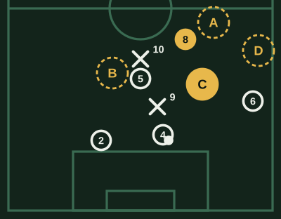
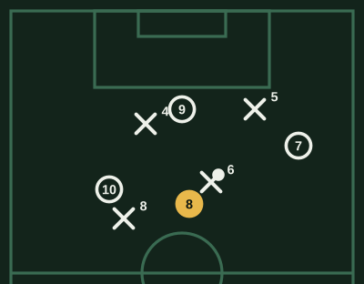
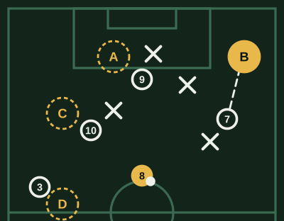
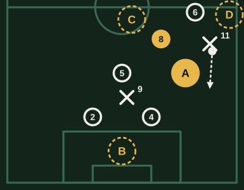

# Banco de Mediocentro (v2)

Revisado por Kevin Lopez el 2026-10-23.

64 preguntas. Cada examen toma 20, de todas las áreas y de las tres dificultades.

## Recepción y perfil

### MC-REC-01 · fácil

Antes de recibir un pase en el medio, ¿qué deberías hacer?

- [ ] Fijar la vista en la pelota desde que sale del pie del compañero
- [x] **Mirar alrededor para saber dónde están rivales y compañeros**
- [ ] Gritarle al que la tiene para que acelere el pase
- [ ] Quedarte quieto para que el pase te llegue justo

> Mirar antes de recibir (perfilarse con información) te deja decidir antes de que llegue el balón y jugar más rápido.

### MC-REC-02 · fácil

Recibes un pase del central y quieres jugar hacia adelante. ¿Cómo pones el cuerpo?

- [ ] De espaldas al arco rival, mirando al central para asegurar el control del pase
- [ ] De frente al arco rival, dándole la espalda al pase
- [x] **Abierto, de medio lado, viendo a la vez al central y la cancha rival**
- [ ] Agachado, para proteger la pelota con el cuerpo

> El perfil abierto te deja recibir y girar en un solo movimiento. De espaldas necesitas un toque más para darte vuelta.

### MC-REC-03 · fácil

Recibes con un rival pegado a tu espalda. ¿Qué es lo más seguro?

- [ ] Intentar girarte rápido para encarar antes de que el rival se acomode
- [ ] Hacerle un caño para salir jugando
- [ ] Pararla con la suela y esperar
- [x] **Proteger la pelota y jugar de cara hacia un compañero**

> Con presión a la espalda, girar es arriesgado. Una descarga de cara mantiene la pelota y da tiempo al equipo.

### MC-REC-04 · media

Recibes en el medio y no tienes a nadie cerca. ¿Qué te conviene en el primer control?

- [x] **Orientarlo hacia adelante para ganar metros y tiempo**
- [ ] Pararla del todo para pensar qué hacer
- [ ] Controlar hacia atrás, por si aparece un rival que no habías visto
- [ ] Dejarla correr hacia la banda

> Sin presión, el control orientado hacia adelante convierte el pase en avance; parar la pelota le da tiempo al rival para cerrarse.

### MC-REC-05 · media

El balón viene por la izquierda y quieres jugar hacia la derecha. ¿Con qué pie lo recibes?

- [ ] Con el izquierdo, el más cercano al pase, para que no se te escape
- [x] **Con el derecho, el más alejado, para abrir el juego de una**
- [ ] Con la suela de cualquiera de los dos
- [ ] Con el empeine del pie más cercano, para asegurar la posesión

> Recibir con el pie lejano acompaña la dirección del juego y te deja ya mirando hacia donde quieres ir.

### MC-REC-06 · media

Ves que el rival te va a presionar fuerte justo cuando recibas. ¿Qué haces?

- [ ] Controlar y esperar a que llegue, para driblarlo y dejarlo atrás
- [ ] Ir hacia la pelota más lento para darte tiempo
- [x] **Jugar a un toque hacia el compañero libre que ya viste**
- [ ] Pedir que te la pasen a otro lado

> Si sabes que la presión llega, el toque de primera la evita; para eso tuviste que mirar antes.

### MC-REC-07 · media

Tu central tiene el balón y un delantero rival tapa la línea de pase hacia ti. ¿Qué haces?

- [ ] Quedarte quieto y pedirla igual
- [ ] Bajar hasta ponerte al lado del central para recibir sin correr ningún riesgo
- [ ] Irte a la banda para dejar el centro libre
- [x] **Moverte unos metros para salir de la sombra del delantero**

> Un pequeño desplazamiento abre la línea de pase. Quedarte detrás del delantero es como no estar.

### MC-REC-08 · media

Recibes un pase largo y alto en el mediocampo. ¿Qué te ayuda a controlarlo?

- [x] **Ir hacia la pelota y amortiguarla con la superficie que deje mejor perfil**
- [ ] Esperar a que pique dos veces
- [ ] Controlarla de espaldas a la cancha rival, protegiéndola con el cuerpo del rival
- [ ] Rechazarla de cabeza hacia cualquier lado

> Atacar la pelota evita que el rival se adelante; elegir bien la superficie te deja seguir la jugada.

### MC-REC-09 · difícil

Recibes entre líneas, con un mediocampista rival cerrándote por la izquierda y un central rival delante. ¿Qué control tiene más sentido?

- [ ] Hacia la izquierda, para encarar al que cierra y dejarlo atrás en el camino al arco
- [x] **Orientado hacia la derecha, alejándote del que cierra y atacando el espacio**
- [ ] Hacia atrás, para devolverla al central
- [ ] Parado, protegiendo hasta que llegue ayuda

> Entre líneas el tiempo es mínimo: el control se orienta hacia donde no viene la presión para quedar de cara.

### MC-REC-10 · difícil

Antes de recibir, ves que un compañero hace un desmarque a la espalda de la defensa. ¿Qué cambia en cómo recibes?

- [ ] No cambia: primero controlas bien y después buscas al compañero que se desmarcó
- [x] **Te perfilas para poder dar el pase en profundidad con el primer o segundo toque**
- [ ] Te quedas de espaldas para proteger la pelota
- [ ] Pides el balón por alto para cabecearlo hacia él

> El desmarque dura un instante. Si ya lo viste, recibes en posición de pasarle rápido; si controlas sin pensar, llegas tarde.

## Pase y circulación

### MC-PAS-01 · fácil

Un compañero está cerca y otro más lejos, los dos libres. ¿Cuál suele ser más seguro?

- [ ] El pase largo, porque avanza más
- [ ] Cualquiera de los dos, da lo mismo
- [ ] Conducir tú mismo para no arriesgar el pase
- [x] **El pase corto al que está cerca**

> El pase corto tiene menos riesgo de error y de intercepción. El largo se elige cuando el premio lo justifica.

### MC-PAS-02 · fácil

¿Por qué conviene pasar al pie más lejano del rival de tu compañero?

- [x] **Para que pueda recibir protegiendo la pelota**
- [ ] Para que el pase vaya más fuerte
- [ ] Para que el rival no vea el pase
- [ ] Para que tu compañero tenga que estirarse

> El pase al pie lejano deja el cuerpo del receptor entre la pelota y el rival.

### MC-PAS-03 · fácil

El rival se amontonó por la izquierda y la derecha está libre. ¿Qué buscas?

- [ ] Seguir tocando por la izquierda
- [x] **Cambiar el juego hacia la derecha**
- [ ] Pasarla atrás al portero
- [ ] Patear al arco desde lejos

> Cuando el rival carga un lado, el cambio de orientación encuentra espacio y superioridad en el otro.

### MC-PAS-04 · media

La pelota circula de lado a lado sin avanzar y el rival está ordenado. ¿Qué la hace útil?

- [ ] Hacerla lenta para descansar
- [ ] Que cada pase sea hacia atrás
- [x] **Hacerla rápida para mover al rival y encontrar el hueco que se abre**
- [ ] Que vaya por el mismo carril, así el equipo no se desordena al perderla

> La circulación sirve si desordena: pases rápidos obligan al rival a moverse y aparecen espacios entre sus líneas.

### MC-PAS-05 · media

¿Qué significa jugar "a la espalda" de un mediocampista rival?

- [ ] Pasarla por encima de su cabeza hacia tu arco
- [ ] Pasarla por detrás de tu propio cuerpo
- [ ] Hacerle una pared a un compañero para quedar de frente al rival
- [x] **Pasar a un compañero ubicado detrás de él, superando su línea**

> Superar líneas con el pase es lo que hace avanzar al equipo: cada línea que queda atrás es un rival menos.

### MC-PAS-06 · media

Tu compañero está libre pero su marca está a dos metros. ¿Cómo debería ser el pase?

- [x] **Tenso y al pie, para que llegue antes que el rival**
- [ ] Bombeado, para que tenga tiempo de pensar qué hacer con ella
- [ ] Suave, para que no se le escape
- [ ] Al espacio, lejos de él

> Con un rival cerca, un pase lento le da tiempo de llegar. La tensión justa es parte de la precisión.

### MC-PAS-07 · media

Das un pase y te quedas quieto. ¿Qué pierde tu equipo?

- [ ] Poco, porque tu parte de la jugada ya la cumpliste al dar el pase
- [x] **Una opción de devolución o de apoyo para la siguiente jugada**
- [ ] Amplitud: el equipo se queda sin un jugador abierto en la banda
- [ ] El derecho a pedir la pelota de nuevo

> Pasar y moverte (para ofrecerte otra vez o arrastrar a un rival) mantiene viva la jugada.

### MC-PAS-08 · media

Tienes la pelota en tu campo y un delantero tuyo corre en diagonal a la espalda de la defensa. ¿Qué tienes que mirar?

- [ ] Que el delantero esté lejos de los defensores, para que no lo alcancen
- [ ] Que el portero rival esté en su línea
- [x] **Si la defensa rival está alta y si puedes pasar sin presión encima**
- [ ] Si el delantero ya levantó la mano para pedirla

> El pase en profundidad funciona contra una línea adelantada y con tiempo para darlo; con presión encima, el error es probable.

### MC-PAS-09 · difícil

Ganas 1 a 0, quedan 10 minutos y el rival presiona desordenado. ¿Qué tipo de circulación te conviene?

- [ ] Pelotazos al delantero para ganar tiempo
- [ ] Arriesgar pases entre líneas buscando el segundo gol para cerrar el partido
- [ ] Pasarla atrás al portero cada vez que te presionan
- [x] **Tener la pelota con pases seguros y buscar el espacio que deja su desorden**

> Con ventaja, la posesión segura gasta el tiempo y cansa al rival; su desorden deja huecos que puedes atacar sin riesgo.

### MC-PAS-10 · difícil

Recibes y ves tres opciones: atrás al central (libre), al costado al lateral (con marca cerca) y adelante al delantero (de espaldas, marcado). ¿Cómo decides?

- [ ] Adelante, aunque esté marcado: el delantero sabe aguantarla de espaldas
- [ ] Al lateral, porque las bandas son más seguras
- [ ] Conducir hacia adelante tú mismo
- [x] **La que avance con menos riesgo; si no hay una clara, al central**

> Avanzar es el objetivo, pero no a cualquier precio. Reiniciar con el central es una buena decisión cuando adelante no hay ventaja.

## Apoyos y ocupación de espacios

### MC-APO-01 · fácil

Un compañero tiene la pelota y está presionado. ¿Qué haces?

- [ ] Alejarte para no traer más rivales
- [ ] Pararte justo detrás del rival que lo presiona
- [ ] Pedirle que la patee lejos
- [x] **Acercarte en un ángulo que le dé una línea de pase libre**

> El apoyo cercano y con línea de pase limpia es la salida de un compañero en apuros.

### MC-APO-02 · fácil

Tu equipo tiene la pelota y tú y otro mediocampista están en la misma zona. ¿Qué conviene?

- [x] **Separarse para ocupar espacios distintos**
- [ ] Quedarse juntos para ayudarse
- [ ] Que los dos pidan la pelota a la vez
- [ ] Que ambos bajen a la altura de los centrales

> Dos jugadores en el mismo lugar se marcan con un solo rival. Repartirse estira al rival y crea opciones.

### MC-APO-03 · fácil

¿Qué es "dar amplitud" en ataque?

- [ ] Correr hacia la pelota en grupo para tener apoyos
- [x] **Tener jugadores abiertos cerca de las bandas**
- [ ] Pasar la pelota más fuerte
- [ ] Jugar en el centro de la cancha

> La amplitud obliga al rival a estirarse a lo ancho, y así se abren espacios por dentro.

### MC-APO-04 · media

El central tiene la pelota y la presión rival es alta. ¿Dónde te ofreces?

- [ ] Cerca del central y a su altura, para que tenga un pase corto y seguro a mano
- [ ] En la línea de los delanteros rivales, de espaldas
- [x] **Entre las líneas de presión rivales, en un hueco donde el central te vea**
- [ ] Lejos, en el área rival

> Aparecer en el hueco entre los presionadores ofrece un pase que supera esa primera línea.

### MC-APO-05 · media

El lateral de tu equipo sube por la banda. ¿Qué espacio puedes ocupar tú?

- [ ] La banda, junto al lateral, para hacer una pared y llegar al fondo
- [ ] El área rival, esperando el centro
- [ ] La posición del lateral, quedándote quieto
- [x] **El carril interior, por si hay que tocar por dentro o cubrir**

> Ocupar el carril interior da una opción de pase por dentro y deja equilibrio si se pierde la pelota.

### MC-APO-06 · media

Formas un triángulo con el lateral y el extremo. ¿Para qué sirve?

- [x] **Para que el que tiene la pelota tenga dos opciones de pase**
- [ ] Para defender mejor los córners
- [ ] Para que los tres ataquen el espacio a la vez y lleguen juntos al área
- [ ] Para que el rival no vea el balón

> Los triángulos dan siempre dos opciones al poseedor y hacen difícil que un solo rival tape los pases.

### MC-APO-07 · media

El delantero baja a pedir la pelota al mediocampo. ¿Qué movimiento tuyo lo complementa?

- [ ] Bajar también a pedirla, para darle una opción de pase cerca
- [x] **Atacar el espacio que dejó libre, hacia adelante**
- [ ] Quedarte en tu lugar mirando
- [ ] Irte a la banda contraria

> Si el delantero arrastra a su marca hacia atrás, queda un espacio adelante. Atacarlo es la jugada complementaria.

### MC-APO-08 · media

¿Por qué conviene no estar en la misma línea horizontal que tus compañeros cuando tienen la pelota?

- [ ] Porque así el equipo ocupa mejor el ancho de la cancha
- [ ] Porque así se defiende mejor
- [x] **Porque un solo rival puede cortar varios pases a la vez**
- [ ] Porque los pases horizontales son más lentos

> Estar escalonado crea líneas de pase en diagonal, que son más difíciles de tapar que las horizontales.

### MC-APO-09 · difícil

El rival defiende con dos líneas de cuatro muy juntas. ¿Dónde está el espacio más valioso para recibir?

- [ ] Delante de su primera línea, que es donde te dejan recibir con tiempo
- [ ] Pegado a la línea de fondo rival
- [ ] En tu propio campo, lejos de ellos
- [x] **Entre sus líneas, en los huecos entre un mediocampista y un defensor**

> Recibir entre líneas obliga al rival a decidir quién sale; cualquier duda abre un pase o un remate.

### MC-APO-10 · difícil

Tu equipo ataca por la derecha y tú eres el mediocampista del lado izquierdo. ¿Dónde te ubicas?

- [ ] Pegado a la banda izquierda, lo más abierto posible
- [ ] En el área rival, para rematar el centro
- [ ] Corriendo hacia la derecha para sumar gente cerca de la pelota y combinar en corto
- [x] **Cerca del centro y algo atrás, para el cambio de juego o cubrir una pérdida**

> El mediocampista del lado débil equilibra: ofrece el cambio de orientación y está listo si se pierde la pelota.

### MC-PIZ-01 · media

Tu central tiene el balón y al pivote lo tienen tapado. ¿Dónde te ofreces?

- [ ] A. Me quedo arriba, lejos, esperando que llegue
- [ ] B. Me pego al pivote para ayudarlo
- [x] **C. Bajo al costado del pivote, al espacio libre, de cara al juego**
- [ ] D. Me abro a la banda, pegado a la raya

> Con el pivote tapado, el mediocentro baja a dar una línea de pase libre al costado, de cara al juego. Lejos no ayuda; pegado al pivote, un solo rival los marca a los dos, y en la banda le quitas el lugar al lateral.

## Presión y recuperación

### MC-PRE-01 · fácil

Vas a presionar a un rival que tiene la pelota. ¿Cómo te acercas?

- [ ] A toda velocidad hasta chocar con él
- [ ] Despacio todo el tiempo, para no gastar energía ni pasarte de largo
- [x] **Rápido al principio y frenando al llegar, para no pasarte de largo**
- [ ] Por detrás, para que no te vea

> Llegar frenado y equilibrado evita que un amague te deje atrás.

### MC-PRE-02 · fácil

Al presionar, ¿qué buscas además de quitar la pelota?

- [ ] Ir derecho al balón, aunque quede abierto el pase hacia adentro
- [ ] Que el rival se canse de tener la pelota en su campo
- [ ] Apurarlo para que la pierda solo, aunque dejes libre a un compañero suyo
- [x] **Tapar un pase peligroso y llevarlo hacia donde tu equipo puede robar**

> Presionar bien es orientar: aunque no robes, cierras el pase más dañino y lo empujas hacia donde tu equipo puede recuperar.

### MC-PRE-03 · fácil

Tu equipo acaba de perder la pelota y tú estás cerca. ¿Qué haces primero?

- [x] **Presionar enseguida al que la tiene para intentar recuperar**
- [ ] Volver corriendo a tu posición para que el equipo quede ordenado
- [ ] Pedir falta al árbitro
- [ ] Esperar a ver qué hace el rival

> Los primeros segundos tras perder la pelota son los mejores para recuperarla: el rival todavía no se ordenó.

### MC-PRE-04 · media

Presionas solo a un rival y él tiene dos compañeros libres. ¿Qué pasa?

- [ ] Igual le robas si llegas rápido, porque no tiene tiempo de pensar el pase
- [x] **Te supera con un pase: la presión tiene que ser coordinada**
- [ ] El rival se pone nervioso y la pierde
- [ ] Tu equipo gana tiempo para ordenarse

> Una presión aislada se salta con un pase. Presiona con compañeros cerrando las opciones cercanas.

### MC-PRE-05 · media

El rival recibe de espaldas en el medio. ¿Qué momento es bueno para presionar?

- [ ] Cuando ya se giró y te mira de frente
- [ ] Cuando pasa la pelota
- [x] **Justo cuando controla, antes de que pueda girarse**
- [ ] Cuando ya levantó la cabeza para buscar un pase

> Un rival de espaldas tiene poca visión. Llegar en el control lo obliga a jugar hacia atrás o a perderla.

### MC-PRE-06 · media

Un compañero presiona al rival con la pelota. ¿Qué haces tú si estás cerca?

- [ ] Ir también encima del mismo rival
- [ ] Quedarte quieto para no estorbar
- [ ] Ir a buscar a un rival lejano
- [x] **Cerrar el pase más cercano de ese rival**

> La segunda línea de presión tapa las salidas; así el que presiona tiene más chances de robar.

### MC-PRE-07 · media

La pelota está en la banda y el rival tiene poco espacio. ¿Por qué es buen lugar para recuperarla?

- [x] **Porque la línea de banda funciona como un defensor más**
- [ ] Porque en la banda los rivales tienen más compañeros cerca
- [ ] Porque los rivales juegan peor por fuera
- [ ] Porque la pelota sale y el saque es tuyo

> Contra la banda el rival tiene menos opciones; encerrarlo ahí facilita el robo.

### MC-PRE-08 · media

¿Cuándo es mejor no salir a presionar y quedarte en tu posición?

- [ ] Cuando estás cansado y quieres descansar
- [x] **Cuando el rival tiene el balón lejos y salir dejaría un hueco a tu espalda**
- [ ] Cuando el rival es más alto y fuerte y te puede ganar el choque cuerpo a cuerpo
- [ ] Cuando tu equipo va ganando

> Presionar sin posibilidades reales de robar solo abre espacios. Esperar ordenado también es defender.

### MC-PRE-09 · difícil

Tu equipo presiona alto y el rival rompe la primera línea con un pase al medio. ¿Qué haces si eres el mediocampista más cercano?

- [ ] Retroceder hasta tu área
- [ ] Seguir presionando al central que dio el pase, para que no se la devuelvan
- [x] **Ir a ese receptor de inmediato para que no se gire**
- [ ] Esperar que los defensores salgan a buscarlo

> Cuando superan la presión, el que recibe en el medio es el peligro. Llegar rápido evita que quede de frente a tu defensa.

### MC-PRE-10 · difícil

Tu equipo presiona alto y te toca saltar sobre los centrales rivales, que salen abiertos desde el portero. ¿Qué trayectoria suele funcionar?

- [ ] Ir directo al portero en línea recta
- [ ] Esperar en la mitad de la cancha
- [x] **Ir a un central tapando el pase al otro, para llevar el juego a una banda**
- [ ] Ir al central más cercano en línea recta, lo más rápido posible para robarle

> Presionar en curva cierra el pase de vuelta; así el rival termina jugando hacia la banda, donde es más fácil recuperar.

### MC-PIZ-02 · media

Acaban de perder el balón y el 6 rival lo recoge a dos metros tuyo. ¿Qué haces?

- [ ] Retrocedo a mi posición antes de que salgan
- [ ] Le doy espacio y espero que se equivoque
- [ ] Me tiro al suelo para robarla de una
- [x] **Lo presiono enseguida, cerrándole el pase hacia el medio**

> Recién perdida, el rival todavía no está ordenado: el más cercano presiona en el acto y le cierra el pase al medio para que la tenga que jugar hacia la banda o hacia atrás. Barrerse a dos metros es regalarle la salida.

## Transiciones

### MC-TRA-01 · fácil

Tu equipo recupera la pelota y el rival está desordenado. ¿Qué buscas?

- [ ] Pasarla atrás para que el equipo se ordene
- [ ] Tenerla quieta para que el rival descanse
- [x] **Atacar rápido hacia adelante antes de que se ordene**
- [ ] Tirarla fuera para cambiar a los cansados

> El mejor momento para atacar es justo tras recuperar: el rival todavía no volvió a su posición.

### MC-TRA-02 · fácil

Tu equipo pierde la pelota en ataque y tú estás lejos de ella. ¿Qué haces?

- [ ] Quedarte arriba esperando el próximo ataque
- [ ] Caminar mientras los demás defienden
- [ ] Ir a presionar al portero rival
- [x] **Volver rápido a tu posición defensiva**

> Si no puedes presionar la pelota, recuperar tu posición evita que el rival te encuentre desordenado.

### MC-TRA-03 · fácil

Recuperas la pelota y un delantero tuyo arranca hacia el arco con espacio. ¿Qué haces?

- [x] **Darle el pase rápido, antes de que lo alcancen**
- [ ] Conducir unos metros para que llegue más gente
- [ ] Esperar a que el delantero vuelva por la pelota
- [ ] Pasarla al costado para asegurar

> En un contragolpe la ventaja dura segundos: el pase temprano la aprovecha.

### MC-TRA-04 · media

Tu equipo pierde la pelota y el rival arranca un contragolpe por el centro. Estás cerca pero no puedes robar. ¿Qué haces?

- [ ] Tirarte al piso para quitarle la pelota
- [x] **Retrasarlo, cerrar el pase por dentro y empujarlo hacia la banda**
- [ ] Dejarlo pasar y correr a tu área para ayudar a los defensores a cerrar
- [ ] Agarrarlo de la camiseta sin pensar en la tarjeta

> Si no puedes robar, ganar tiempo es la prioridad: cada segundo que retrasas es un compañero que vuelve.

### MC-TRA-05 · media

En un contragolpe de tu equipo, ¿dónde te conviene correr si no llevas la pelota?

- [ ] Detrás del que conduce, en su misma línea
- [ ] Hacia el que conduce, para pedírsela de cerca y que no tenga que arriesgar
- [x] **Por un carril distinto al del que conduce, para darle una opción de pase**
- [ ] Hacia atrás, para cubrir

> Correr por otro carril estira a la defensa y le da al poseedor la opción de pase o de seguir.

### MC-TRA-06 · media

Recuperas la pelota pero el rival se reorganizó rápido y no hay espacio. ¿Qué haces?

- [ ] Forzar el contragolpe igual
- [ ] Tirarla larga al delantero, que puede ganarle a su marca
- [ ] Patear al arco desde donde estés
- [x] **Asegurar la posesión y empezar un ataque elaborado**

> Si la ventaja desapareció, forzar el contragolpe regala la pelota. Mejor tenerla y atacar con orden.

### MC-TRA-07 · media

Hacer una falta táctica en la mitad de la cancha para cortar un contragolpe… ¿qué tienes que considerar?

- [x] **Si ya tienes amarilla y si la falta evita un ataque realmente peligroso**
- [ ] Que la falta conviene en cualquier contragolpe, porque frena el ataque de raíz
- [ ] Que es mejor hacerla en el área rival, lejos de tu arco
- [ ] Que sea lo más fuerte posible para que no se repita

> Una falta táctica puede salvar un gol, pero cuesta tarjeta y puede dejarte con uno menos si ya tenías amarilla.

### MC-TRA-08 · media

Tu equipo ataca con muchos jugadores arriba. ¿Qué haces para estar listo si se pierde la pelota?

- [ ] Sumarte al ataque para aumentar la presión y recuperar la pelota más arriba
- [x] **Ubicarte por detrás de la jugada para cortar el primer pase del rival**
- [ ] Quedarte en tu área
- [ ] Esperar en la banda

> Prepararse para la pérdida mientras atacas (vigilancia previa) hace que el contragolpe rival muera rápido.

### MC-TRA-09 · difícil

Recuperas en tu campo con 3 contra 3 por delante y un compañero llegando por detrás. ¿Qué decisión acelera la ventaja?

- [ ] Pasarla de inmediato al compañero que viene detrás
- [ ] Conducir hacia la banda para alejarte de los rivales
- [x] **Conducir hacia un defensor para fijarlo y soltar el pase cuando salga**
- [ ] Frenar hasta que lleguen más compañeros

> Conducir hacia un defensor lo obliga a decidir; cuando sale a ti, deja libre a un compañero. Es la forma de convertir igualdad en ventaja.

### MC-TRA-10 · difícil

Pierdes la pelota y la presión tras pérdida no funcionó: el rival ya pasó tu línea. ¿Cuál es la prioridad para el mediocampo?

- [ ] Perseguir al que conduce por donde vaya
- [ ] Quedarse arriba para el próximo contragolpe
- [x] **Volver por dentro, cerrando el centro y los pases a la espalda de la defensa**
- [ ] Abrirse a las bandas para cubrir los centros, que es por donde suele terminar

> Cuando la recuperación falla, el mediocampo protege el centro del campo y la zona delante de su área.

### MC-PIZ-04 · media

Recuperas en el medio y el 7 ya arrancó a la espalda de su lateral. ¿A quién se la das?

- [ ] A. Al pie del 9, de espaldas y con marca
- [x] **B. Al espacio, a la carrera del 7**
- [ ] C. Al 10, que tiene un rival encima
- [ ] D. Atrás, al lateral

> En la transición, la primera mirada es hacia adelante: el 7 ya ganó la espalda y el pase al espacio lo deja solo. El 9 y el 10 tienen marca; volver al lateral le da tiempo al rival para ordenarse.

## Equilibrio y vigilancias

### MC-EQU-01 · fácil

Juegan con doble mediocentro y tu compañero sube al ataque. ¿Qué haces tú?

- [ ] Subir también para sumar en el área
- [ ] Irte a una banda
- [x] **Quedarte un poco más atrás para dar equilibrio**
- [ ] Ponerte junto a los centrales

> Si los dos mediocampistas suben, el centro queda vacío ante una pérdida. Uno va y otro queda.

### MC-EQU-02 · fácil

Tu equipo defiende cerca de su área. ¿Dónde está tu zona habitual?

- [ ] Dentro del área chica
- [ ] En la mitad de la cancha, esperando el contragolpe para salir rápido
- [ ] Pegado a la banda
- [x] **Delante de la defensa, protegiendo la zona del borde del área**

> El mediocampista protege la zona frente al área: ahí nacen los remates de media distancia y los pases filtrados.

### MC-EQU-03 · fácil

¿Qué significa "tener equilibrio" en el equipo?

- [x] **Que al atacar queden jugadores bien parados para defender una pérdida**
- [ ] Que el equipo reparta la pelota y cada jugador toque una cantidad parecida
- [ ] Que cada jugador corra más o menos lo mismo
- [ ] Que el equipo juegue igual por las dos bandas

> El equilibrio es pensar en la pérdida mientras atacas: gente bien parada para frenar el contragolpe.

### MC-EQU-04 · media

El mediapunta rival se ubica entre tus mediocampistas y tus defensores. ¿Qué haces?

- [ ] Dejarlo libre porque no es tu marca y los centrales lo tienen de frente
- [x] **Vigilarlo de cerca y avisar a los defensores si se mueve**
- [ ] Subir a presionar a sus defensores
- [ ] Pegarte a tu central

> El jugador entre líneas es el más peligroso: si recibe de frente, ataca a tu defensa.

### MC-EQU-05 · media

Tu lateral subió y tu equipo pierde la pelota por su lado. ¿Qué haces si eres el mediocampista más cercano?

- [ ] Ir al área a esperar el centro
- [ ] Gritarle al lateral para que vuelva
- [x] **Cubrir la zona que dejó libre hasta que vuelva**
- [ ] Quedarte en el centro mirando

> Las coberturas entre líneas mantienen al equipo compacto mientras el que subió recupera su lugar.

### MC-EQU-06 · media

Tu equipo defiende y la pelota está en la banda contraria a la tuya. ¿Dónde te ubicas?

- [ ] En tu banda, lejos de la jugada
- [ ] En el área rival, por si recuperan
- [ ] Junto a la pelota, presionando con tus compañeros para robar rápido
- [x] **Corrido hacia el centro y hacia la pelota, achicando espacios**

> Al defender, el equipo se junta hacia el lado del balón. El lado lejano importa menos que cerrar el centro.

### MC-EQU-07 · media

Un rival llega desde atrás hacia el área sin que nadie lo siga. ¿Quién suele tener que tomarlo?

- [x] **El mediocampista, que lo acompaña en su carrera**
- [ ] El portero, saliendo del área
- [ ] El central, dejando a su delantero
- [ ] El que esté más cerca, aunque sea un defensor

> Las llegadas de segunda línea son responsabilidad del mediocampo; si las toma un central, deja libre a su delantero.

### MC-EQU-08 · media

Tu equipo tiene la pelota y tú eres el mediocampista más retrasado. ¿Qué cuidas?

- [ ] Llegar al área para rematar
- [x] **Estar listo para cortar el contragolpe por el centro**
- [ ] Pedir la pelota en cada jugada
- [ ] Ir a la banda para dar amplitud

> El mediocampista más retrasado es el primer freno del contragolpe; su posición pesa más que su participación en el ataque.

### MC-EQU-09 · difícil

Ganas 1 a 0 y el rival mete un delantero más. ¿Qué ajuste suele tener sentido para ti?

- [ ] Subir para presionar más arriba
- [ ] Marcar al nuevo delantero dentro del área
- [x] **Jugar más cerca de los centrales para proteger el centro y los rechazos**
- [ ] Seguir igual, porque el planteo ya te tiene ganando y cambiar puede confundir

> Si el rival carga el área, acortar la distancia con la defensa evita el espacio entre líneas y gana los segundos balones.

### MC-EQU-10 · difícil

Tu equipo ataca con los dos laterales arriba. ¿Qué estructura conviene dejar atrás contra dos delanteros rivales?

- [ ] Solo los dos centrales, uno contra uno, para tener más gente en el ataque
- [ ] Los dos centrales pegados al portero
- [x] **Los dos centrales y un mediocampista cerca, para tener tres contra dos**
- [ ] Un central y el portero adelantado

> Con tres atrás contra dos delanteros hay superioridad para la vigilancia: uno puede anticipar mientras los otros cubren.

### MC-PIZ-03 · difícil

Tu lateral derecho subió y perdieron el balón: el extremo rival arranca solo por la banda. ¿Dónde te ubicas?

- [x] **A. Cierro en diagonal hacia la banda para frenarlo mientras vuelve el lateral**
- [ ] B. Me meto al área a esperar el centro
- [ ] C. Me quedo en mi lugar, en el medio
- [ ] D. Lo persigo desde atrás

> Lo que equilibra es frenar al que lleva el balón desde adentro y en diagonal: no lo dejas entrar al centro y le das tiempo al lateral para volver. Perseguirlo desde atrás llega tarde; quedarte o meterte al área le deja toda la banda.
