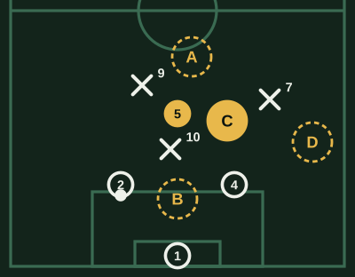
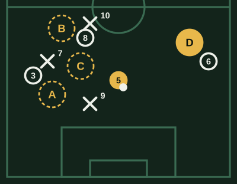
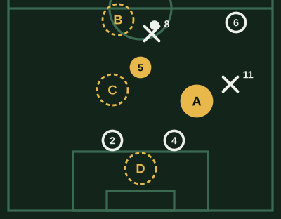
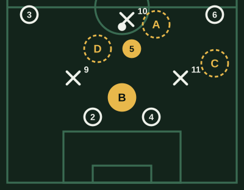

# Banco de Pivote (v1)

Revisado por Kevin Lopez el 2026-10-23.

64 preguntas. Cada examen toma 20, de todas las áreas y de las tres dificultades.

## Posición y perfil

### MCD-POS-01 · fácil

Tu equipo tiene el balón en los centrales. ¿Dónde te ubicas?

- [ ] Al lado de un central, en su misma línea
- [x] **Delante de ellos, en una línea de pase libre**
- [ ] Arriba, cerca del 9, para recibir de espaldas
- [ ] Abierto cerca de la banda, para dar amplitud

> Delante de los centrales y sin un rival en el medio, eres el pase que hace avanzar al equipo. En su misma línea no ganas nada, arriba recibes de espaldas, y abierto le quitas al equipo el pase por el centro.

### MCD-POS-02 · fácil

Vas a recibir un pase en el medio. ¿Qué haces antes de que llegue?

- [ ] Miro al compañero que me la va a dar
- [ ] Miro solo el balón para controlarlo bien
- [x] **Miro por encima del hombro**
- [ ] Me acerco al balón para que no me lo anticipen

> Mirar antes te dice dónde están los rivales y los compañeros: así sabes hacia dónde controlar. Si solo miras el balón, lo descubres tarde.

### MCD-POS-03 · fácil

¿Cómo te conviene recibir del central?

- [ ] De espaldas al arco rival, mirando al central
- [ ] De frente al central, para asegurar el control
- [ ] De costado, mirando hacia la banda
- [x] **Perfilado, con el cuerpo abierto hacia adelante**

> Perfilado ves el campo y puedes jugar hacia adelante con un toque. De espaldas o de frente al central, cualquier presión te obliga a devolverla.

### MCD-POS-04 · media

El 10 rival se pone a tu espalda para tapar el pase desde los centrales. ¿Qué haces?

- [x] **Me muevo para quedar fuera de su sombra**
- [ ] Me quedo quieto, el central igual me la puede dar
- [ ] Le pido al central que la tire por encima del 10
- [ ] Me voy arriba a presionar a su pivote

> Si un rival te tapa, el central no tiene pase: un par de pasos al costado te deja libre. Quedarte quieto es quedar marcado aunque no te toque.

### MCD-POS-05 · media

Los laterales de tu equipo suben al ataque al mismo tiempo. ¿Dónde te ubicas?

- [ ] Más arriba, para sumarme al ataque
- [x] **Más atrás, cerca de los centrales**
- [ ] Abierto en una banda, para tapar una de las subidas
- [ ] En el medio, a la misma altura que antes

> Con los dos laterales arriba, atrás quedan solo los centrales. El pivote se acerca a ellos para que una pérdida no deje un contragolpe tres contra dos.

### MCD-POS-06 · media

El rival presiona con dos delanteros a tus centrales. ¿Qué te conviene?

- [ ] Quedarme arriba para recibir el pase largo
- [ ] Pegarme a un delantero rival para marcarlo
- [x] **Bajar entre los centrales**
- [ ] Abrirme a la banda para que salgan por fuera

> Contra dos delanteros, si bajas entre los centrales quedan tres contra dos y alguien sale libre. Arriba o en la banda no ayudas a superar esa presión.

### MCD-POS-07 · media

Tu equipo ataca por la banda derecha. ¿Dónde se ubica el pivote?

- [ ] En la banda derecha, al lado del balón
- [ ] En la banda izquierda, para el cambio de frente
- [ ] Arriba, en la puerta del área rival
- [x] **Detrás del balón, corrido hacia ese lado**

> Cerca del balón pero detrás de él, das una salida hacia atrás, puedes cambiar el juego y quedas en tu lugar si se pierde.

### MCD-POS-08 · media

Te marcan muy de cerca cada vez que recibes. ¿Qué cambias?

- [x] **Juego a uno o dos toques**
- [ ] Me alejo hacia la banda para recibir solo
- [ ] Intento girar más rápido con el balón
- [ ] Bajo a recibir más atrás, lejos de la marca

> Si te marcan encima, el tiempo para controlar es corto: tocar rápido mueve el balón antes de que llegue. Alejarte hacia la banda o bajar más le quita al equipo su salida por el medio.

### MCD-POS-09 · difícil

El 9 rival se queda cerca de ti cuando tu equipo sale. ¿Qué genera eso?

- [ ] Que tengo que bajar más para recibir
- [x] **Un central libre para conducir**
- [ ] Que nuestro 9 queda libre arriba
- [ ] Que el arquero tiene que sacar largo

> Si el 9 te marca a ti, uno de tus centrales queda sin presión: puede conducir hacia adelante y romper la primera línea. Tu marca también ayuda al equipo.

### MCD-POS-10 · difícil

El rival defiende con dos delanteros muy juntos y el centro tapado. ¿Dónde puede estar la salida?

- [ ] Por el centro igual, con paredes cortas
- [x] **Por fuera, buscando a los laterales**
- [ ] Con pases largos a la espalda de su defensa
- [ ] Con el arquero, reiniciando desde atrás

> Si el rival cierra el medio, deja espacio afuera: los laterales reciben con tiempo. Insistir por el centro es jugar donde el rival quiere.

### MCD-PIZ-01 · media

El central tiene el balón y el 10 rival te tapa por detrás. ¿Dónde te ofreces?

- [ ] A. Donde estoy, detrás del 10
- [ ] B. Bajo entre los centrales
- [x] **C. Un par de pasos al costado**
- [ ] D. Me voy a la banda

> El 10 te tapa la línea de pase: un par de pasos al costado te deja libre y de cara. Arriba o en la banda no eres opción para el central.

## Salida de balón

### MCD-SAL-01 · fácil

Recibes del central sin presión y con espacio por delante. ¿Qué haces?

- [ ] La devuelvo al central enseguida
- [ ] Pateo largo a la espalda de la defensa
- [ ] Juego de primera al lateral
- [x] **Conduzco unos metros y busco el pase**

> Sin presión, conducir atrae a un rival y libera a un compañero. Devolverla sin necesidad o rifarla desperdicia la ventaja.

### MCD-SAL-02 · fácil

Te presionan por la espalda cuando recibes. ¿Qué haces?

- [x] **Juego de primera hacia el que está libre**
- [ ] Me giro para encarar al rival
- [ ] Freno el balón y lo protejo
- [ ] La saco larga hacia adelante

> Con un rival a la espalda, girar es arriesgado. El pase de primera al compañero libre saca la presión sin perderla.

### MCD-SAL-03 · fácil

El arquero tiene el balón y quiere salir jugando. ¿Qué haces?

- [ ] Me voy arriba para que saque largo
- [x] **Me ofrezco libre, entre o delante de los centrales**
- [ ] Me pego a un central para pedirla corta
- [ ] Me abro a la banda para dejarle el centro

> Para salir jugando, el arquero necesita pases: el pivote libre es la opción más segura por el centro.

### MCD-SAL-04 · media

Recibes y ves que el lateral del otro lado está solo. ¿Qué haces?

- [ ] Juego corto al central de mi lado
- [ ] Conduzco hacia la banda donde estoy
- [x] **Cambio de frente hacia él**
- [ ] Pase al 9, de espaldas y marcado

> El lado contrario está libre porque el rival se cargó de tu lado: el cambio de frente lo aprovecha antes de que se reacomode.

### MCD-SAL-05 · media

El rival presiona alto y te cierra la salida por dentro. ¿Qué buscas?

- [ ] Girar por dentro igual
- [ ] Un pase largo al 9
- [ ] Devolverla al arquero para empezar de nuevo
- [x] **Abrir el juego hacia los laterales**

> Si te cierran por dentro, el espacio está afuera: jugar con los laterales supera la presión. Forzar por el medio es perderla cerca del arco.

### MCD-SAL-06 · media

Un central tuyo conduce con espacio. ¿Qué haces?

- [x] **Me muevo para dejarle libre el pase hacia adelante**
- [ ] Me acerco a pedírsela
- [ ] Me quedo delante de él para la pared
- [ ] Bajo a su lado por si la pierde

> Si el central conduce, tu movimiento le abre el pase o arrastra a un rival. Acercarte a pedirla o quedarte en su camino lo frena.

### MCD-SAL-07 · media

Te llega el balón mal, botando, con un rival cerca. ¿Qué haces?

- [ ] Intento un control orientado para salir jugando
- [x] **Lo aseguro con un toque y juego simple**
- [ ] Le pego de volea hacia adelante
- [ ] La paro con el pecho y giro

> Un balón difícil con presión no es para arriesgar: asegurarlo y jugar simple mantiene la posesión.

### MCD-SAL-08 · media

El rival marca a tus centrales y deja al arquero libre. ¿Qué haces?

- [ ] Le pido al arquero que saque largo
- [ ] Me voy arriba para estirar al rival
- [x] **Me ofrezco al arquero**
- [ ] Me pego a un central para que me la dé

> Si el rival deja libre al arquero, él es un jugador más en la salida: con el pivote ofrecido, forman un rombo que supera la presión.

### MCD-SAL-09 · difícil

Recibes entre los centrales y el rival salta a presionarte con un delantero. ¿Qué queda libre?

- [ ] El 9 de mi equipo, que baja a recibir
- [ ] El lateral de mi equipo de ese lado
- [ ] El otro central, el más lejano
- [x] **El central de ese lado**

> Si el delantero rival salta sobre ti, deja de marcar a un central: ese central es tu pase. Leerlo te saca de la presión con un toque.

### MCD-SAL-10 · difícil

Ganan 1-0, queda poco y recibes con presión cerca de tu área, sin un pase claro. ¿Qué haces?

- [ ] Intento salir jugando corto entre los rivales
- [ ] Giro para encarar
- [ ] La devuelvo al arquero
- [x] **La saco lejos, hacia una banda**

> Con el resultado a favor y sin pase claro, perderla cerca de tu área cuesta el partido: alejarla hacia una banda lo evita. Devolverla al arquero con la presión encima es otro riesgo.

### MCD-PIZ-02 · media

Recibes en el medio y el rival cargó todo hacia tu izquierda. ¿A quién se la das?

- [ ] A. Al 3, con el 7 encima
- [ ] B. Al 8, con el 10 cerca
- [ ] C. Conduzco hacia la izquierda
- [x] **D. Cambio de frente al 6**

> El rival se cargó a tu izquierda: el 6 del otro lado está solo. El cambio de frente lo aprovecha antes de que basculen; a la izquierda todos tienen marca.

## Pase y circulación

### MCD-PAS-01 · fácil

Tienes dos opciones: un pase corto seguro o uno largo arriesgado. El partido está empatado y el rival ordenado. ¿Qué eliges?

- [ ] El largo, para sorprender
- [ ] Conduzco hacia adelante a buscar el hueco
- [ ] El largo, que si sale nos deja de cara al arco
- [x] **El corto seguro**

> Contra un rival ordenado, el pase largo arriesgado suele terminar en pérdida. El corto mantiene el balón hasta que aparezca un hueco.

### MCD-PAS-02 · fácil

Un compañero te pide el balón al pie y otro pica al espacio libre. ¿A quién se la das?

- [x] **Al que pica al espacio**
- [ ] Al que la pide al pie, que es más seguro
- [ ] Me la quedo y conduzco
- [ ] Atrás al central

> El que pica al espacio libre puede quedar de frente al arco. Si el pase es posible, es la opción que más daño hace.

### MCD-PAS-03 · fácil

¿A qué pie de tu compañero le das el pase?

- [ ] Al pie más cercano a mí
- [x] **Al pie lejos de su marca**
- [ ] Al medio de los dos pies
- [ ] Al de su pierna buena

> Al pie lejano del rival, tu compañero recibe protegido y puede girar. Al pie cercano al rival, se la regalas a su marca.

### MCD-PAS-04 · media

Tu equipo tiene el balón pero el rival está bien cerrado. ¿Qué buscas con la circulación?

- [ ] Pases largos a la espalda para que retrocedan
- [ ] Conducir por el centro hasta encontrar un hueco
- [x] **Moverlo rápido de un lado al otro para abrir huecos**
- [ ] Retenerlo atrás sin arriesgar

> Contra un bloque cerrado, la circulación rápida obliga al rival a correr de lado a lado: así aparecen los espacios.

### MCD-PAS-05 · media

Das un pase y quedas libre. ¿Qué haces?

- [ ] Me quedo en mi lugar para no desordenarme
- [ ] Corro al área a esperar el centro
- [ ] Vuelvo entre los centrales
- [x] **Me muevo para ofrecerme otra vez**

> El pase no termina tu jugada: moverte le da al compañero otra opción, y así el balón circula.

### MCD-PAS-06 · media

El 10 de tu equipo está entre líneas y libre, pero hay un rival en el camino del pase. ¿Qué haces?

- [x] **Conduzco un paso para abrir el ángulo**
- [ ] Le doy el pase fuerte, por el costado del rival
- [ ] Le pido que se mueva hacia mí
- [ ] Busco otra opción hacia atrás

> Un paso con el balón cambia el ángulo y abre la línea de pase. Pasar contra el rival es regalarla; ir atrás desperdicia al 10 libre.

### MCD-PAS-07 · media

Vas a cambiar de frente con un pase largo. ¿Cómo debe llegar?

- [ ] Bombeado, para que pase por encima de la presión
- [x] **Tenso, que llegue rápido**
- [ ] Raso y suave, para que lo controle fácil
- [ ] Al espacio, lejos del compañero

> El cambio de frente sirve si llega antes que el rival que bascula: un pase tenso gana ese tiempo. Uno bombeado le da al rival tiempo de llegar.

### MCD-PAS-08 · media

Recibes y el pase vertical está cerrado. ¿Qué haces?

- [ ] Fuerzo el pase vertical igual
- [ ] Me quedo con el balón hasta que se abra
- [x] **Juego al costado y me ofrezco**
- [ ] Giro y conduzco hacia adelante

> Si el pase vertical está cerrado, mover el balón de lado cambia la posición del rival y puede abrirlo después.

### MCD-PAS-09 · difícil

El rival presiona empujándote hacia tu izquierda, y su extremo del otro lado se cierra para tapar al 8. ¿Dónde está el espacio?

- [ ] En el lado izquierdo, donde está el balón
- [ ] En el centro, donde se cerró su extremo
- [ ] A la espalda de su defensa, con un pase largo
- [x] **En mi lateral derecho, que quedó solo**

> Si te empujan a la izquierda y su extremo se cierra por dentro, tu lateral derecho queda sin marca: llegar a él rápido, directo o en dos pases, supera la presión. El centro es justo lo que tapó el extremo.

### MCD-PAS-10 · difícil

Ves que el volante rival se adelanta cada vez que tus centrales tienen el balón. ¿Qué aprovechas?

- [ ] Que puedo presionarlo yo
- [ ] Que el central puede conducir por su lado
- [ ] Que el 9 puede bajar a recibir
- [x] **El espacio que deja a su espalda**

> Si el volante salta, deja un hueco a su espalda: un pase entre líneas a ese espacio supera dos líneas de presión.

## Coberturas y vigilancias

### MCD-COB-01 · fácil

Tu lateral sube al ataque. ¿Qué haces?

- [ ] Subo con él para ayudar
- [ ] Me quedo en el centro, delante de los centrales
- [ ] Bajo a la línea de los centrales
- [x] **Me corro hacia su lado**

> Cuando el lateral sube, su espacio queda libre: el pivote se corre hacia ese lado, sin dejar el medio, para tapar el contragolpe.

### MCD-COB-02 · fácil

Tu equipo ataca y tú te quedas atrás. ¿A quién vigilas?

- [x] **Al rival que podría recibir el contragolpe por el medio**
- [ ] Al que tiene el balón, para presionarlo
- [ ] Al 9 rival, que está con mis centrales
- [ ] Al delantero rival más alejado del balón

> Mientras el equipo ataca, el pivote vigila al rival que quedó adelante para que, si se pierde, no reciba solo.

### MCD-COB-03 · fácil

Un central sale a cortar al medio y deja su lugar. ¿Qué haces?

- [ ] Salgo con él a presionar
- [x] **Bajo a cubrir su espacio**
- [ ] Me quedo en mi lugar, delante de la defensa
- [ ] Le pido al lateral que se cierre

> Si un central sale, el pivote baja a su lugar hasta que vuelva: así la defensa no queda con un hueco.

### MCD-COB-04 · media

El 10 rival se mueve entre tus líneas, a tu espalda. ¿Qué haces?

- [ ] Lo sigo pegado adonde vaya, para que no reciba
- [ ] Se lo dejo a los centrales y cuido el medio
- [x] **Lo tengo vigilado y salto cuando recibe**
- [ ] Me alejo para presionar arriba

> Entre líneas el 10 es peligroso, pero perseguirlo a todos lados te saca del centro. Vigilarlo y saltar cuando recibe lo deja sin tiempo.

### MCD-COB-05 · media

El balón está en una banda y tu equipo defiende. ¿Dónde te ubicas?

- [ ] En el centro, sin correrme con el balón
- [ ] En la banda contraria
- [ ] Entre los centrales
- [x] **Corrido hacia el balón, cerrando por dentro**

> Con el balón en una banda, el pivote se corre hacia ese lado para cerrar el pase por dentro, que es el más peligroso.

### MCD-COB-06 · media

El otro volante central de tu equipo salió a presionar arriba. ¿Qué haces?

- [x] **Me quedo a cubrir su espacio**
- [ ] Salgo también a presionar con él
- [ ] Marco pegado al 10 rival
- [ ] Bajo a la línea de los centrales

> Si un volante salta, el otro equilibra: quedarte cubre el hueco a su espalda. Si salen los dos, el medio queda vacío.

### MCD-COB-07 · media

El rival va a centrar desde la banda. ¿Dónde te ubicas?

- [ ] En el área chica, con los centrales
- [x] **En la puerta del área, por el rechazo**
- [ ] En la banda, para tapar el centro antes de que salga
- [ ] En la mitad de la cancha

> El rechazo de un centro cae en la puerta del área: el pivote ahí lo gana o lo bloquea antes de que un rival patee.

### MCD-COB-08 · media

Un rival corre libre a la espalda del otro volante central de tu equipo. ¿Qué haces?

- [ ] Le aviso al otro volante y sigo en mi zona
- [ ] Corro a presionar al que tiene el balón
- [x] **Lo tomo yo y aviso**
- [ ] Bajo a cubrir delante de los centrales

> Si un rival entra libre por tu zona, lo tomas y avisas. Esperar a que vuelva tu compañero le da tiempo de recibir solo.

### MCD-COB-09 · difícil

Tu equipo ataca con muchos jugadores y el rival deja dos delanteros arriba. ¿Qué haces?

- [ ] Me sumo al ataque, hay suficientes atrás
- [ ] Marco a uno solo de los delanteros
- [ ] Me voy a la banda por el rechazo
- [x] **Me quedo con los centrales**

> Con dos delanteros rivales arriba, los centrales solos quedan dos contra dos. El pivote suma uno y, si se pierde, hay superioridad atrás.

### MCD-COB-10 · difícil

Ganan 1-0 y el rival ataca con su 10 entre líneas. ¿Qué cuidas sobre todo?

- [ ] Que no reciba en su campo
- [ ] Que no centre desde la banda
- [ ] Que no reciba de espaldas
- [x] **Que no gire cerca del área**

> El 10 de cara en la puerta del área es el peligro más grande: puede patear o filtrar. Cerrarle ese espacio es la prioridad del pivote.

### MCD-PIZ-03 · media

Tu lateral derecho subió y perdieron el balón. ¿Dónde te ubicas?

- [x] **A. Me corro a la derecha**
- [ ] B. Voy a presionar al 8
- [ ] C. Me quedo en el centro
- [ ] D. Me meto entre los centrales

> Con el lateral arriba, el 11 rival quedó libre en esa banda: corriéndote hacia ese lado, delante del central, cortas el pase o frenas al 11.

## Recuperación y duelos

### MCD-REC-01 · fácil

Un rival conduce hacia ti por el medio. ¿Qué haces?

- [ ] Me tiro al piso a quitársela
- [x] **Lo espero perfilado**
- [ ] Retrocedo hasta la línea de los centrales
- [ ] Salgo rápido a quitársela

> Perfilado y cerrando el pase, lo frenas sin regalarle la espalda. Tirarte al piso en el medio, si fallas, deja a la defensa expuesta.

### MCD-REC-02 · fácil

Un rival recibe de espaldas en el medio. ¿Qué haces?

- [ ] Le dejo espacio y espero que intente girar
- [ ] Me pego mucho para robarla
- [x] **Me acerco para que no gire**
- [ ] Tapo el pase a su compañero más cercano

> De espaldas no es peligroso si no gira: acercarte lo obliga a jugar hacia atrás. Pegarte mucho para robarla suele terminar en falta o en que te gire.

### MCD-REC-03 · fácil

Hay un balón dividido en el medio. ¿Qué haces?

- [ ] Espero a ver qué hace el rival
- [ ] Me tiro al piso para llegar antes
- [ ] Pongo el pie de costado, sin fuerza
- [x] **Llego con el cuerpo entre el rival y el balón**

> En el dividido gana el que pone el cuerpo entre el rival y el balón: así lo protege aunque llegue al mismo tiempo. Tirarte al piso, si llegas tarde, es falta y te deja afuera.

### MCD-REC-04 · media

El rival contraataca y tú eres el único entre él y tus centrales. ¿Qué haces?

- [x] **Retrocedo frenándolo hasta que lleguen ayudas**
- [ ] Salgo a quitársela de una
- [ ] Salgo a cortar el pase al que lo acompaña
- [ ] Retrocedo hasta mi área sin frenarlo

> Si sales y fallas, el rival queda solo contra los centrales. Frenarlo y ganar tiempo deja volver al equipo.

### MCD-REC-05 · media

Recuperas el balón en el medio con un rival cerca. ¿Qué haces primero?

- [ ] Intento un pase largo enseguida
- [x] **Un pase seguro al compañero libre**
- [ ] Conduzco entre los rivales
- [ ] La protejo hasta que llegue un apoyo

> Recién recuperado, lo primero es no perderla: un pase simple asegura la posesión y después se busca el ataque.

### MCD-REC-06 · media

El volante rival te supera con una gambeta. ¿Qué haces?

- [ ] Me tiro de atrás a recuperarla
- [ ] Me quedo donde estoy
- [x] **Vuelvo por dentro, hacia mi arco**
- [ ] Corro detrás de él por su mismo camino

> Superado, vuelves por dentro para cerrarle el camino al arco y ayudar a los centrales. Tirarte de atrás es falta y suele ser tarjeta.

### MCD-REC-07 · media

Un rival alto gana todos los balones aéreos en el medio. ¿Qué haces?

- [ ] Salto igual con él cada vez
- [ ] Salto antes que él para molestarlo
- [ ] Le dejo el duelo a un central
- [x] **Voy al rebote de su cabezazo**

> Si no le ganas arriba, gana la segunda pelota: ubicarte donde cae el cabezazo recupera el balón sin pelear el duelo.

### MCD-REC-08 · media

El rival le pasa a su 10 entre líneas y no llegas a cortar el pase. ¿Qué haces?

- [x] **Me acerco a presionar su control**
- [ ] Espero a que controle para robarla con más seguridad
- [ ] Me tiro al piso a cortar
- [ ] Se lo dejo a los centrales

> Si no llegas al pase, lo que queda es que no gire: presionar su control lo obliga a jugar de espaldas. Esperar le da tiempo, y tirarte al piso tarde es falta o te deja afuera.

### MCD-REC-09 · difícil

Ya tienes tarjeta amarilla y el rival te encara en el medio. ¿Qué haces?

- [ ] Le entro fuerte igual, a ganar el balón
- [x] **Defiendo de pie, sin entradas arriesgadas**
- [ ] Me alejo y se lo dejo a un central
- [ ] Le hago falta antes de que arranque

> Con amarilla, una entrada arriesgada puede dejar al equipo con diez. Defender de pie y acompañar sigue sirviendo sin ese riesgo.

### MCD-REC-10 · difícil

El rival juega muchos balones largos a su 9 y él los baja de pecho. ¿Qué haces?

- [ ] Me quedo lejos, es trabajo de los centrales
- [x] **Me quedo cerca del 9 para ganar la descarga**
- [ ] Salto con el 9 para molestarlo
- [ ] Presiono al que tira el pelotazo

> Si el 9 baja el balón para un compañero, la descarga es el momento de robar: cerca de él la ganas antes de que juegue.

## Transiciones

### MCD-TRA-01 · fácil

Tu equipo pierde el balón en campo rival. ¿Qué haces?

- [ ] Voy a presionar arriba con los delanteros
- [ ] Me quedo arriba por si la recuperamos
- [x] **Me ubico delante de los centrales para cortar el contragolpe**
- [ ] Bajo a la línea de los centrales

> Tras la pérdida, el pivote es el primer freno por el centro: delante de los centrales corta el pase o frena al que conduce.

### MCD-TRA-02 · fácil

Recuperas el balón en el medio y el rival está desordenado. ¿Qué haces?

- [ ] Freno y espero que se ordene el equipo
- [ ] La aseguro con un pase al lateral
- [ ] Busco al central
- [x] **Paso rápido hacia adelante**

> Con el rival desordenado, el primer pase hacia adelante lanza el contragolpe antes de que se reacomode.

### MCD-TRA-03 · fácil

Pierden el balón y el rival que la tiene está cerca de ti. ¿Qué haces?

- [x] **Lo presiono enseguida**
- [ ] Vuelvo a mi posición
- [ ] Retrocedo a cerrar el centro
- [ ] Espero que llegue un compañero para ir los dos

> El más cercano presiona al instante: el rival todavía no está ordenado y la puede perder.

### MCD-TRA-04 · media

Contragolpe rival dos contra dos con tus centrales. Vienes desde atrás. ¿A quién vas?

- [ ] Al que no tiene el balón
- [x] **Al que tiene el balón**
- [ ] Me ubico en el área chica
- [ ] Me quedo detrás de los centrales, de libre

> Si llegas, tomas al del balón y liberas a un central para marcar al otro. Así se arma el tres contra dos.

### MCD-TRA-05 · media

Recuperan el balón y tú lo recibes con espacio. ¿Qué miras primero?

- [ ] Si puedo conducir hasta el área
- [ ] Dónde está el central de mi equipo
- [x] **Si hay un compañero libre adelante para el pase rápido**
- [ ] Si el rival que me sigue está cerca

> En la transición, la mirada va adelante: un compañero libre arriba es el contragolpe. Si no está, se juega simple.

### MCD-TRA-06 · media

Pierden el balón y los dos laterales están arriba. ¿Qué haces?

- [ ] Voy a presionar al que la tiene
- [ ] Cubro solo una banda
- [ ] Me quedo en el medio
- [x] **Bajo entre los centrales**

> Con los laterales arriba, atrás quedan dos: el pivote entra entre ellos y la defensa tiene tres para el contragolpe.

### MCD-TRA-07 · media

Recuperas, pero el rival ya está ordenado atrás. ¿Qué haces?

- [x] **Aseguro el pase y armamos**
- [ ] Pase largo a la espalda
- [ ] Conduzco en velocidad
- [ ] Pateo de lejos

> El contragolpe sirve si el rival está desordenado. Si ya está ordenado, forzarlo es perder el balón: toca asegurar el pase y armar.

### MCD-TRA-08 · media

El rival pierde el balón y tu delantero lo recupera arriba. ¿Qué haces?

- [ ] Me quedo atrás, por si la pierde
- [x] **Le doy un apoyo cerca**
- [ ] Corro al área rival
- [ ] Me abro a la banda

> Tu delantero recuperó lejos de su equipo: necesita un apoyo cerca para no perderla otra vez.

### MCD-TRA-09 · difícil

El rival contraataca y tú estás lejos. Uno de tus centrales salió. ¿Qué haces?

- [ ] Voy al balón por el camino más corto para frenarlo
- [ ] Me cierro a tapar al 10 rival
- [x] **Vuelvo al espacio del central que salió**
- [ ] Marco al delantero más cercano a mí

> El hueco del central que salió es el que busca el rival: llegar a ese espacio cierra la jugada más peligrosa.

### MCD-TRA-10 · difícil

Ganan 1-0, último minuto, y recuperan el balón. ¿Qué haces?

- [ ] Busco el segundo gol rápido para cerrar el partido
- [ ] Pateo lejos el balón
- [x] **Mantengo la posesión con pases seguros**
- [ ] Conduzco hacia la esquina rival

> Con el partido casi ganado, tener el balón es defender: pases seguros gastan el tiempo y el rival no ataca.

### MCD-PIZ-04 · media

Pierden el balón y los dos laterales están arriba. ¿Dónde te ubicas?

- [ ] A. Presiono al 10
- [x] **B. Entre los centrales**
- [ ] C. Cubro la banda derecha
- [ ] D. Me quedo donde estoy

> Con los laterales arriba y dos rivales listos para el contragolpe, entrar entre los centrales arma tres contra dos. Presionar solo o cubrir una banda deja al centro dos contra dos.
