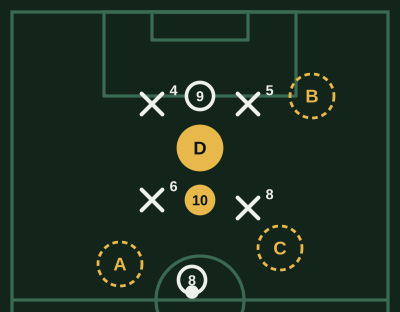
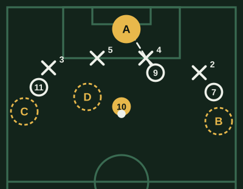
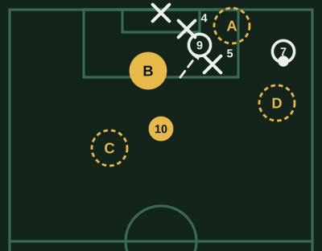
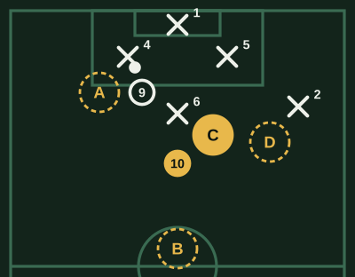

# Banco de Mediapunta (v1)

**Borrador sin revisar.** Marca lo que cambiarías al lado de cada pregunta: la respuesta correcta, una opción que también podría valer, una explicación floja o una pregunta que sobra.

64 preguntas. Cada examen toma 20, de todas las áreas y de las tres dificultades.

## Recepción entre líneas

### MP-ENT-01 · fácil

Tu equipo tiene el balón en el medio. ¿Dónde te ubicas?

- [ ] Al lado del 9, en la línea de los centrales
- [ ] Junto a mis volantes, para recibir cerca
- [ ] Abierto en una banda
- [x] **Entre los volantes y los defensores rivales**

> Entre las líneas del rival, ni los volantes ni los defensores te marcan cómodos: si recibes ahí, quedas de cara a la defensa.

### MP-ENT-02 · fácil

Vas a recibir entre líneas. ¿Qué haces antes de que te llegue el balón?

- [x] **Miro dónde están los rivales y el 9**
- [ ] Miro solo el balón para controlarlo bien
- [ ] Corro hacia el balón con la cabeza baja
- [ ] Me quedo quieto esperándolo

> Entre líneas el tiempo es poco: si ya miraste, sabes si girar, tocar de primera o filtrar. Si solo miras el balón, lo decides tarde.

### MP-ENT-03 · fácil

¿Cómo te conviene recibir entre líneas?

- [ ] De espaldas al arco, mirando al pasador para no perderla
- [x] **Perfilado, para girar con el primer control**
- [ ] De frente al pasador, con los pies juntos
- [ ] Corriendo hacia mi propio arco

> Perfilado puedes girar con el primer toque y quedar de cara a la defensa. De espaldas, cualquier volante que vuelva te encierra.

### MP-ENT-04 · media

Recibes entre líneas y el central rival sale fuerte a presionarte. ¿Qué haces?

- [ ] Me giro para encararlo y ganarle en velocidad
- [ ] La protejo y espero apoyo
- [x] **La toco de primera al espacio que dejó**
- [ ] La devuelvo larga atrás

> Si el central sale a buscarte, deja un hueco en la última línea: el pase de primera ahí deja a un compañero de cara al arco.

### MP-ENT-05 · media

El pivote rival te sigue a todas partes. ¿Qué haces?

- [ ] Me quedo quieto y la pido al pie
- [ ] Bajo a recibir a la altura de mis centrales
- [ ] Me abro a la banda para alejarme de él
- [x] **Lo arrastro para abrir espacio a mis volantes**

> Si el pivote te sigue, deja libre el centro: tu movimiento le abre espacio a un volante que llega. Ese desmarque también es tu trabajo.

### MP-ENT-06 · media

Recibes entre líneas, giras y quedas de cara a la defensa. ¿Qué buscas primero?

- [x] **El pase a la espalda de la defensa**
- [ ] Conducir hasta el área para patear más cerca
- [ ] Patear desde donde estoy
- [ ] Abrir a la banda

> De cara a la defensa, el pase a la espalda es el más dañino: deja a un compañero solo frente al arco. Si no está, buscas la siguiente opción.

### MP-ENT-07 · media

El rival cierra mucho el centro y no te llega el balón entre líneas. ¿Qué haces?

- [ ] Me quedo en el centro hasta que me la den
- [x] **Me muevo hacia un costado**
- [ ] Bajo hasta mi defensa a pedirla
- [ ] Me pongo en la línea del 9

> Si el centro está tapado, el hueco suele estar entre el lateral y el central rivales: moverte hacia ahí te deja una línea de pase.

### MP-ENT-08 · media

Te dan un pase entre líneas, pero viene fuerte y con un rival cerca. ¿Qué haces?

- [ ] Lo controlo con calma y después decido
- [ ] Intento girar con el balón
- [x] **Descargo de primera**
- [ ] Lo dejo pasar por si llega otro

> Un pase fuerte con un rival cerca no da tiempo de controlar y girar: la descarga de primera mantiene el balón y la jugada.

### MP-ENT-09 · difícil

Recibes entre líneas y ves que el volante rival vuelve rápido a cerrarte. ¿Qué haces?

- [ ] Espero que llegue para gambetearlo
- [ ] Freno el balón y lo protejo
- [ ] La devuelvo hacia atrás
- [x] **Decido antes de que llegue: giro o pared**

> Entre líneas el espacio dura un segundo: decidir antes de que te cierren es lo que hace útil la recepción.

### MP-ENT-10 · difícil

El rival defiende con dos líneas muy juntas y no hay espacio entre ellas. ¿Qué te conviene?

- [ ] Quedarme entre líneas igual, esperando que se abra un pase
- [ ] Ir de 9, delante de los centrales
- [ ] Pedir pelotazos a la espalda
- [x] **Bajar a recibir delante de su primera línea**

> Si las líneas están pegadas, el espacio está delante de ellas: bajar a recibir y jugar de cara obliga a alguna a salir y abre el hueco.

### MP-PIZ-01 · media

Tu volante tiene el balón. ¿Dónde te ofreces?

- [ ] A. Al lado de mi volante
- [ ] B. En la línea de los centrales, con el 9
- [ ] C. Delante de sus volantes
- [x] **D. Entre las dos líneas**

> Entre las líneas, ni los volantes ni los centrales te marcan cómodos: si recibes ahí, giras de cara a la defensa. Al lado del volante o con el 9 no eres una opción nueva.

## Último pase

### MP-ULT-01 · fácil

El 9 pica a la espalda del central y tú tienes el balón de cara. ¿Qué haces?

- [ ] Le doy el pase al pie
- [x] **Le doy el pase al espacio**
- [ ] Pateo yo de lejos
- [ ] Conduzco unos metros más

> Si el 9 ya ganó la espalda, el pase al espacio lo deja solo. Al pie lo obliga a frenar y la defensa vuelve.

### MP-ULT-02 · fácil

Hay dos compañeros libres: uno en la banda y otro en el área. ¿A quién se la das?

- [ ] Al de la banda, que es más seguro
- [ ] Me la quedo y sigo yo
- [x] **Al del área**
- [ ] Al que esté más cerca de mí

> El compañero libre en el área está más cerca del gol. Si el pase es posible, es el que más daño hace.

### MP-ULT-03 · fácil

¿Con qué fuerza das un pase a la espalda de la defensa?

- [ ] Fuerte, para que no la corten
- [ ] Suave, para que el compañero la controle sin problema
- [ ] Lo más fuerte posible
- [x] **La justa para que llegue antes que el arquero**

> Fuerte se va al arquero o afuera; suave la cortan los defensores. La fuerza justa la deja en la carrera de tu compañero.

### MP-ULT-04 · media

Tu compañero pica en diagonal a la espalda del lateral. ¿Adónde va el pase?

- [x] **Delante de él, en su carrera**
- [ ] A sus pies, donde está ahora
- [ ] Detrás de él, para que frene
- [ ] Al arco, por si llega

> El pase en profundidad se da donde va a estar, no donde está: delante de su carrera lo recibe sin frenar.

### MP-ULT-05 · media

Ves el pase filtrado, pero hay riesgo de que lo corten y el rival contragolpee. Van empatados al principio del partido. ¿Qué haces?

- [ ] Lo intento cada vez, es mi trabajo
- [x] **Lo intento si está claramente libre**
- [ ] No lo intento, es muy arriesgado
- [ ] Lo intento solo si vamos perdiendo, para no arriesgar

> El último pase vale el riesgo cuando la ventaja es clara. Arriesgar sin ventaja da contragolpes; no arriesgar nunca deja al equipo sin ocasiones.

### MP-ULT-06 · media

El extremo encara por fuera y el 9 está marcado en el área. ¿Qué movimiento haces?

- [ ] Me meto al área chica con el 9
- [ ] Voy a la banda a ayudar al extremo
- [x] **Me ofrezco para el pase atrás**
- [ ] Me quedo lejos, en el medio

> Si el 9 está marcado, la puerta del área es la zona del pase atrás: desde ahí llegas de frente y remates cómodo.

### MP-ULT-07 · media

Tienes el balón y el defensor rival cierra la línea de pase al 9. ¿Qué haces?

- [ ] Fuerzo el pase igual
- [ ] Pateo al arco
- [ ] La toco atrás para que otro busque el pase
- [x] **Conduzco un paso para abrir el ángulo**

> Un paso con el balón cambia el ángulo: el defensor tiene que moverse y la línea se abre. Forzarla es regalarla.

### MP-ULT-08 · media

Tu 9 es lento pero gana todo de cabeza. ¿Qué último pase le conviene?

- [x] **Un centro o un pase elevado a su zona**
- [ ] Pases al espacio a la espalda de los centrales
- [ ] Pases rasos al pie de espaldas
- [ ] Paredes rápidas en el área

> El pase tiene que aprovechar lo que tu compañero hace bien: con un 9 bueno de cabeza y lento, el balón elevado le rinde más que la carrera.

### MP-ULT-09 · difícil

El rival defiende con la línea muy adelantada y presiona alto. ¿Qué pase te conviene buscar?

- [ ] Pases cortos entre líneas
- [x] **El pase a la espalda de la línea**
- [ ] Pases al pie del 9
- [ ] Cambios de frente a la banda

> Con la línea adelantada, el espacio está detrás de ella: un solo pase bien dado supera a toda la defensa.

### MP-ULT-10 · difícil

El rival defiende con todos atrás y la línea muy baja. ¿Qué pase te conviene buscar?

- [ ] Pases a la espalda de la línea
- [x] **Pases cortos y rápidos**
- [ ] Pelotazos al área
- [ ] Remates de lejos cada vez

> Con la línea baja, a su espalda no hay espacio. El hueco se abre con pases cortos y rápidos que muevan a los defensores.

### MP-PIZ-02 · media

Recibes de cara a la defensa. ¿A quién se la das?

- [x] **A. Al espacio, a la carrera del 9**
- [ ] B. Al pie del 7, con el 2 cerca
- [ ] C. Al 11, con el 3 encima
- [ ] D. Pateo yo desde aquí

> El 9 pica en diagonal a la espalda del 4: el pase al espacio lo deja solo frente al arco. El 7 y el 11 tienen marca, y el remate de lejos es peor ocasión.

## Llegada y remate

### MP-LLE-01 · fácil

Tu equipo va a centrar desde la banda. ¿Dónde llegas?

- [ ] Al área chica con el 9
- [x] **A la puerta del área**
- [ ] A la banda, para ayudar
- [ ] Me quedo en el medio

> El mediapunta llega de segunda línea: en la puerta del área recibe el pase atrás o el rechazo de frente al arco.

### MP-LLE-02 · fácil

Recibes de frente en la puerta del área, con espacio. ¿Qué haces?

- [ ] Me la acomodo para la mejor pierna
- [ ] Busco un pase más
- [x] **Pateo**
- [ ] Conduzco hasta el área chica

> De frente y con espacio cerca del área, el remate es la mejor ocasión. Cada toque de más deja cerrar a los defensores.

### MP-LLE-03 · fácil

El 9 descarga para ti y tú llegas en carrera. ¿Qué haces?

- [ ] La controlo para acomodarme
- [ ] La devuelvo al 9
- [ ] Freno y espero
- [x] **Le pego de primera**

> Si llegas en carrera y el balón te espera, el remate de primera sorprende a la defensa antes de que se reacomode.

### MP-LLE-04 · media

Das un pase al 9 y él queda de espaldas. ¿Qué haces?

- [x] **Sigo la jugada para la devolución**
- [ ] Me quedo donde estoy
- [ ] Vuelvo atrás a cubrir por si la pierde
- [ ] Me abro a la banda

> El 9 de espaldas necesita un apoyo de frente: si sigues la jugada, la pared te deja de cara al arco.

### MP-LLE-05 · media

Pateas desde fuera del área y el arquero está bien ubicado al centro. ¿Adónde apuntas?

- [ ] Fuerte al medio
- [x] **Abajo y al palo**
- [ ] Arriba, al medio del arco
- [ ] Al cuerpo, por si da rebote

> Desde lejos, el remate abajo y junto al palo es el más difícil: el arquero tiene que tirarse lejos. Al medio la ataja sin moverse.

### MP-LLE-06 · media

El 9 arrastra a los centrales hacia el primer palo. ¿Qué haces?

- [ ] Voy también al primer palo
- [ ] Me quedo afuera del área
- [x] **Llego al punto de penal**
- [ ] Voy al segundo palo, lejos de todo

> Si los centrales siguen al 9, el punto de penal queda libre: el que llega de segunda línea encuentra ahí la ocasión.

### MP-LLE-07 · media

Quedas mano a mano con el arquero. ¿Qué haces?

- [ ] Pateo fuerte enseguida
- [ ] Intento gambetearlo
- [ ] Espero a que llegue un compañero
- [x] **Lo miro y decido según cómo sale**

> Si no miras, decide el arquero. Mirarlo te dice si cruzarla, picarla o eludirlo.

### MP-LLE-08 · media

Hay un rebote en la puerta del área y llegas a la vez que un defensor. ¿Qué haces?

- [x] **Le pego de primera, antes de que me cierre**
- [ ] La controlo y busco el ángulo para patear mejor
- [ ] Freno y dejo que la saque él
- [ ] La toco hacia la banda

> En el rebote gana el más rápido: de primera llegas antes que el bloqueo. Controlarla le da tiempo al defensor.

### MP-LLE-09 · difícil

El rival marca bien al 9 en el área y tú llegas de segunda línea sin marca. ¿Qué te pide el equipo?

- [ ] Quedarme atrás para el contragolpe
- [x] **Llegar al área en el momento justo**
- [ ] Pedir que el 9 baje a recibir
- [ ] Ir a la banda a centrar

> Si el 9 está marcado y tú no, tu llegada es la ocasión: aparecer en el momento justo te deja solo.

### MP-LLE-10 · difícil

Llegas al área de segunda línea y el defensor te ve. ¿Qué haces?

- [ ] Sigo corriendo derecho para llegar antes que él
- [x] **Freno o cambio de dirección**
- [ ] Me quedo afuera del área
- [ ] Pido el balón al pie

> Si el defensor ya te ve, un frenazo o un cambio de dirección te separa: así recibes libre.

### MP-PIZ-03 · media

El extremo va a centrar y el 9 arrastra a los centrales al primer palo. ¿Adónde llegas?

- [ ] A. Al primer palo, con el 9
- [x] **B. Al punto de penal, que quedó libre**
- [ ] C. Me quedo afuera del área
- [ ] D. A la banda, a ayudar al 7 por si no puede centrar

> Con los centrales arrastrados al primer palo, el punto de penal quedó vacío: el que llega de segunda línea encuentra ahí el pase atrás o el centro.

## Movilidad y asociación

### MP-ASO-01 · fácil

Un compañero te pasa el balón y sigue corriendo. ¿Qué haces?

- [ ] Me la quedo y conduzco
- [ ] La paso atrás
- [ ] Pateo de lejos
- [x] **Se la devuelvo en su carrera**

> Si tu compañero da el pase y sigue corriendo, te está pidiendo la pared: devolvérsela en carrera supera al rival.

### MP-ASO-02 · fácil

Das un pase y quedas libre. ¿Qué haces?

- [x] **Me vuelvo a ofrecer**
- [ ] Me quedo en el lugar del pase
- [ ] Vuelvo a mi campo
- [ ] Me pego a un rival

> Dar el pase no termina tu jugada: moverte le da al compañero otra opción.

### MP-ASO-03 · fácil

El extremo de tu lado se mete hacia adentro. ¿Qué haces?

- [ ] Me acerco a él para pedírsela
- [x] **Me voy a otro espacio**
- [ ] Me quedo en el mismo lugar
- [ ] Voy al área

> Si el extremo entra, ocupa tu zona: moverte hacia otro espacio evita que se estorben y abre una opción nueva.

### MP-ASO-04 · media

El 9 baja a recibir y arrastra a un central. ¿Qué haces?

- [ ] Bajo yo también
- [ ] Me quedo en mi lugar
- [x] **Ataco el espacio que dejó el central**
- [ ] Me abro a la banda para dar amplitud al equipo

> Si el central sigue al 9, su zona queda libre: el mediapunta la ataca y llega de frente al arco.

### MP-ASO-05 · media

Tu equipo tiene el balón en una banda y el rival se cargó de ese lado. ¿Qué haces?

- [ ] Me voy también a esa banda
- [ ] Me quedo atrás
- [ ] Me meto al área
- [x] **Me ofrezco para el cambio de frente**

> Si el rival se carga de un lado, el otro queda libre: ofrecerte como puente para el cambio de frente lo aprovecha.

### MP-ASO-06 · media

Recibes y el volante de tu equipo llega por detrás, de frente. ¿Qué haces?

- [x] **Se la doy a él**
- [ ] Me giro yo para encarar
- [ ] Me la quedo protegiendo
- [ ] La toco a la banda

> El que llega de frente ve todo el campo: darle el balón convierte una recepción de espaldas en una jugada de cara.

### MP-ASO-07 · media

Los volantes rivales te marcan muy de cerca. ¿Qué cambias?

- [ ] Intento gambetear más
- [x] **Juego a uno o dos toques**
- [ ] Dejo de pedir el balón
- [ ] Me alejo del juego

> Con marca encima, tocar rápido mueve el balón antes de que lleguen. Gambetear o esconderte le quita al equipo su enlace.

### MP-ASO-08 · media

Tu equipo tiene el balón atrás y no encuentra salida. ¿Qué haces?

- [ ] Me quedo arriba, esperando un pelotazo al 9
- [ ] Pido pelotazos
- [x] **Bajo un poco para dar una opción**
- [ ] Me voy a la banda

> Si el equipo no puede salir, el mediapunta baja a ofrecerse: un pase más corto ayuda a superar la presión.

### MP-ASO-09 · difícil

El 9, el extremo y tú están en la misma zona. ¿Qué haces?

- [ ] Me quedo, así estamos juntos para las paredes
- [ ] Le pido al extremo que se vaya
- [ ] Pido el balón ahí mismo
- [x] **Me muevo a otra zona para abrir espacio**

> Tres jugadores en la misma zona se estorban y un rival marca a dos. Si te vas a otra zona, estiras a la defensa.

### MP-ASO-10 · difícil

El rival marca hombre a hombre en el medio. ¿Qué aprovechas?

- [ ] Que voy a recibir libre cada vez
- [ ] Que el rival se cansa antes
- [ ] Que puedo quedarme quieto
- [x] **Que mi movimiento arrastra a mi marca**

> Con marca hombre a hombre, cada vez que te mueves te sigue un rival: así abres espacios para tus compañeros.

## Presión

### MP-PRE-01 · fácil

Tu equipo presiona arriba. ¿A quién vigilas normalmente?

- [ ] Al arquero rival
- [ ] A un lateral rival
- [ ] Al que tenga el balón
- [x] **Al pivote rival**

> Con el equipo presionando, el mediapunta tapa al pivote rival: si él recibe libre, la presión entera queda superada.

### MP-PRE-02 · fácil

Pierden el balón cerca del área rival. ¿Qué haces?

- [x] **Presiono enseguida**
- [ ] Vuelvo a mi campo
- [ ] Me quedo esperando el contragolpe
- [ ] Le pido al 9 que vaya él

> Recién perdida, el rival todavía está desordenado: presionar en el acto puede recuperar el balón cerca del arco.

### MP-PRE-03 · fácil

Tu equipo defiende atrás. ¿Dónde te ubicas?

- [ ] Arriba con el 9, listo para el contragolpe
- [x] **Delante de mis volantes**
- [ ] Dentro de mi área
- [ ] En una banda

> Cuando el equipo espera, el mediapunta cierra el pase por el centro: obliga al rival a jugar por fuera.

### MP-PRE-04 · media

El central rival tiene el balón y el pivote rival se ofrece. ¿Qué haces?

- [ ] Voy también al central
- [ ] Me alejo hacia la banda
- [x] **Tapo al pivote**
- [ ] Retrocedo a mi área

> Si el 9 va al central y tú tapas al pivote, el pase por dentro queda cerrado y el rival tiene que ir por fuera.

### MP-PRE-05 · media

El pivote rival recibe de espaldas. ¿Qué haces?

- [ ] Lo dejo y vuelvo
- [ ] Le entro por detrás
- [ ] Espero a que gire
- [x] **Lo presiono para que no gire**

> De espaldas no es peligroso si no gira: presionarlo lo obliga a jugar hacia atrás. Entrar por detrás es falta.

### MP-PRE-06 · media

El rival te supera en la presión con un pase al pivote. ¿Qué haces?

- [x] **Vuelvo detrás del balón**
- [ ] Me quedo arriba
- [ ] Sigo presionando al que pasó
- [ ] Voy al área

> Superado, todavía ayudas si vuelves: tapas el pase hacia adelante y el equipo se ordena.

### MP-PRE-07 · media

Van ganando, quedan quince minutos y estás cansado. ¿Cómo presionas?

- [ ] A todo, como al principio
- [x] **Elijo los momentos**
- [ ] Dejo de presionar
- [ ] Solo al arquero

> Cansado, presionar todo te deja sin piernas. Elegir los momentos (un mal control, un pase atrás) rinde más con menos.

### MP-PRE-08 · media

El rival saca del arco corto. ¿Qué haces?

- [ ] Presiono al arquero para que la saque mal
- [ ] Me quedo en mi campo
- [x] **Me ubico para tapar el pase al pivote**
- [ ] Marco a un lateral

> Si el pivote no puede recibir, el arquero tiene que dársela a un central apretado o sacar largo.

### MP-PRE-09 · difícil

El rival sale con tres atrás y su pivote bajo entre ellos. ¿Qué haces?

- [ ] Voy al pivote solo, lejos del 9
- [ ] Me quedo atrás esperando
- [ ] Marco a uno solo de los centrales
- [x] **Me paro entre dos de ellos, junto al 9**

> Si el pivote baja entre los centrales, son cuatro contra dos: parados entre ellos, tú y el 9 cierran los pases y los obligan a ir por fuera.

### MP-PRE-10 · difícil

Tu equipo recupera y el rival contraataca rápido. ¿Qué haces?

- [ ] Me quedo arriba
- [ ] Corro al balón por el camino más corto
- [ ] Voy a la banda
- [x] **Vuelvo por dentro**

> Volviendo por dentro tapas el pase más peligroso, el que va al medio, y ayudas a tus volantes.

### MP-PIZ-04 · media

Tu equipo presiona arriba y el central rival tiene el balón. ¿Dónde te paras?

- [ ] A. Al central con el balón, junto al 9
- [ ] B. Atrás, en mi campo
- [x] **C. Encima del 6, tapándole el pase**
- [ ] D. Con el lateral, en la banda

> Si el 9 presiona al central, tu trabajo es el pivote: tapado el 6, el pase por dentro queda cerrado y el rival tiene que ir por fuera o largo.

## Lectura del juego

### MP-LEC-01 · fácil

El rival está desordenado después de perder el balón. ¿Qué haces?

- [x] **Acelero el juego**
- [ ] Freno para que se ordene mi equipo
- [ ] Paso atrás
- [ ] Me quedo con el balón

> El desorden del rival dura segundos: acelerar el juego lo aprovecha antes de que se reacomode.

### MP-LEC-02 · fácil

Tu equipo pierde muchos balones seguidos. ¿Qué haces cuando recibes?

- [ ] Busco la jugada difícil para cambiar el partido
- [x] **Juego simple para asegurar el balón**
- [ ] Pateo de lejos
- [ ] Me la quedo

> Cuando el equipo pierde muchos balones, asegurar la posesión calma el partido y lo ordena.

### MP-LEC-03 · fácil

El rival defiende muy cerrado. ¿Qué te pide el equipo?

- [ ] Pases arriesgados cada vez
- [ ] Remates de lejos cada vez
- [x] **Paciencia con el balón**
- [ ] Pelotazos al área

> Contra un bloque cerrado, apurarse es perder el balón: la paciencia mueve al rival hasta que aparece el hueco.

### MP-LEC-04 · media

Van ganando 1-0 en los últimos minutos y recibes con espacio. ¿Qué haces?

- [ ] Busco el segundo gol rápido
- [ ] Pateo de lejos
- [ ] Paso largo al 9
- [x] **Conservo el balón**

> Con el resultado a favor y poco tiempo, tener el balón es defender: perderla da un contragolpe.

### MP-LEC-05 · media

Van perdiendo y queda poco. ¿Qué cambias?

- [x] **Arriesgo más el último pase**
- [ ] Juego más seguro
- [ ] Bajo a defender
- [ ] Me quedo en la banda

> Perdiendo y con poco tiempo, el pase seguro no alcanza: hay que arriesgar más para crear ocasiones.

### MP-LEC-06 · media

Ves que el lateral derecho rival es lento. ¿Qué haces?

- [ ] Ataco por el otro lado
- [x] **Busco atacar por ese lado**
- [ ] Sigo jugando igual
- [ ] Le aviso solo al extremo del otro lado

> Una debilidad del rival es una ventaja: llevar el juego hacia el lateral lento la aprovecha.

### MP-LEC-07 · media

Tu equipo tiene el balón y el rival se repliega rápido. ¿Qué haces?

- [ ] Sigo el contragolpe igual, por si encuentro un hueco
- [ ] Pateo de lejos
- [x] **Paso a un ataque armado, con pases**
- [ ] Paso largo a la espalda

> Si el rival ya volvió, el contragolpe no tiene ventaja: toca armar el ataque con pases.

### MP-LEC-08 · media

Ves que el pivote rival sube mucho a atacar. ¿Qué aprovechas?

- [ ] Que puedo marcarlo yo
- [ ] Que su equipo tiene uno más
- [ ] Que el 9 puede bajar
- [x] **El espacio que deja a su espalda**

> Si el pivote sube, su espacio queda libre: recibir ahí en la transición te deja de cara a los centrales.

### MP-LEC-09 · difícil

El rival hace muchas faltas para cortar tu juego. ¿Qué haces?

- [x] **Toco más rápido**
- [ ] Busco más las faltas
- [ ] Dejo de pedir el balón
- [ ] Me alejo del juego

> Si cortan con faltas, tocar rápido no les da tiempo: el balón se mueve antes del contacto.

### MP-LEC-10 · difícil

Llevas el balón en un contragolpe tres contra dos. ¿Qué haces?

- [x] **Fijo a un defensor y paso al libre**
- [ ] Paso enseguida a la banda
- [ ] Conduzco hasta el área solo, para que no la corten
- [ ] Freno para que lleguen más

> En superioridad, fijar a un defensor deja libre a un compañero: el pase en el momento justo lo deja solo.
