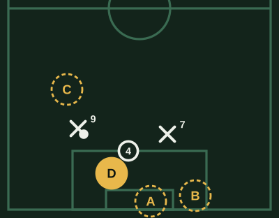
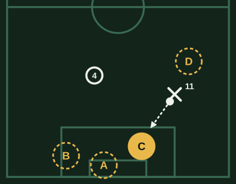
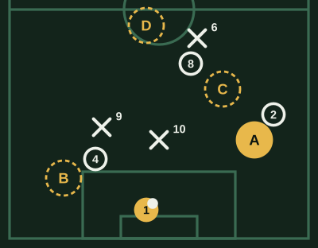
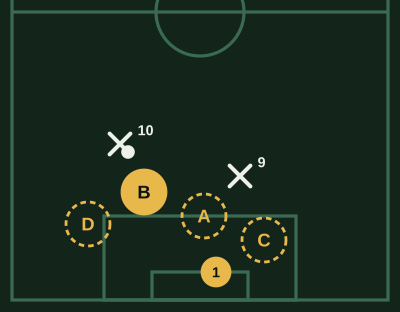

# Banco de Portero (v1)

**Borrador sin revisar.** Marca lo que cambiarías al lado de cada pregunta: la respuesta correcta, una opción que también podría valer, una explicación floja o una pregunta que sobra.

64 preguntas. Cada examen toma 20, de todas las áreas y de las tres dificultades.

## Posición y ángulo

### POR-POS-01 · fácil

Un rival va a patear desde el centro, fuera del área. ¿Dónde te paras?

- [ ] Pegado a un palo, para cubrir bien ese lado
- [ ] Sobre la línea, en el centro, sin mirar dónde está el balón
- [x] **En la línea imaginaria entre el balón y el centro del arco**
- [ ] Bien adelante, en el punto de penal

> Entre el balón y el centro del arco cubres lo mismo de cada lado. Pegado a un palo le regalas el otro; muy adelante, te pueden picar.

### POR-POS-02 · fácil

El balón está en la banda, lejos de tu arco. ¿Dónde te ubicas?

- [ ] Sobre la línea, quieto en el centro del arco
- [ ] Pegado al primer palo, por si patean
- [ ] En el área chica, detrás de mis centrales
- [x] **Un poco adelantado**

> Con el balón lejos no hay remate posible: adelantado cubres el pase largo a la espalda de tu defensa, que es el peligro real.

### POR-POS-03 · fácil

El rival se prepara para patear. ¿Cómo te paras?

- [x] **Quieto y en la punta de los pies**
- [ ] Saltando en el lugar para estar activo
- [ ] Con los pies juntos para que no pase entre las piernas
- [ ] Moviéndome hacia el lado donde creo que va a patear

> Quieto y en la punta de los pies puedes salir hacia cualquier lado en el momento del remate. Si estás en el aire o adivinando, el remate te agarra a destiempo.

### POR-POS-04 · media

Te patean desde un ángulo cerrado, cerca de la línea de fondo. ¿Qué cubres sobre todo?

- [ ] El segundo palo, por el remate cruzado
- [x] **El primer palo**
- [ ] El centro del arco
- [ ] Me quedo en el centro, mirando el pase atrás

> Desde un ángulo cerrado, el remate al primer palo es el que no puede entrar: si lo cubres, el delantero solo tiene un hueco chico al segundo o el pase atrás.

### POR-POS-05 · media

El rival conduce hacia tu área y no hay defensores entre él y tú. ¿Qué haces?

- [ ] Me quedo sobre la línea esperando el remate
- [ ] Salgo corriendo a toda velocidad hacia él
- [x] **Salgo unos pasos, sin quedar vendido**
- [ ] Me tiro a sus pies apenas entra al área

> Adelantarte un poco reduce el arco que ve el delantero. Si sales demasiado rápido, te supera con un toque; sobre la línea, ve todo el arco.

### POR-POS-06 · media

Hay un tiro libre lejano, sin barrera, y el balón está alto. ¿Dónde te ubicas?

- [ ] Sobre la línea, por si patea directo
- [ ] Pegado al primer palo
- [ ] Fuera del área, para anticiparme
- [x] **Un poco adelantado, para salir al centro**

> Desde lejos lo más probable es el centro al área: un poco adelantado llegas a cortarlo. Sobre la línea quedas lejos de la caída del balón.

### POR-POS-07 · media

Tu defensa está muy adelantada, cerca de la mitad de la cancha. ¿Dónde te ubicas?

- [x] **Fuera del área chica**
- [ ] Sobre la línea, que es mi lugar
- [ ] En el punto de penal, quieto
- [ ] Muy adelante, a la altura de mis centrales

> Con la defensa alta queda mucho espacio a su espalda: el arquero adelantado barre los pases largos. Sobre la línea, un pase al espacio deja al delantero solo.

### POR-POS-08 · media

Un rival recibe en el borde del área de espaldas al arco. ¿Qué haces?

- [ ] Salgo a quitársela
- [x] **Me acomodo según dónde podría girar o pasar**
- [ ] Me quedo pegado a un palo
- [ ] Me quedo en el centro del arco, sin moverme

> De espaldas todavía no remata: ajustas tu posición a lo que puede hacer al girar o al pase que puede dar. Salir a buscarlo deja el arco vacío.

### POR-POS-09 · difícil

Te patean de lejos y hay varios jugadores entre el balón y tú. ¿Qué cuidas?

- [ ] Quedarme detrás de mis defensores para que tapen
- [ ] Adivinar un lado y tirarme antes
- [x] **Ver el balón y estar listo para un desvío**
- [ ] Salir a cortar el remate

> Con jugadores delante, el balón aparece tarde o cambia de dirección: moverte para verlo y estar listo para el desvío vale más que adivinar.

### POR-POS-10 · difícil

Atajaste un remate pero dejaste el rebote y un rival va a patear de nuevo. ¿Qué haces?

- [ ] Me quedo en el suelo para tapar más espacio
- [ ] Me tiro hacia el balón aunque llegue tarde
- [x] **Me paro de frente al remate**
- [ ] Me quedo de rodillas para tapar abajo

> Si llegas al balón, lo atrapas o despejas. Si no, levantarte y pararte de frente al remate te da opciones; en el suelo te superan con una picada.

### POR-PIZ-01 · media

El 9 rival va a patear desde la izquierda del área. ¿Dónde te paras?

- [ ] A. En el centro del arco, sobre la línea
- [ ] B. Pegado al segundo palo
- [ ] C. Fuera del área, a buscarlo
- [x] **D. Adelantado, hacia el balón**

> Entre el balón y el centro del arco, y un poco adelantado, achicas el ángulo. En el centro sobre la línea dejas libre el primer palo; en el segundo palo, todavía más.

## Mano a mano

### POR-UNO-01 · fácil

Un delantero queda solo contra ti y conduce hacia el área. ¿Qué buscas?

- [ ] Tirarme a sus pies apenas puedo
- [ ] Quedarme sobre la línea esperando
- [x] **Acortar con calma y esperar**
- [ ] Salir corriendo para llegar antes que él

> En el mano a mano, el que decide primero pierde: te acercas para achicar el arco y esperas que él muestre su intención.

### POR-UNO-02 · fácil

El delantero se adelanta el balón de más en el mano a mano. ¿Qué haces?

- [ ] Me quedo esperando que remate
- [ ] Retrocedo hacia la línea
- [ ] Espero a que lo vuelva a controlar
- [x] **Salgo a ganarlo**

> Si el delantero pierde el control, el balón es de quien llegue primero: es el momento de salir con decisión.

### POR-UNO-03 · fácil

En el mano a mano, ¿cómo te paras cuando el delantero está cerca?

- [x] **Bajo y con las manos abiertas**
- [ ] De pie y con los brazos arriba
- [ ] De rodillas, para tapar el piso
- [ ] De costado, para tapar un lado

> Cerca, la mayoría de los remates van bajos: estar bajo y con las manos a los costados te deja cubrir los dos lados rápido.

### POR-UNO-04 · media

El delantero levanta la cabeza para picarla. ¿Qué haces?

- [ ] Me tiro al suelo para tapar el remate
- [x] **Me quedo de pie, sin tirarme**
- [ ] Salgo corriendo hacia él
- [ ] Retrocedo de espaldas

> Si te tiras, la picada te pasa por encima. De pie todavía puedes saltar o retroceder unos pasos.

### POR-UNO-05 · media

El delantero entra en diagonal desde la banda, con su pierna buena hacia el arco. ¿Qué cubres?

- [ ] El segundo palo, por el remate cruzado
- [ ] El centro del arco
- [x] **El primer palo, y lo empujo hacia afuera**
- [ ] Me tiro hacia la banda

> Si tapas el primer palo, lo obligas a abrirse o a cruzar con poco ángulo. Si te vas al segundo, el primer palo queda libre.

### POR-UNO-06 · media

El delantero intenta eludirte hacia un costado. ¿Qué haces?

- [ ] Le entro a las piernas para frenarlo
- [ ] Lo dejo pasar y vuelvo al arco
- [ ] Me tiro hacia el balón con los pies
- [x] **Lo acompaño sin tirarme**

> Si lo acompañas, al eludirte se aleja del arco y pierde ángulo. Entrarle a las piernas es penal y expulsión.

### POR-UNO-07 · media

Un pase largo va a la espalda de tu defensa y el delantero corre hacia el balón. ¿Qué haces?

- [x] **Salgo si llego antes que él**
- [ ] Me quedo en el arco para el mano a mano
- [ ] Salgo aunque llegue después
- [ ] Salgo hasta el borde del área y espero

> Si llegas primero, despejas o atrapas y se terminó la jugada. Si llegas tarde, quedas fuera del arco con el delantero de frente.

### POR-UNO-08 · media

Saliste lejos del área y el delantero llega primero. ¿Qué haces?

- [ ] Le hago falta para frenarlo
- [x] **Retrocedo hacia el arco**
- [ ] Sigo hacia él para trabarlo
- [ ] Me quedo donde estoy

> Si llegó primero, ya no lo ganas: volver hacia el arco te deja tapar algo. Hacerle falta fuera del área es tarjeta y, si era clara ocasión, roja.

### POR-UNO-09 · difícil

El delantero queda solo pero lejos, a unos 20 metros, y conduce despacio. ¿Qué haces?

- [ ] Salgo corriendo a buscarlo
- [ ] Me quedo en la línea
- [x] **Me adelanto unos pasos y espero**
- [ ] Me tiro en cuanto patee

> Lejos y despacio, salir corriendo le deja picarla; quedarte en la línea le deja ver todo el arco. Unos pasos adelante achicas sin quedar vendido.

### POR-UNO-10 · difícil

En un mano a mano el delantero te amaga patear. ¿Qué haces?

- [ ] Me tiro hacia el lado del amague
- [ ] Me tiro al medio para tapar más
- [x] **No me tiro hasta que patee de verdad**
- [ ] Salgo a sus pies apenas amaga

> El amague busca que te tires antes: si esperas el remate real, el delantero tiene que decidir sin que te hayas movido.

### POR-PIZ-04 · media

El delantero entra solo en diagonal desde la derecha. ¿Dónde lo esperas?

- [ ] A. En el centro del arco, sobre la línea
- [ ] B. Pegado al segundo palo
- [x] **C. Adelantado, tapando el primer palo**
- [ ] D. Corriendo hacia él, fuera del área

> Adelantado y tapando el primer palo, lo obligas a abrirse o a cruzar con poco ángulo. Sobre la línea o en el segundo palo ve el arco entero; salir corriendo lejos le deja picarla.

## Juego aéreo

### POR-AER-01 · fácil

Llega un centro al área chica. ¿Cuándo sales?

- [x] **Si estoy seguro de llegar al balón**
- [ ] Cada vez que hay un centro
- [ ] Cuando un delantero rival salta
- [ ] Cuando mis defensores me lo piden

> Salir y no llegar deja el arco vacío. Si estás seguro de ganar el balón, sales con decisión; si no, te quedas en el arco.

### POR-AER-02 · fácil

Sales a un centro. ¿Qué avisas?

- [ ] Me quedo callado para no distraerlos
- [x] **"¡Mía!", fuerte, antes de salir**
- [ ] El nombre de un defensor
- [ ] "¡Fuera!" mientras salto

> Avisar antes evita choques con tus defensores y les dice que se aparten. Avisar tarde o no avisar termina en choques o en dos que no la tocan.

### POR-AER-03 · fácil

Sales a un centro rodeado de jugadores y no estás seguro de atraparlo. ¿Qué haces?

- [ ] Intento atraparlo igual
- [ ] Lo toco suave hacia un costado
- [x] **Lo despejo con los puños, lejos**
- [ ] Me quedo en el arco a mitad de camino

> Con mucha gente y sin seguridad, el puño lo aleja del área. Intentar atraparlo y que se te caiga deja el balón a un rival en el área chica.

### POR-AER-04 · media

Hay un córner en contra. ¿Dónde te ubicas?

- [ ] Pegado al primer palo
- [ ] Pegado al segundo palo
- [ ] Fuera del área chica
- [x] **En el centro del arco**

> Desde el centro del arco y un poco adelantado llegas a los dos palos y sales a los centros. Pegado a un palo, el otro queda lejos.

### POR-AER-05 · media

Un rival se para delante de ti en el córner para molestarte. ¿Qué haces?

- [x] **Me corro para ver el balón**
- [ ] Lo empujo para apartarlo
- [ ] Me quedo detrás de él, sin moverme
- [ ] Me adelanto para alejarme de él

> Lo importante es ver el balón: un paso al costado y un defensor que lo marque resuelven. Empujarlo puede terminar en penal.

### POR-AER-06 · media

El centro viene pasado, al segundo palo, y no llegas. ¿Qué haces?

- [ ] Sigo hacia el balón aunque no llegue
- [x] **Vuelvo a la línea**
- [ ] Me quedo donde salí
- [ ] Me tiro al suelo

> Si no llegas, lo mejor es volver al arco y pararte para el cabezazo. Seguir de largo o quedarte afuera deja el arco vacío.

### POR-AER-07 · media

¿Con cuántas piernas saltas al salir a un centro?

- [ ] Con las dos, para saltar más
- [ ] Sin saltar, con los brazos arriba
- [x] **Con una, con la rodilla arriba**
- [ ] Con una, con las dos piernas estiradas

> Con un pie llegas más alto, y la rodilla arriba te protege de los choques. Con los pies juntos saltas menos y quedas expuesto.

### POR-AER-08 · media

Atrapas un centro con varios rivales cerca. ¿Qué haces después?

- [ ] Lo pateo lejos enseguida
- [ ] Lo dejo caer para jugarlo con el pie
- [ ] Me quedo en el suelo con el balón
- [x] **Busco a un compañero libre**

> Atrapado el centro, el rival está desordenado: mirar rápido y salir con un compañero libre puede ser un contragolpe.

### POR-AER-09 · difícil

El viento lleva los centros hacia tu arco. ¿Qué cambias?

- [x] **Un poco más atrás**
- [ ] Salgo más lejos que de costumbre
- [ ] No cambio mi posición
- [ ] Me pongo pegado a la línea todo el partido

> Con viento a favor del centro, el balón se cierra hacia el arco: un poco más atrás llegas a tiempo. Salir lejos te deja vendido.

### POR-AER-10 · difícil

Van ganando, último minuto, y el rival tira centros con todos en el área. ¿Qué haces?

- [x] **Salgo solo a lo seguro**
- [ ] Salgo a cada centro
- [ ] Me quedo sobre la línea para no arriesgar
- [ ] Atrapo y retengo el balón aunque me rodeen

> Con el área llena, un error es gol: sales solo a lo seguro y despejas lejos, sin arriesgar el atrape.

## Juego con los pies

### POR-PIE-01 · fácil

Un defensor te pasa el balón hacia atrás. ¿Qué haces?

- [ ] La agarro con las manos
- [ ] La pateo fuerte sin mirar
- [x] **Controlo hacia un lado libre y juego**
- [ ] Espero que se detenga sola

> El pase atrás de un compañero no se puede agarrar con las manos. Controlar hacia un espacio libre te da tiempo para jugar.

### POR-PIE-02 · fácil

Te pasan el balón atrás y un delantero viene a presionarte. ¿Qué haces?

- [ ] Intento gambetearlo
- [ ] La controlo con calma
- [ ] La agarro con las manos
- [x] **Juego rápido o la saco lejos**

> Con presión, cada toque de más es un riesgo cerca de tu arco. Lo seguro es jugar rápido al libre o alejarla.

### POR-PIE-03 · fácil

Un pase largo del rival pasa a tu defensa y llega fuera del área. ¿Qué haces si llegas primero?

- [x] **Lo despejo con el pie, lejos**
- [ ] Lo agarro con las manos
- [ ] Lo controlo y salgo jugando
- [ ] Lo dejo pasar

> Fuera del área no puedes usar las manos. Si llegas primero, lo más seguro es despejarlo lejos.

### POR-PIE-04 · media

Tu equipo sale jugando y tus centrales están abiertos. ¿Dónde te ubicas?

- [ ] Sobre la línea, lejos de la jugada
- [x] **Entre ellos, como opción de pase**
- [ ] Pegado a un central
- [ ] Fuera del área, delante de los centrales

> Entre los centrales y un poco adelantado, eres una opción más para superar la presión. Sobre la línea quedas lejos para recibir.

### POR-PIE-05 · media

Recibes y el lateral está libre pero lejos. ¿Qué pase le das?

- [ ] Uno bombeado, para pasar por encima
- [ ] Uno suave, para que lo controle fácil
- [x] **Uno firme, que llegue rápido**
- [ ] Uno largo, a la espalda de él

> Si el pase es lento, el rival llega a cortarlo. Uno firme llega antes de que la presión cierre.

### POR-PIE-06 · media

Recibes un pase atrás y tu pierna mala queda del lado del balón. ¿Qué haces?

- [ ] La acomodo a la buena aunque me presionen
- [ ] La pateo con la buena de cualquier forma
- [ ] La agarro con las manos
- [x] **Juego con la mala si es simple**

> Cerca del arco, la decisión depende del tiempo: si la jugada es simple, la mala alcanza; si tienes tiempo, la acomodas. Arriesgar con presión es lo peligroso.

### POR-PIE-07 · media

Te presionan y no hay pase seguro. ¿Qué haces?

- [x] **La saco lejos, hacia una banda**
- [ ] Intento el pase igual
- [ ] La retengo para ganar una falta
- [ ] La saco hacia el centro de la cancha

> Sin pase seguro, alejarla es lo correcto. Hacia la banda, si sale, es un lateral lejos de tu arco; al centro puede volver rápido.

### POR-PIE-08 · media

Tu equipo presiona arriba y el rival juega largo a la espalda de tu defensa. ¿Dónde te conviene estar?

- [ ] Sobre la línea, que es mi lugar
- [x] **Adelantado, fuera del área chica**
- [ ] En el punto de penal
- [ ] Pegado al primer palo

> Si tu equipo presiona arriba, la defensa está alta: el arquero adelantado llega a los balones largos antes que el delantero.

### POR-PIE-09 · difícil

El rival presiona a tus centrales y deja libre al pivote. Tienes el balón. ¿Qué haces?

- [ ] Juego con el central más cercano
- [ ] Saco largo para evitar riesgos
- [x] **Busco el pase al pivote**
- [ ] Conduzco yo hacia adelante

> Si el rival tapa a los centrales, el pivote libre es la salida: un pase limpio supera su primera línea de presión.

### POR-PIE-10 · difícil

Van ganando, último minuto, y te pasan el balón atrás con un delantero cerca. ¿Qué haces?

- [ ] Salgo jugando corto para mantener la posesión
- [ ] Intento eludir al delantero
- [x] **La saco lejos, sin arriesgar**
- [ ] La retengo hasta que me presione

> Con el resultado a favor, un error con los pies cerca del arco es gol. Lo seguro es alejarla.

## Saques y distribución

### POR-SAQ-01 · fácil

Atrapas el balón y el rival está desordenado. ¿Qué haces?

- [ ] Espero a que se ordene mi equipo
- [x] **Saco rápido a un compañero libre**
- [ ] La retengo para descansar
- [ ] Saco largo sin mirar

> Un rival desordenado es una oportunidad: el saque rápido a un compañero libre puede ser un contragolpe.

### POR-SAQ-02 · fácil

Vas a sacar con la mano a un compañero cercano. ¿Cómo lo haces?

- [ ] Alto, para que lo baje con el pecho
- [ ] Lo más fuerte posible
- [x] **Rodando o a media altura, a sus pies**
- [ ] Picando delante de él

> Rodando o a media altura, tu compañero controla fácil. Alto o picando, le cuesta y el rival llega.

### POR-SAQ-03 · fácil

¿Cuándo conviene sacar largo?

- [ ] Cada vez, para alejar el balón
- [ ] Cuando estoy cansado
- [ ] Cuando mi equipo pide calma
- [x] **Cuando no hay salida corta**

> El saque largo sirve cuando no hay salida corta segura. Hacerlo cada vez regala el balón a menudo.

### POR-SAQ-04 · media

Vas a sacar largo. ¿Hacia dónde?

- [x] **Hacia una banda**
- [ ] Al centro de la cancha
- [ ] Lo más lejos posible, sin mirar
- [ ] Hacia donde está el defensor más alto

> Hacia una banda, si se pierde, el rival está lejos de tu arco y tu compañero puede ganarlo. Al centro, si lo ganan, atacan de frente.

### POR-SAQ-05 · media

Saque de arco: el rival presiona alto con todos. ¿Qué haces?

- [ ] Salgo jugando corto igual
- [x] **Saco largo, a la espalda de su presión**
- [ ] Le paso al central presionado
- [ ] Retengo el balón esperando

> Si presionan con todos, detrás de ellos hay espacio: el saque largo bien dado deja a tu equipo con ventaja.

### POR-SAQ-06 · media

Atrapas el balón y tu delantero pica solo. ¿Qué haces?

- [ ] Espero a que lleguen más
- [ ] Juego corto al central
- [x] **Saco rápido hacia él**
- [ ] Saco largo al área rival

> Si el delantero ya está libre, el saque rápido lo pone en carrera antes de que la defensa vuelva.

### POR-SAQ-07 · media

Van perdiendo y quedan pocos minutos. ¿Cómo sacas?

- [ ] Despacio, para ordenar al equipo
- [ ] Largo cada vez, sin mirar
- [ ] Corto, para asegurar el balón
- [x] **Rápido, sin perder tiempo**

> Perdiendo, cada segundo cuenta: sacar rápido le da más tiempo al equipo para atacar.

### POR-SAQ-08 · media

Atrapas el balón y un rival se queda delante tuyo para molestar el saque. ¿Qué haces?

- [x] **Me muevo para sacar por otro lado**
- [ ] Lo empujo para que se aparte
- [ ] Le saco encima igual
- [ ] Me quedo quieto con el balón

> Si te tapan un lado, te mueves dentro del área y sacas por el otro. Empujarlo puede terminar en falta.

### POR-SAQ-09 · difícil

Van ganando, último minuto, y atrapas el balón. ¿Qué haces?

- [ ] Saco rápido para un contragolpe
- [x] **Saco tranquilo a una zona segura**
- [ ] Me quedo con el balón todo lo que pueda
- [ ] Saco largo al área rival

> Con el resultado a favor, no hace falta apurarse, pero retenerlo de más es tiro libre en contra. Sacar a una zona segura gasta el tiempo sin riesgo.

### POR-SAQ-10 · difícil

El rival defiende con la línea muy alta. Atrapas el balón. ¿Qué buscas?

- [ ] Un saque corto al lateral
- [x] **Un saque largo a la espalda de su línea**
- [ ] Un saque a la mitad de la cancha
- [ ] Esperar a que se ordene mi equipo

> Con la línea alta, su espalda está libre: un saque largo bien dirigido deja a tu delantero solo.

### POR-PIZ-02 · media

Atrapas el balón y el rival está desordenado. ¿A quién sacas?

- [x] **A. Al 2, libre en la banda**
- [ ] B. Al 4, con el 9 encima
- [ ] C. Al 8, con el 6 cerca
- [ ] D. Largo, al medio de la cancha

> Con el rival desordenado, el saque rápido al compañero libre arranca el ataque. El 4 tiene al 9 encima, el 8 tiene al 6 y el saque largo al medio se pierde fácil.

## Organización y comunicación

### POR-ORG-01 · fácil

Hay un tiro libre cerca del área. ¿Quién arma la barrera?

- [x] **Yo, porque veo el arco y el balón**
- [ ] El capitán del equipo
- [ ] El defensor más alto
- [ ] El que esté más cerca del balón

> El arquero es el único que ve a la vez el balón y su arco: por eso decide dónde va la barrera y cuántos van.

### POR-ORG-02 · fácil

Armas la barrera. ¿Qué parte del arco tapa?

- [ ] El centro del arco
- [x] **El palo más cercano al balón**
- [ ] El palo más lejano
- [ ] Los dos palos a la vez

> La barrera tapa el palo cercano y tú cubres el resto del arco. Si tapa el centro, quedan libres los dos lados.

### POR-ORG-03 · fácil

Ves a un rival libre en el área antes de un centro. ¿Qué haces?

- [ ] Me callo para no desconcentrarlos
- [ ] Salgo yo a marcarlo
- [x] **Aviso fuerte a un defensor**
- [ ] Espero que lo vean ellos

> Desde el arco ves lo que tus defensores no ven: avisar a tiempo evita que un rival quede solo.

### POR-ORG-04 · media

Tu defensa se queda atrás cuando el balón va hacia arriba. ¿Qué haces?

- [ ] Me quedo callado
- [ ] Salgo a buscar el balón
- [ ] Les pido que bajen más
- [x] **Les pido que suban**

> Si la defensa no sube con el balón, queda espacio entre líneas para el rival. El arquero ve toda la línea y la ordena.

### POR-ORG-05 · media

Hay un tiro libre en el borde del área, de frente al arco. ¿Cuántos pones en la barrera?

- [x] **Varios, cuatro o cinco**
- [ ] Uno solo
- [ ] Dos, para tener más defensores libres
- [ ] Sin barrera, para ver el balón

> De frente y cerca, el remate directo es el gran peligro: una barrera de varios tapa gran parte del arco.

### POR-ORG-06 · media

Tus defensores discuten quién marca a quién en un córner. ¿Qué haces?

- [ ] Me concentro solo en el balón
- [x] **Ordeno las marcas antes del saque**
- [ ] Le pido al capitán que ordene
- [ ] Espero que se arreglen

> Antes del córner hay tiempo para ordenar: el arquero ve todo el área y define las marcas para que nadie quede libre.

### POR-ORG-07 · media

Un compañero te va a pasar el balón atrás. ¿Qué le dices?

- [ ] Me quedo callado, que decida él
- [ ] Le pido que me la pase fuerte
- [x] **Le aviso si puede dármela**
- [ ] Le pido que la retenga

> El compañero de espaldas no ve tu situación: tu aviso le dice si el pase atrás es seguro o si tiene que alejarla.

### POR-ORG-08 · media

El rival arma un contragolpe y tu defensa está desordenada. ¿Qué haces?

- [ ] Salgo de mi arco a frenar
- [ ] Me quedo callado esperando
- [ ] Les pido que vuelvan, sin decir a quién
- [x] **Aviso a quién tiene que tomar cada uno**

> En el desorden, una orden clara vale mucho: decir quién toma a quién organiza la defensa en segundos.

### POR-ORG-09 · difícil

Van ganando y el equipo está nervioso, perdiendo balones. ¿Qué haces?

- [x] **Calmo el juego y ordeno**
- [ ] Saco rápido cada vez
- [ ] Les pido que ataquen para hacer otro
- [ ] Me callo, cada uno sabe lo suyo

> El arquero ve todo y puede marcar el ritmo: calmar el juego y ordenar al equipo ayuda a cerrar el partido.

### POR-ORG-10 · difícil

Es un tiro libre lejano y el rival tiene buenos cabeceadores. ¿Qué pides?

- [x] **Línea alta y pareja**
- [ ] Que se metan al área chica a defender
- [ ] Una barrera de cinco
- [ ] Que marquen solo a los más altos

> En un tiro libre lejano, la línea alta deja a los cabeceadores en fuera de juego o lejos del arco; metida en el área chica, cabecean cerca.

### POR-PIZ-03 · media

Hay un tiro libre en contra desde la izquierda del área. ¿Dónde va la barrera?

- [ ] A. Tapando el centro del arco
- [x] **B. Tapando el palo cercano**
- [ ] C. Tapando el palo lejano
- [ ] D. Sin barrera, para verlo bien

> La barrera cubre el palo cercano al balón y tú te ocupas del resto del arco. Si tapa el centro o el palo lejano, el cercano queda libre y es el remate más corto.
